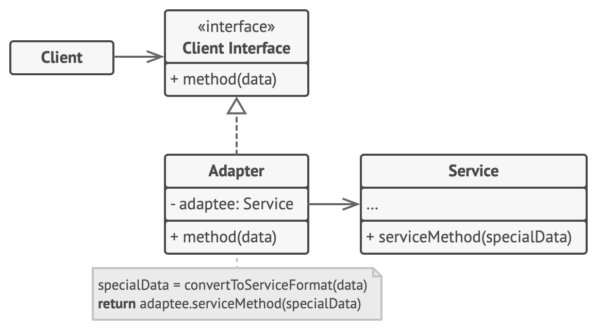
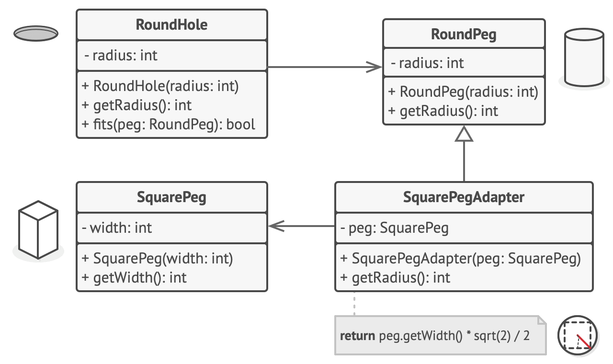

#Adapter pattern

## Vấn đề

Trong ứng dụng thị trường chứng khoán, dữ liệu được tải xuống ở định dạng XML nhưng thư viện phân tích của bên thứ 3 chỉ hỗ trợ định dạng JSON.

Việc sửa đổi trực tiếp thư viện để chấp nhận XML là rủi ro và có thể phá vỡ mã hiện có hoặc không thể thực hiện được nếu không có quyền truy cập vào source code. Sự cố không tương thích này khiến việc tích hợp thư viện mới vào ứng dụng trở nên khó khăn.

## Giải pháp

Bạn có thể tạo một bộ chuyển đổi. Đây là một đối tượng đặc biệt có chức năng chuyển đổi giao diện của một đối tượng để đối tượng khác có thể hiểu được.

## Kết cấu

- **Khách hàng**:
là lớp chứa logic nghiệp vụ hiện có của chương trình.

- **Giao diện máy khách**: mô tả giao thức mà các lớp khác phải tuân theo để có thể cộng tác với mã máy khách.

- **Dịch vụ** là một số lớp hữu ích (thường là bên thứ 3 hoặc kế thừa).
Máy khách không thể sử dụng trực tiếp lớp này vì nó có giao diện không tương thích.

## Mã giả

## Triển vọng

- **Nguyên tắc Single Responsibility**. Bạn có thể tách giao diện hoặc mã chuyển đổi dữ liệu khỏi logic nghiệp vụ chính của chương trình.
- **Nguyên tắc đóng/mở**. Bạn có thể đưa các loại bộ điều hợp mới vào chương trình mà không vi phạm mã máy khách hiện có, miễn là chúng hoạt động với các bộ điều hợp thông qua giao diện máy khách

## Hậu quả

- Độ phức tạp tổng thể của mã tăng lên vì bạn cần giới thiệu một tập hợp các giao diện và lớp mới.

## Tài liệu tham khảo
- https://refactoring.guru/design-patterns/adapter
