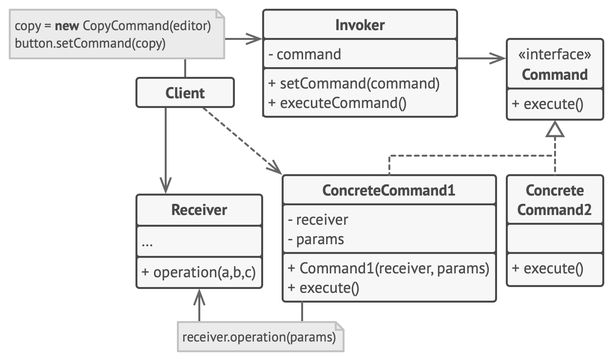
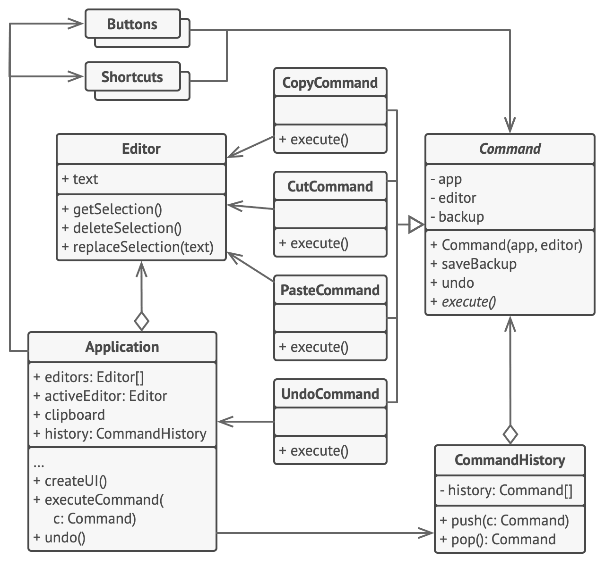

# Yêu cầu

## Vấn đề

Khi xử lý các nút có chức năng khác nhau, cách tiếp cận phổ biến là tạo nhiều lớp con cho mỗi nút. Tuy nhiên, điều này dẫn đến sự kết hợp chặt chẽ giữa GUI và logic nghiệp vụ, khiến mã dễ hỏng và khó bảo trì.

Lệnh Design Pattern cung cấp giải pháp tốt hơn bằng cách đóng gói các yêu cầu dưới dạng đối tượng, cho phép tách rời người gửi và receiver. Điều này giúp tăng cường tính linh hoạt và khả năng mở rộng của mã.

>[!NOTE]
> Biến "dễ bay hơi" là một lệnh tới compiler, chỉ ra rằng giá trị của biến có thể bị thay đổi bất ngờ bởi các sự kiện bên ngoài

## Thành phần chính

- **Giao diện lệnh**:
giao diện thường khai báo **chỉ một phương thức** để thực thi lệnh.

- **Lệnh cụ thể**:
Thực hiện phương thức từ giao diện.
Lệnh cụ thể đóng vai trò trung gian, chuyển yêu cầu đến các đối tượng logic nghiệp vụ.
Chúng có thể lưu trữ các tham số dưới dạng các trường và được tạo thành immutable bằng cách đặt các trường này thông qua hàm tạo.

- **Người gửi (Invoker)**:
kích hoạt đối tượng Lệnh thay vì tương tác trực tiếp với receiver.
Lệnh được Client tạo trước và chuyển đến người gửi thông qua hàm tạo, đảm bảo tính linh hoạt và tách rời.

- **Receiver**:
Lớp Receiver chứa logic nghiệp vụ.
Hầu hết mọi đối tượng đều có thể hoạt động như receiver.
Hầu hết các lệnh chỉ xử lý chi tiết về cách một yêu cầu được chuyển đến receiver, trong khi bản thân receiver thực hiện công việc thực tế.

- **Khách hàng**:
Máy khách tạo và cấu hình các đối tượng lệnh cụ thể.
Máy khách phải chuyển tất cả các tham số yêu cầu, bao gồm phiên bản receiver, vào hàm tạo của lệnh.
Sau đó, lệnh kết quả có thể được liên kết với một hoặc nhiều người gửi.

## Mã giả

## Triển vọng:

- **Nguyên tắc Single Responsibility**. Bạn có thể tách các lớp gọi các thao tác khỏi các lớp thực hiện các thao tác này.
- **Nguyên tắc đóng/mở**. Bạn có thể đưa các lệnh mới vào ứng dụng mà không vi phạm mã máy khách hiện có.
- Có thể ghép một tập lệnh đơn giản thành một tập lệnh phức tạp.

## Hậu quả:

- Mã có thể trở nên phức tạp hơn vì bạn đang giới thiệu một lớp hoàn toàn mới giữa người gửi và người nhận.

## thẩm quyền giải quyết

- https://refactoring.guru/design-patterns/command

