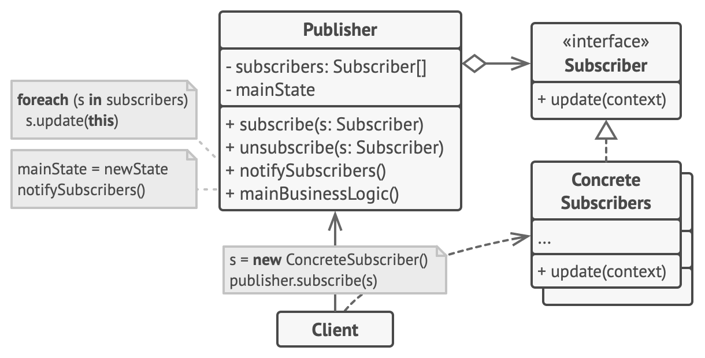
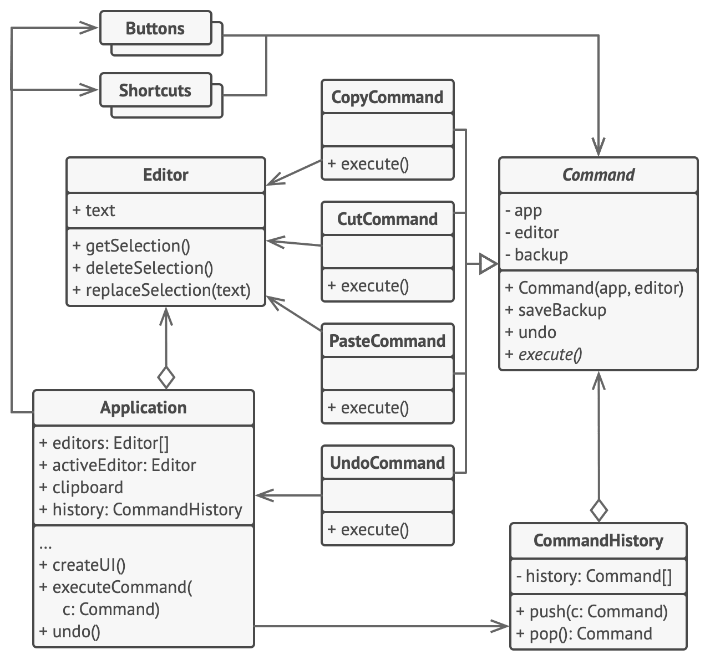

# Observer Design Pattern

## Vấn đề

Có hai đối tượng: Khách hàng và Cửa hàng.
Khách hàng đang háo hức mua một sản phẩm mới (như iPhone mới nhất), sản phẩm này sẽ sớm có mặt trong cửa hàng.

Nếu khách hàng ghé thăm cửa hàng hàng ngày để kiểm tra tình trạng còn hàng thì sẽ rất lãng phí thời gian.
Mặt khác, nếu cửa hàng gửi email thường xuyên cho tất cả khách hàng khi có sản phẩm mới về, điều đó có thể bị coi là thư rác và gây khó chịu cho những người không quan tâm.

Điều này tạo ra xung đột: hoặc khách hàng lãng phí thời gian hoặc cửa hàng lãng phí nguồn lực.

## Giải pháp

Đối tượng có trạng thái thú vị được gọi là **nhà xuất bản**, trong khi đối tượng muốn theo dõi các thay đổi của nó được gọi là **người đăng ký**.

## Kết cấu

- **Nhà xuất bản**:
đưa ra các sự kiện quan tâm cho các đối tượng khác. Những sự kiện này xảy ra khi nhà xuất bản thay đổi trạng thái hoặc thực hiện một số hành vi. Nhà xuất bản chứa cơ sở hạ tầng đăng ký cho phép người đăng ký mới tham gia và người đăng ký hiện tại rời khỏi danh sách.

- **Interface thuê bao**:
khai báo interface thông báo.
Trong hầu hết các trường hợp, nó bao gồm một phương pháp cập nhật duy nhất.

- **Người đăng ký cụ thể**:
việc triển khai Interface thực hiện một số hành động nhằm phản hồi các thông báo do nhà xuất bản đưa ra.
Tất cả các lớp này phải triển khai cùng một interface để nhà xuất bản không bị ghép nối với các lớp cụ thể.

- **Client**:
tạo các đối tượng nhà xuất bản và người đăng ký riêng biệt, sau đó đăng ký người đăng ký để cập nhật nhà xuất bản.

## Mã giả

## Triển vọng

- **Nguyên tắc đóng/mở**.
Bạn có thể giới thiệu các lớp người đăng ký mới mà không cần phải thay đổi mã của nhà xuất bản (và ngược lại nếu có interface nhà xuất bản).

- Bạn có thể thiết lập quan hệ giữa các đối tượng tại runtime.

## Hậu quả

- Người đăng ký được thông báo theo thứ tự ngẫu nhiên.

## thẩm quyền giải quyết

- https://refactoring.guru/design-patterns/observer