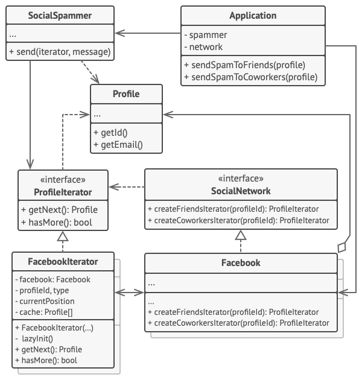

# Trình vòng lặp

## Vấn đề

Các collection như danh sách, cây và biểu đồ lưu trữ các phần tử theo cách khác nhau, **nhưng tất cả đều cần một cách để duyệt qua các phần tử của chúng một cách tuần tự**.

Tuy nhiên, việc thêm trực tiếp nhiều thuật toán truyền tải (ví dụ: theo chiều sâu, theo chiều rộng) vào lớp collection vi phạm trách nhiệm chính của nó trong việc lưu trữ dữ liệu.
Nó cũng kết hợp mã client với cấu trúc của collection cụ thể, khiến mã không linh hoạt và khó bảo trì hơn.

## Giải pháp

Ý tưởng chính của Iterator pattern là trích xuất hành vi truyền tải của collection thành một đối tượng riêng biệt gọi là iterator.

## Kết cấu

- **Interface Iterator**:
khai báo các thao tác cần thiết để duyệt collection: tìm nạp phần tử tiếp theo, truy xuất vị trí hiện tại, khởi động lại quá trình lặp, v.v.

- **Bộ lặp cụ thể**:
triển khai các thuật toán cụ thể để duyệt collection. Đối tượng iterator sẽ tự theo dõi tiến trình truyền tải. Điều này cho phép một số trình vòng lặp đi qua cùng một collection một cách độc lập với nhau.

- **Interface Collection**:
khai báo một hoặc nhiều phương thức để có được các trình vòng lặp tương thích với collection

- **Collection cụ thể**:
trả về các phiên bản mới của một lớp lặp cụ thể mỗi khi client request một phiên bản đó.

- **Client** hoạt động với cả collection và bộ lặp thông qua interface của chúng. Bằng cách này, client không được ghép nối với các lớp cụ thể, cho phép bạn sử dụng nhiều collection và trình vòng lặp khác nhau với cùng một mã client.
Thông thường, client không tự tạo các trình vòng lặp mà thay vào đó lấy chúng từ các collection.

## Mã giả

## Triển vọng

- **Nguyên tắc Single Responsibility**. Bạn có thể dọn sạch mã client và các collection bằng cách trích xuất các thuật toán truyền tải cồng kềnh thành các lớp riêng biệt.

- **Nguyên tắc đóng/mở**. Bạn có thể triển khai các loại collection và trình vòng lặp mới cũng như chuyển chúng sang mã hiện có mà không vi phạm bất kỳ điều gì.

- Bạn có thể lặp song song trên cùng một collection vì mỗi đối tượng iterator chứa trạng thái lặp riêng của nó.
- Vì lý do tương tự, bạn có thể trì hoãn việc lặp lại và tiếp tục lặp lại khi cần.

## Hậu quả

- Việc áp dụng mẫu có thể là quá mức cần thiết nếu ứng dụng của bạn chỉ hoạt động với các collection đơn giản.
- Sử dụng trình vòng lặp có thể kém hiệu quả hơn so với việc xem trực tiếp các phần tử của một số collection chuyên biệt.

## Thẩm quyền giải quyết

- https://refactoring.guru/design-patterns/iterator

