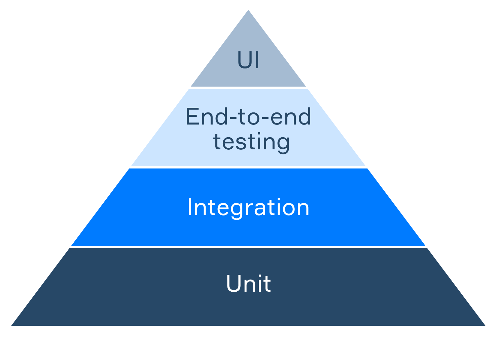

# Tránh lỗi

Hầu như không thể tránh được tất cả các lỗi trong một chương trình lớn, nhưng có thể giảm số lượng của chúng. 

1. **Đảm bảo bạn biết phải làm gì**. Là một lập trình viên, bạn cần hiểu các yêu cầu của chương trình mà bạn sắp làm việc. Nếu có nghi ngờ, bạn luôn có thể tìm thấy một số trợ giúp trên Internet hoặc từ các nhà phát triển đồng nghiệp.

2. **Phân tách chương trình** thành các đơn vị nhỏ dễ xem và dễ hiểu. Một kiến ​​trúc tốt làm giảm độ phức tạp của phần mềm và do đó giảm số lỗi.

3. **Viết mã dễ đọc** và tuân theo tất cả các tiêu chuẩn của ngôn ngữ. Nó cũng sẽ cho phép bạn mắc ít lỗi hơn.

4. **Viết các bài kiểm tra tự động** sẽ kiểm tra chương trình tại thời điểm xây dựng.

## Kiểm tra chức năng

Kiểm tra chức năng kiểm tra xem đầu ra có đáp ứng một số yêu cầu cụ thể hay không. Nhiệm vụ chính của nó là xác nhận rằng chức năng của ứng dụng hoặc hệ thống hoạt động như mong đợi.

Cần có điều gì đó xác định điều gì có thể chấp nhận được và điều gì không. Thông thường, nó được viết trong một bản đặc tả. Nó là một tài liệu mô tả hành vi dự kiến ​​của một chương trình.

## Kim tự tháp thử nghiệm

Khái niệm chính đại diện cho các loại thử nghiệm khác nhau là kim tự tháp thử nghiệm. Đây là một công cụ hỗ trợ trực quan tuyệt vời cho thấy các cấp độ kiểm tra khác nhau. Nó cũng cho thấy mức độ của các bài kiểm tra ở mỗi cấp độ.

Ở cấp độ thấp hơn, có nhiều bài kiểm tra hơn và chúng diễn ra nhanh hơn vì chúng nhỏ và nhằm mục đích kiểm tra các chức năng hoặc tính năng riêng lẻ.

## Kiểm tra đơn vị

Mục tiêu của kiểm thử đơn vị là tách biệt các phần riêng lẻ của chương trình và cho thấy rằng mỗi phần này đều hoạt động.

##Thử nghiệm tích hợp

Họ lấy các đơn vị đã được kiểm tra làm đầu vào, nhóm chúng thành các bộ lớn hơn, chạy thử nghiệm được xác định trong kế hoạch kiểm tra cho các bộ này và trình bày chúng dưới dạng đầu ra và đầu vào cho quá trình kiểm tra hệ thống tiếp theo. **Mục tiêu là kiểm tra khả năng tích hợp của ứng dụng với tất cả các thành phần bên ngoài.**

## Thử nghiệm từ đầu đến cuối

**Thử nghiệm từ đầu đến cuối** là phương pháp software testing để kiểm tra toàn bộ luồng ứng dụng. **Mục đích của thử nghiệm toàn diện là mô phỏng kịch bản thực tế của người dùng và xác thực hệ thống đang được thử nghiệm cũng như các thành phần của nó để tích hợp và toàn vẹn dữ liệu.**

Nó được thực hiện trong các tình huống thực tế như giao tiếp của ứng dụng với phần cứng, mạng, cơ sở dữ liệu và các ứng dụng khác.

##Thử nghiệm UI

Thử nghiệm UI là viết tắt của thử nghiệm User Interface. Ý tưởng là các kỹ sư QA mô phỏng hành động của người dùng. nhấp chuột vào các nút và liên kết cũng như các hành động khác thuộc loại tương tự. Vấn đề là kiểm tra sự tương tác giữa các thành phần.

Thử nghiệm UI không chỉ có thể được thực hiện bởi các nhà phát triển mà còn bởi người dùng. Loại thử nghiệm chức năng này được gọi là **thử nghiệm Beta**.

**Beta** hoặc **Thử nghiệm chấp nhận** được thực hiện ở giai đoạn cuối khi phiên bản thô hoặc beta của sản phẩm đã sẵn sàng. 

## Khói và hồi quy

**Kiểm tra khói** là một kỹ thuật kiểm tra được lấy cảm hứng từ kiểm tra phần cứng, kiểm tra khói từ các thành phần phần cứng sau khi bật nguồn phần cứng.

Smoke testing có nghĩa là một tập hợp các thử nghiệm tối thiểu để tìm ra một số lỗi rõ ràng.

Sẽ vô nghĩa nếu gửi một chương trình chưa vượt qua bài kiểm tra này để kiểm tra sâu hơn.

**Kiểm tra hồi quy** thường được thực hiện sau khi kiểm tra khói và một số thay đổi mã. Mục tiêu của nó là xác nhận rằng những thay đổi này không tác động tiêu cực đến bộ chức năng/tính năng hiện có

## Thẩm quyền giải quyết

- https://hyperskill.org/learn/step/13438

