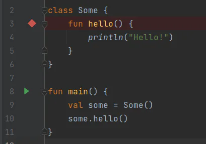
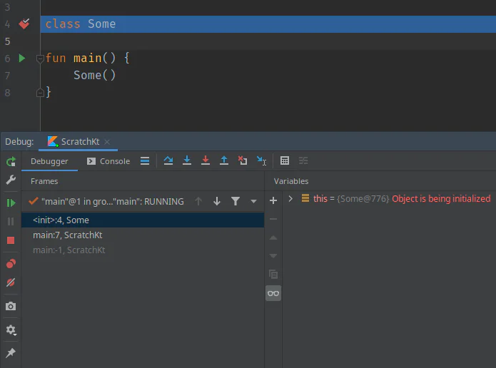
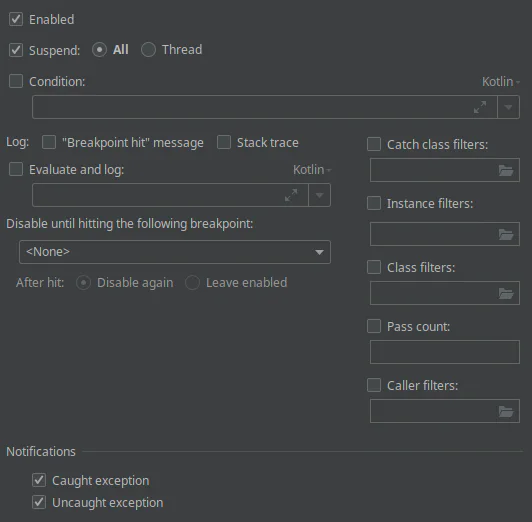

# Tính năng gỡ lỗi nâng cao

Điểm ngắt dòng rất hữu ích, nhưng có một số vị trí khác có thể hữu ích để dừng thực thi:

- Khi hàm tạo chính được gọi.

- Khi một phương thức cụ thể được gọi. Bao gồm một cái đã bị ghi đè hoặc một cái có source code không chính xác hoặc bị thiếu.

- Khi một ngoại lệ của một loại cụ thể được ném ra.

- Dòng tiếp theo của phương thức hiện tại, khi việc thực thi chương trình đã bị dừng.

- Dòng đầu tiên của phương thức sẽ được gọi và thêm vào call stack tiếp theo.

- Dòng tiếp theo của phương thức gọi sau phương thức hiện đang thực thi được xuất ra từ call stack.

## Điểm dừng của hàm tạo và phương thức
Để đặt **điểm dừng phương thức**, hãy nhấp vào phần khai báo phương thức và bạn sẽ thấy chỉ báo điểm dừng hình kim cương:

Việc thực thi sẽ dừng ở dòng đầu tiên của phương thức

**Hàm tạo chính** có thể không chứa bất kỳ câu lệnh nào và thậm chí có thể không có bất kỳ khai báo thuộc tính hoặc dấu ngoặc đơn nào.

Để đặt điểm ngắt của hàm tạo, hãy nhấp vào phần khai báo lớp. Bạn sẽ thấy một hình thoi thay vì một hình tròn và quá trình thực thi sẽ dừng ngay bên trong hàm tạo, được gọi là `<init>` trong mã byte:

## Điểm dừng ngoại lệ

Khi xảy ra sự cố ứng dụng, bạn có thể thấy dấu vết ngăn xếp của nó, nhưng điều đó không phải lúc nào cũng đủ. Đi qua các khung ngăn xếp và quan sát trạng thái ứng dụng ngay trước khi xảy ra sự cố có thể rất hữu ích.

Nhấn Run → View Điểm dừng... cho phép bạn xem tất cả các điểm dừng hiện tại và đặt **điểm dừng ngoại lệ**

Kotlin sử dụng cơ chế ngoại lệ tương tự như Java, vì vậy hãy nhấp vào tùy chọn Điểm dừng ngoại lệ Java. Sau khi thực hiện việc này, bạn có thể chọn bất kỳ loại ngoại lệ nào có sẵn trong dự án hiện tại và định cấu hình bất kỳ chi tiết nào bạn muốn. Ví dụ: bạn có thể chọn dừng các ngoại lệ đã phát hiện, các ngoại lệ chưa phát hiện hoặc cả hai.

Xong! Bây giờ, quá trình thực thi sẽ dừng khi ném ra một ngoại lệ đáp ứng các điều kiện đã chỉ định.