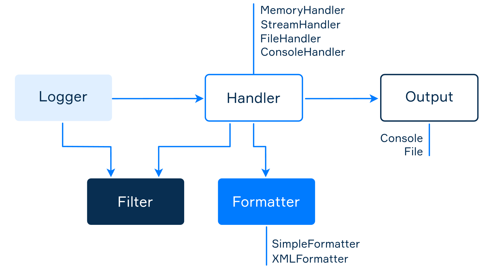

# Nhật ký

Ghi nhật ký đề cập đến hành động ghi lại trong quá trình thực thi ứng dụng. Nhật ký là bản ghi cung cấp cho chúng tôi thông tin về các sự kiện trong ứng dụng phần mềm. Bản ghi này có thể là một thông báo đủ để hiểu sự kiện đã xảy ra, nó có thể bao gồm dấu thời gian, mô tả và mức độ nghiêm trọng. Những sự kiện này có thể do người dùng tạo hoặc do hệ thống tạo. Chúng tôi sử dụng tệp nhật ký hoặc đôi khi là đầu ra tiêu chuẩn để tạo các bản ghi này.

## Chúng tôi cần đăng nhập vì nhiều lý do. 
- xử lý sự cố

- kiểm toán

- hồ sơ

- thống kê

## Cấp độ nhật ký

- Nhật ký **Gỡ lỗi** được sử dụng để chẩn đoán ứng dụng. Thông báo gỡ lỗi cho chúng tôi biết chương trình đang thực hiện những gì ở một bước nhất định và kết quả của những hành động này là gì. 

- **Thông tin** được sử dụng để ghi lại thông tin quan trọng về một ứng dụng. Nó được sử dụng để ghi nhật ký bắt đầu dịch vụ, dừng dịch vụ, cấu hình, giả định. 

- Nhật ký **Cảnh báo** được coi là cấp độ lỗi đầu tiên của ứng dụng. Chúng thường được áp dụng để ghi lại các lần thử truy cập tài nguyên lặp đi lặp lại, thiếu dữ liệu thứ cấp hoặc chuyển từ máy chủ chính sang máy chủ dự phòng. 

- **Lỗi** cấp độ nhật ký được sử dụng cho các vấn đề nghiêm trọng hơn. Những loại vấn đề này thường ảnh hưởng đến kết quả của hoạt động nhưng không chấm dứt chương trình. Lỗi được coi là cấp độ thứ hai của lỗi ứng dụng. 

- **Gây tử vong** là cấp độ lỗi ứng dụng thứ ba. Nó được sử dụng để chỉ ra một lỗi nghiêm trọng hơn nhiều khiến chương trình bị chấm dứt. Thông báo như vậy có thể cho biết chương trình đã bị lỗi hoàn toàn và tùy thuộc vào thời gian cũng như điều kiện xảy ra lỗi này mà nhà phát triển có thể tìm ra cách khắc phục sự cố.

## Định dạng nhật ký
```bash
[date time][log level][message]
```

## Ghi nhật ký tiêu chuẩn cho JVM



### Lớp ghi nhật ký

Có bảy cấp độ nhật ký trong gói ghi nhật ký của Java. Danh sách dưới đây cho thấy chúng từ mức độ nghiêm trọng cao nhất đến thấp nhất.
| Cấp độ nhật ký| Giá trị |
|----------|-------|
| SEVERE | 1000 |
| WARNING | 900 |
| INFO | 800 |
| CONFIG | 700 |
| FINE | 500 |
| FINER | 400 |
| FINEST | 300 |

### Trình xử lý và trình định dạng

**trình xử lý** (`Handler` trong `java.util.logging package`) chịu trách nhiệm gửi nhật ký thực tế ra thế giới bên ngoài. Nó được mở rộng bởi năm lớp cụ thể. Hai lớp quan trọng nhất trong số đó là `ConsoleHandler` và `FileHandler`. `ConsoleHandler` ghi thông điệp tường trình vào `System.err`, trong khi `FileHandler` ghi thông điệp tường trình vào một tệp.

trình xử lý sử dụng **formatter** để định dạng thông điệp tường trình. Có hai loại trình định dạng trong gói ghi nhật ký. Đó là `SimpleFormatter` và `XMLFormatter`. Tất nhiên, cả hai đều mở rộng lớp trừu tượng `Formatter` trong gói ghi nhật ký.

Ví dụ:

```kotlin
import java.util.logging.FileHandler
import java.util.logging.Handler
import java.util.logging.Logger
import java.util.logging.XMLFormatter

object Main {
    @JvmStatic
    fun main(args: Array<String>) {
        val logger = Logger.getLogger(Main::class.java.name)
        val fileHandler: Handler = FileHandler("default.log")
        logger.addHandler(fileHandler)
        fileHandler.formatter = XMLFormatter()
        logger.info("Info log message")
    }
}
```


tập tin đầu ra:

```log
<?xml version="1.0" encoding="UTF-8" standalone="no"?>
<!DOCTYPE log SYSTEM "logger.dtd">
<log>
<record>
  <date>2023-01-09T07:29:56.688157Z</date>
  <millis>1673249396688</millis>
  <nanos>157000</nanos>
  <sequence>0</sequence>
  <logger>Main</logger>
  <level>INFO</level>
  <class>Main</class>
  <method>main</method>
  <thread>1</thread>
  <message>Info log message</message>
</record>
</log>
```

## Bộ lọc

Khi chúng tôi đang phát triển một ứng dụng phần mềm, chúng tôi viết càng nhiều thông điệp tường trình càng tốt. Nhưng chúng tôi không muốn tất cả các thông điệp tường trình được thực thi mỗi khi ứng dụng chạy: nó sẽ lãng phí tài nguyên và có thể tạo ra các tệp nhật ký dài không cần thiết. Đó là lý do tại sao chúng tôi sử dụng bộ lọc. 

Để làm được điều đó, trước tiên, bạn phải tạo một lớp **bộ lọc tùy chỉnh** bằng cách triển khai giao diện `Filter` trong gói ghi nhật ký.

```kotlin
class FilterExample : Filter {
    override fun isLoggable(record: LogRecord): Boolean {
        return if (record.level !== Level.INFO) {
            false
        } else true
    }
}
```

### Đăng nhập lại

một thư viện ghi nhật ký phổ biến có tên Logback. Nó là sự kế thừa của thư viện ghi nhật ký Log4j và dựa trên các khái niệm tương tự.

Logback nhanh chóng trong cả ghi nhật ký đồng bộ và không đồng bộ, đồng thời cung cấp nhiều tính năng hữu ích, khiến nó trở thành lựa chọn tốt cho dự án ở mọi quy mô.

Sự khác biệt quan trọng nhất giữa việc sử dụng trình ghi nhật ký `Logback` và việc chỉ in thông báo tới `System.out` là mỗi trình ghi nhật ký có một ngữ cảnh. Bối cảnh trình ghi nhật ký cho phép bật hoặc tắt một số thông báo nhật ký nhất định và chịu trách nhiệm tạo các phiên bản trình ghi nhật ký cũng như sắp xếp thứ bậc của chúng. Chúng ta hãy xem xét kỹ hơn tất cả các tính năng này.

### Thêm Logback vào dự án

```kotlin
dependencies {
    implementation ("ch.qos.logback:logback-classic:1.2.11")
}
```

Thư viện này sẽ kéo theo hai phần phụ thuộc khác là `slf4j-api` và `logback-core`.

**SLF4J** (Ghi nhật ký đơn giản Facade cho Java) là một mặt tiền hoặc bản tóm tắt cho các thư viện ghi nhật ký khác nhau, bao gồm cả Logback. Nó cung cấp tính năng ghi nhật ký đơn giản API và Logback triển khai tính năng này một cách tự nhiên. Bạn có thể gọi trình ghi nhật ký SLF4J với Logback làm phương thức triển khai cơ bản mà không cần bất kỳ chi phí nào.

Thư viện `logback-core` đặt nền tảng cho Logback và cung cấp một số lớp được tạo sẵn để sử dụng. Họ là:

- ConsoleAppender, bổ sung các sự kiện nhật ký vào System.out hoặc System.err;

- FileAppender, thêm các sự kiện nhật ký vào tệp;

- RollingFileAppender, thêm các sự kiện nhật ký vào tệp và có thể thay đổi mục tiêu ghi nhật ký của nó sang tệp khác khi đáp ứng một điều kiện nhất định.

Thư viện logback-classic cung cấp các lớp giúp gửi dữ liệu đến các hệ thống bên ngoài. Họ là:

- SMTPAppender, thu thập dữ liệu trong các gói và gửi nội dung của gói đến email do người dùng xác định sau khi xảy ra sự kiện do người dùng chỉ định;

- DBAppender, bổ sung dữ liệu vào các bảng cơ sở dữ liệu.

### Tinh chỉnh cấu hình và mức độ ghi nhật ký

Để định cấu hình trình ghi nhật ký trong Logback, bạn có thể sử dụng tệp xml hoặc tệp Groovy.

bạn sẽ cần phải truy cập tệp logback.xml, sau đó chỉ định tên và cấp độ tham số. Trong tham số tên, chỉ định đường dẫn đến gói hoặc lớp trong dự án của bạn và trong tham số cấp độ, chỉ định cấp độ ghi nhật ký mà bạn cần. 

```kotlin
import org.slf4j.LoggerFactory

class Example {
    private val LOG = LoggerFactory.getLogger(Example::class.java)

    fun log() {
        LOG.warn("WARN level message")
        LOG.info("INFO level message")
    }
}

class LoggerLevelClass {
    private val LOG = LoggerFactory.getLogger(LoggerLevelClass::class.java)

    fun log() {
        LOG.debug("DEBUG level message")
        LOG.info("INFO level message")
    }
}

fun main() {
    Example().log()
    LoggerLevelClass().log()
}
```

```xml
<configuration>
<appender name="console" class="ch.qos.logback.core.ConsoleAppender">
    <encoder>
        <pattern>%d{HH:mm:ss.SSS} [%thread] %-5level %logger{36} - %msg%n</pattern>
    </encoder>
</appender>

<logger name="com.example" level="warn"/>
<logger name="com.example.LoggerLevelClass" level="info"/>

<root level="info">
    <appender-ref ref="console" />
</root>
</configuration>
```

Mỗi logger sẽ chỉ xuất ra các thông báo có mức yêu cầu nhật ký cao hơn hoặc bằng mức của logger.

```bash
16:19:28.528 [main] INFO Example - INFO Level message
16:19:28.533 [main] INFO Example - INFO Level message
16:19:28.524 [main] INFO LoggerLevelClass - INFO Level message
Process finished with exit code 0
```


