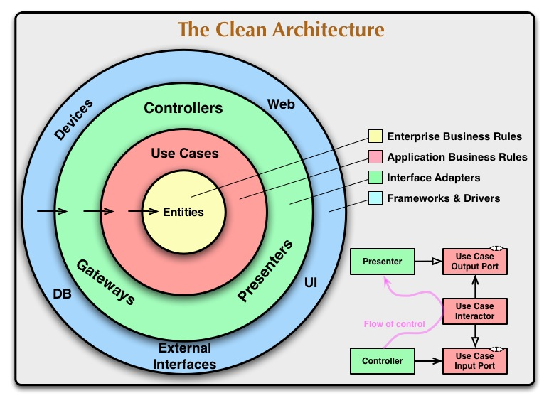

#Clean Architecture

Clean Architecture **là software architecture** do Robert C. Martin (hay còn gọi là Bác Bob) đề xuất.

## Quy tắc phụ thuộc

Các vòng tròn đồng tâm tượng trưng cho các lĩnh vực khác nhau của phần mềm. Nói chung, bạn càng đi xa thì phần mềm càng trở nên cấp cao hơn. Các vòng tròn bên ngoài là cơ chế. Các vòng tròn bên trong là các chính sách.

Quy tắc này nói rằng **các phần phụ thuộc source code** chỉ có thể **trỏ vào trong**.
Không có gì ở vòng bên trong có thể biết bất cứ điều gì về điều gì đó ở vòng bên ngoài.

Đặc biệt, tên của thứ được khai báo ở vòng tròn bên ngoài không được đề cập bằng mã ở vòng tròn bên trong.
Điều đó bao gồm, chức năng, lớp học. các biến hoặc bất kỳ thực thể phần mềm được đặt tên nào khác.

## Thực thể

Các thực thể đóng gói các quy tắc kinh doanh trên toàn doanh nghiệp.
Một thực thể có thể là một đối tượng có các phương thức hoặc nó có thể là một tập hợp các cấu trúc dữ liệu và hàm.
Các thực thể có thể được sử dụng bởi nhiều ứng dụng khác nhau trong doanh nghiệp.

Trong hầu hết các trường hợp, các thực thể là đối tượng kinh doanh của ứng dụng.
Chúng gói gọn các quy tắc chung và cấp cao nhất.
Họ ít có khả năng thay đổi nhất khi có điều gì đó bên ngoài thay đổi.

## Trường hợp sử dụng

Lớp này chứa các quy tắc kinh doanh cụ thể của ứng dụng.
Nó đóng gói và thực hiện tất cả các trường hợp sử dụng của hệ thống.
Các trường hợp sử dụng này điều phối luồng dữ liệu đến và đi từ các thực thể, đồng thời hướng dẫn các thực thể đó sử dụng các quy tắc kinh doanh của chúng để đạt được mục tiêu của trường hợp sử dụng.

Chúng tôi không mong đợi những thay đổi trong lớp này sẽ ảnh hưởng đến các thực thể.
Chúng tôi cũng không cho rằng lớp này sẽ bị ảnh hưởng bởi những thay đổi đối với các yếu tố bên ngoài như cơ sở dữ liệu, UI hoặc bất kỳ khung phổ biến nào.
Lớp này được tách biệt khỏi những mối quan tâm như vậy.

## Bộ điều hợp giao diện

Lớp này là một tập hợp các bộ điều hợp chuyển đổi dữ liệu từ định dạng thuận tiện nhất cho **trường hợp sử dụng** và **thực thể** sang định dạng thuận tiện nhất cho một số cơ quan bên ngoài như Cơ sở dữ liệu hoặc Web.

Ví dụ: nó sẽ chứa toàn bộ Kiến trúc của GUI.
`Presenters`, `Views` và `Controllers` đều thuộc về đây.
Các mô hình có thể chỉ là các cấu trúc dữ liệu được truyền từ bộ điều khiển đến các trường hợp sử dụng, sau đó quay trở lại từ các trường hợp sử dụng này đến người trình bày và dạng xem.

Tương tự, trong lớp này, dữ liệu được chuyển đổi từ dạng thuận tiện nhất cho các thực thể và trường hợp sử dụng sang dạng thuận tiện nhất cho mọi hoạt động liên tục mà framework đang được sử dụng. Cơ sở dữ liệu.
Không có mã nào trong vòng kết nối này nên biết bất cứ điều gì về cơ sở dữ liệu.
Nếu cơ sở dữ liệu là cơ sở dữ liệu SQL thì tất cả SQL phải được giới hạn ở lớp này và đặc biệt đối với các phần của lớp này có liên quan đến cơ sở dữ liệu.

Ngoài ra, trong lớp này còn có bất kỳ bộ điều hợp nào khác cần thiết để chuyển đổi dữ liệu từ một số dạng bên ngoài, chẳng hạn như dịch vụ bên ngoài, sang dạng nội bộ được sử dụng bởi các trường hợp sử dụng và thực thể.

## Khung và Trình điều khiển

Lớp ngoài cùng thường bao gồm các khung và công cụ như Cơ sở dữ liệu, Web Framework, v.v.

Nói chung, bạn không viết nhiều mã trong lớp này ngoài mã giao tiếp với vòng tròn tiếp theo vào trong.

Lớp này là nơi chứa tất cả các chi tiết. Web là một chi tiết. Cơ sở dữ liệu là một chi tiết. Chúng tôi giữ những thứ này ở bên ngoài, nơi chúng có thể gây hại ít.

## Ưu điểm của Clean Architecture

- **Độc lập với các Khung**: Tránh bị khóa vào một framework cụ thể, giúp việc áp dụng các công nghệ mới dễ dàng hơn.
- **Khả năng kiểm tra**: Logic nghiệp vụ có thể được kiểm tra độc lập với UI, cơ sở dữ liệu hoặc các dịch vụ bên ngoài.
- **Separation of Concerns**: Sự phân chia rõ ràng giữa các quy tắc kinh doanh, trường hợp sử dụng và các phần phụ thuộc bên ngoài giúp cải thiện khả năng bảo trì.
- **Khả năng mở rộng**: Kiến trúc linh hoạt cho phép các nhóm mở rộng hệ thống mà không ảnh hưởng đến các chức năng cốt lõi.
- **UI và thay thế cơ sở dữ liệu dễ dàng**: UI hoặc cơ sở dữ liệu có thể được hoán đổi mà không cần sửa đổi logic cốt lõi.

##Nhược điểm của Clean Architecture

- **Tăng độ phức tạp**: Yêu cầu nhiều lớp, dẫn đến nhiều mã và tính trừu tượng hơn.
- **Đường cong học tập dốc hơn**: Các nhà phát triển không quen với dependency inversion và các lớp kiến ​​trúc ban đầu có thể gặp khó khăn.
- **Thêm mã Boilerplate**: Việc triển khai ranh giới giữa các lớp yêu cầu giao diện bổ sung và logic chuyển đổi dữ liệu.
- **Chi phí hiệu suất tiềm năng**: Các lớp bổ sung và dependency inversion có thể gây ra sự đánh đổi hiệu suất nhỏ.
- **Không phải lúc nào cũng cần thiết**: Kỹ thuật quá mức cho các dự án nhỏ có thể làm chậm quá trình phát triển mà không mang lại lợi ích đáng kể.

## Tham khảo
- https://blog.cleancoder.com/uncle-bob/2012/08/13/the-clean-architecture.html

