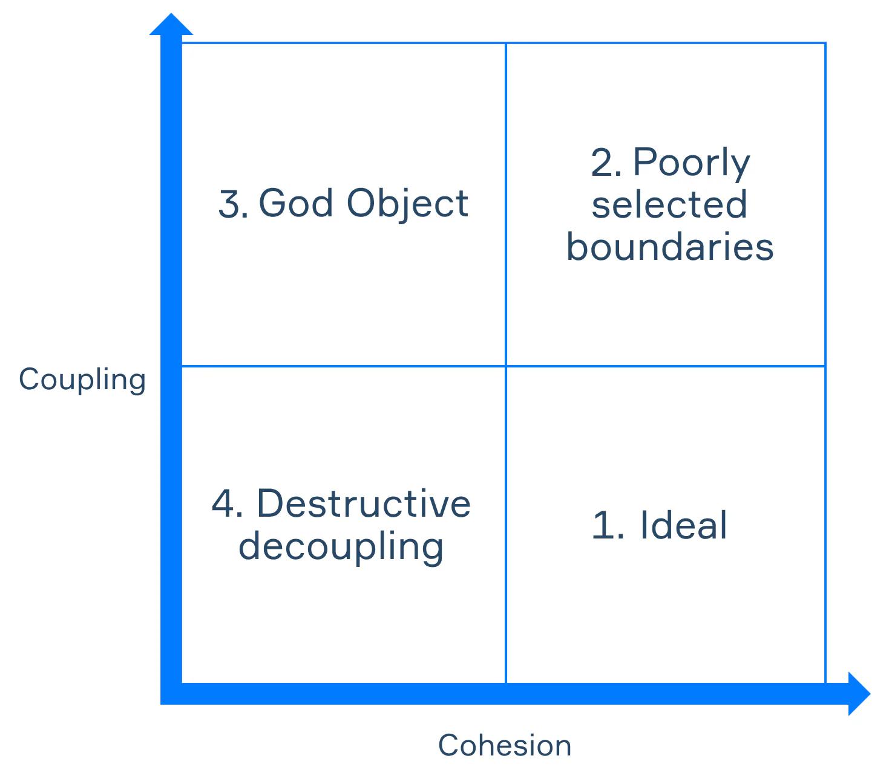

# Khớp nối và sự gắn kết

## Khớp nối

**Khớp nối** là mức độ mà các thành phần phần mềm phụ thuộc vào nhau. Có hai cấp độ khớp nối cơ bản: **chặt** và **lỏng**.

Khớp nối lỏng lẻo có nghĩa là ít phụ thuộc lẫn nhau giữa các lớp, trong khi khớp nối chặt chẽ thì ngược lại. 

Sự khác biệt là trong sự kết hợp chặt chẽ, một lớp phụ thuộc rất nhiều vào lớp khác và biết quá nhiều về các phương thức của nó. 
Tuy nhiên, trong sự ghép nối lỏng lẻo, một lớp biết rất ít về việc tạo đối tượng và các phương thức trong lớp khác. Điều này làm cho các lớp này ít phụ thuộc lẫn nhau hơn.


Cách đơn giản nhất để nới lỏng sự ghép nối là triển khai một giao diện trong mã của bạn. Ngoài ra còn có các cách khác để nới lỏng khớp nối, như dependency injection.

### Ví dụ về khớp nối chặt

Giả sử bạn đang chế tạo một robot. Bộ phận trung tâm của robot này là một động cơ không thể dễ dàng thay thế

```
class Engine is
   method run() is

class Robot is
   Engine eng = new Engine()
   eng.run()
```

Ở đây, lớp `Robot` phụ thuộc vào `Engine` và cần tạo một phiên bản của nó. 
Lớp phụ thuộc của bạn biết quá nhiều về các phương thức trong trường hợp này, điều này sẽ thắt chặt mối liên kết này. Mọi thay đổi trong `Engine` cũng sẽ buộc bạn phải thay đổi `Robot`. 
Vì vậy, nếu động cơ không hoạt động thì toàn bộ robot sẽ ngừng hoạt động.


### Ví dụ về khớp nối lỏng lẻo

```
// Define an interface for the Engine
interface IEngine is
   method run()

// Concrete implementation of the IEngine interface
class StandardEngine implements IEngine is
   method run() is
     print("Standard Engine is running")

class AdvancedEngine implements IEngine is
   method run() is
     print("Advanced Engine is running")

// Robot class depends on the abstraction, not a concrete class
class Robot is
   IEngine eng

   constructor Robot(IEngine eng) is
      this.eng = eng

   method start() is
      eng.run()

// Instantiate a Robot with a specific engine implementation
class Main is
   method main() is
      IEngine standard = new StandardEngine()
      Robot robot1 = new Robot(standard)
      robot1.start()

      IEngine advanced = new AdvancedEngine()
      Robot robot2 = new Robot(advanced)
      robot2.start()
```

Điều này cung cấp một lớp trừu tượng và cho phép lớp `Robot` tương tác với bất kỳ triển khai nào của công cụ. Loại động cơ cụ thể được đưa vào lớp `Robot` thông qua hàm tạo của nó. Cách tiếp cận này tuân thủ Nguyên tắc Dependency Inversion. Nếu cần loại công cụ mới, bạn có thể tạo một lớp mới triển khai `IEngine` mà không cần sửa đổi lớp `Robot`.

## Sự gắn kết

**Sự gắn kết** là sự thể hiện của các hàm lớp. Nó là thước đo mức độ liên quan chặt chẽ giữa trách nhiệm của một thành phần.

- **Độ gắn kết thấp** gợi ý rằng một thành phần đang cố gắng thực hiện quá nhiều nhiệm vụ không liên quan, khiến việc duy trì và hiểu khó khăn hơn. 

- **Độ gắn kết cao** chỉ ra rằng một thành phần thực hiện một nhiệm vụ duy nhất hoặc một nhóm nhiệm vụ liên quan, dẫn đến mã dễ hiểu và dễ bảo trì hơn.

## Làm việc với sự gắn kết và khớp nối

Biểu đồ dưới đây minh họa những hậu quả có thể xảy ra dựa trên mức độ gắn kết và khớp nối.



> [!IMPORTANT]
> Lý tưởng nhất là các đối tượng của bạn nên có độ kết nối thấp và độ kết dính cao. 
> Khi cố gắng hạ thấp khớp nối, bạn không nên quên tăng độ gắn kết và ngược lại.

## Phần kết luận

Hãy tóm tắt những gì chúng ta biết về khớp nối và sự gắn kết.

- Bạn nên cố gắng đạt được khớp nối lỏng lẻo. Khớp nối lỏng lẻo làm cho các phần trong mã của bạn ít phụ thuộc lẫn nhau hơn. Cách dễ nhất bạn có thể đạt được là với các giao diện và dependency injection.

- Các phần trong code của bạn phải có tính gắn kết cao để có thể tập trung hơn. Điều này sẽ làm cho chúng có thể tái sử dụng nhiều hơn và dễ kiểm tra hơn.


## Tham khảo
- https://hyperskill.org/learn/step/21478