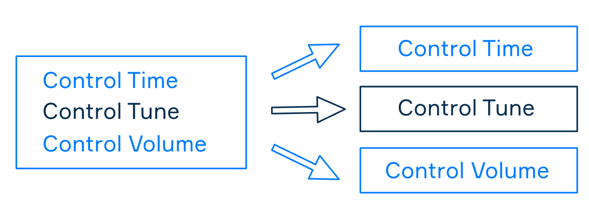

# Nguyên lý Single responsibility

Nguyên tắc Single Responsibility nêu rõ rằng **một lớp nên làm một việc và do đó nó chỉ nên có một lý do duy nhất để thay đổi**.

Vậy làm thế nào chúng ta có thể thiết lập ranh giới cho những phần khác nhau chịu trách nhiệm trong các trường hợp khác?

Hãy tưởng tượng chúng ta đang làm việc trên một ứng dụng mới dành cho điện thoại thông minh. Nó có các chức năng như đồng hồ báo thức, nhắc nhở và đồng hồ bấm giờ. Bởi vì chúng đều liên quan đến thời gian nên chúng có thể hợp nhất thành một lớp. Thay vào đó, khi cố gắng tập hợp các chức năng tương tự lại với nhau, chúng tôi tạo ra một đối tượng của Chúa.

> [!NOTE]
> Đối tượng của Chúa là đối tượng biết quá nhiều hoặc làm quá nhiều.

Trong trường hợp của chúng tôi, tốt hơn là nên tách biệt ba hàm này với nhau để chúng tôi có thể cập nhật chúng một cách độc lập mà không làm ô nhiễm mã với các chi tiết không cần thiết.

Mỗi bộ phận sẽ chịu trách nhiệm về một việc cụ thể và không biết những bộ phận khác đang làm gì. Thiết kế này có nhiều khả năng giữ cho mã sạch sẽ và rõ ràng hơn.

- **Ranh giới trách nhiệm**

Chúng tôi quyết định thêm tùy chọn để người dùng chọn nhạc chuông báo thức. Chúng tôi thêm các phương thức `listTune`, `setTune` và `playTune` vào lớp `AlarmClock`.

Sau khi khởi chạy ứng dụng, người dùng bắt đầu tải xuống ứng dụng và để lại những đánh giá gợi ý rằng sẽ thật tuyệt nếu nhạc chuông có thể to hơn khi chuông báo thức reo. Để giải quyết vấn đề này, chúng tôi thêm một phương thức mới `setEnhancingMode`. Tuy nhiên, khi thực hiện điều này, chúng tôi nhận ra rằng mình đang trộn lẫn các trách nhiệm khác nhau trong cùng một lớp—đặt giai điệu và kiểm soát âm lượng. Lần này lớp chúng ta có ít nhất ba lý do để thay đổi:

- Phương pháp thời gian

- phương pháp khối lượng

- Phương pháp điều chỉnh

Vấn đề là, nếu chúng ta cập nhật các phương thức âm lượng, nó có thể ảnh hưởng đến các phương thức thời gian. Vì vậy, để giữ mọi thứ ngăn nắp và tránh nhầm lẫn, chúng tôi quyết định chia lớp thành các phần nhỏ hơn, mỗi phần chỉ chịu trách nhiệm về một nhiệm vụ và phân công trách nhiệm tương ứng.

Bạn có thể hỏi, lúc đó `AlarmClock` sẽ làm gì? Câu trả lời rất đơn giản: **nó sẽ gọi các lớp khác và sắp xếp công việc của chúng tùy theo request của người dùng.** Vì vậy, chúng tôi cũng có thể sử dụng lại các lớp `Tune` và `Volume` cho `Reminder`.

> [!TIP]
> Để vạch ra ranh giới cho trách nhiệm, hãy tự hỏi:
> đây có phải là những trách nhiệm tương tự đối với người dùng hay không? Nếu chúng giống nhau, hãy liên kết các phương thức lại với nhau.
> Nếu không, hãy chia chúng để tạo ra các lớp chỉ có một lý do để thay đổi.

> [!CAUTION]
> Cốt lõi của nguyên tắc không phải là chia mã thành những phần nhỏ riêng biệt. Bạn tập hợp những gì thuộc cùng một trách nhiệm vào một nơi, sau đó tách các đơn vị có trách nhiệm khác nhau ra.

## Tham khảo
- https://hyperskill.org/learn/step/8963