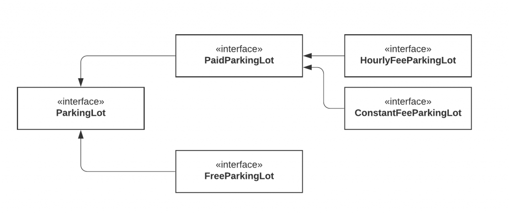

# Nguyên tắc Interface Segregation

Khi bắt đầu một ứng dụng mới, ý tưởng đầu tiên xuất hiện trong đầu là xác định các hàm, lớp và giao diện mà chúng ta sẽ sử dụng trong suốt dự án. Làm việc sâu hơn với mã, chúng ta có thể bỏ sót điểm khi giao diện của chúng ta bắt đầu xử lý nhiều hơn mức chúng có thể xử lý, khiến việc làm việc với chúng trở nên khó khăn. Đây là lúc Nguyên tắc Interface Segregation phát huy tác dụng.

Nguyên tắc Interface Segregation (ISP) dựa trên hai điểm chính: 

- các đối tượng không nên bị buộc phải triển khai các phần của giao diện mà chúng không sử dụng;
- nhiều giao diện cụ thể sẽ tốt hơn một giao diện có mục đích chung.

Nói cách khác, để làm cho giao diện của chúng ta trở nên chính xác, chúng ta nên làm cho chúng trở nên cụ thể, để chúng ta sẽ không phải triển khai các phương pháp không cần thiết trong tương lai.

## Ví dụ

Chúng tôi đã mô hình hóa một bãi đậu xe rất đơn giản.

```java
public interface ParkingLot {

    void parkCar();    // Decrease empty spot count by 1
    void unparkCar(); // Increase empty spots by 1
    void getCapacity();    // Returns car capacity
    double calculateFee(Car car); // Returns the price based on number of hours
    void doPayment(Car car);
}

class Car {

}
```

Đây là loại bãi đỗ xe mà bạn phải trả phí theo giờ.
Bây giờ hãy xem xét rằng chúng tôi muốn triển khai một bãi đậu xe miễn phí.

```java
public class FreeParking implements ParkingLot {

    @Override
    public void parkCar() {

    }

    @Override
    public void unparkCar() {

    }

    @Override
    public void getCapacity() {

    }

    @Override
    public double calculateFee(Car car) {
        return 0;
    }

    @Override
    public void doPayment(Car car) {
        throw new Exception("Parking lot is free");
    }
}
```
Giao diện bãi đỗ xe của chúng tôi bao gồm 2 thứ: Logic liên quan đến đỗ xe (đỗ xe, đỗ xe, lấy sức chứa) và logic liên quan đến thanh toán.

Nhưng nó quá cụ thể. Do đó, lớp `FreeParking` của chúng tôi buộc phải triển khai các phương thức liên quan đến thanh toán không liên quan. Hãy tách biệt hoặc tách biệt các giao diện.



Bây giờ chúng tôi đã tách bãi đậu xe. Với mô hình mới này, chúng tôi thậm chí có thể tiến xa hơn và chia PaidParkingLot để hỗ trợ các loại thanh toán khác nhau.


## Tham khảo 
- https://hyperskill.org/learn/step/10089
- https://www.freecodecamp.org/news/solid-principles-explained-in-plain-english/