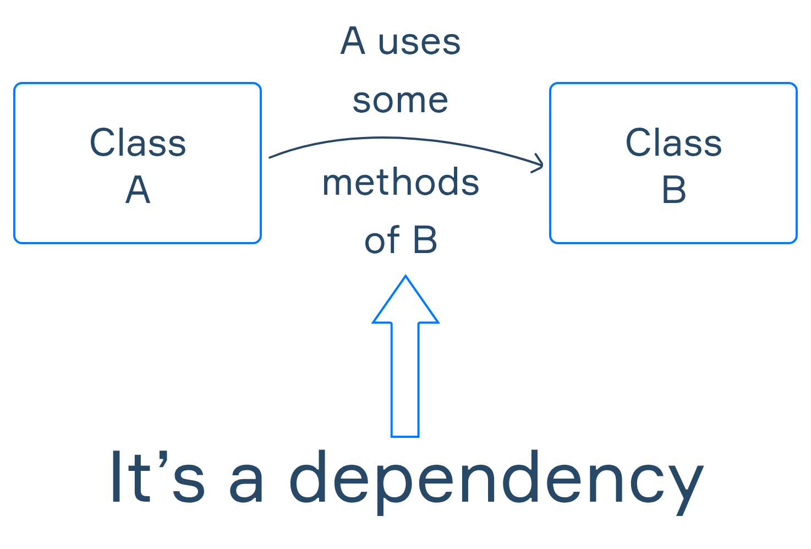

#Dependency Inversion

Nguyên tắc Dependency Inversion nêu rõ rằng các lớp của chúng ta phải phụ thuộc vào interface hoặc lớp trừu tượng thay vì các lớp và hàm cụ thể.

## Đảo ngược quyền kiểm soát

Đảo ngược điều khiển (IoC) là một nguyên tắc thiết kế phần mềm trong đó luồng điều khiển của chương trình được đảo ngược so với phương pháp truyền thống.
Thay vì gọi thủ công các thư viện hoặc thành phần, IoC cho phép framework hoặc vùng chứa quản lý và gọi các thành phần ứng dụng khi cần.
Điều này giúp tách biệt logic kinh doanh khỏi cơ sở hạ tầng, cải thiện khả năng mở rộng và khả năng bảo trì.

Cách phổ biến để triển khai IoC là thông qua Dependency Injection (DI), Bộ định vị dịch vụ trong đó các dependency của đối tượng được cung cấp bên ngoài thay vì được tạo bên trong chính đối tượng đó. Điều này làm giảm sự liên kết chặt chẽ giữa các thành phần và tăng tính linh hoạt của hệ thống.

##Dependency Injection

> [!NOTE]
> Sự phụ thuộc là mối quan hệ giữa hai lớp trong đó một lớp sử dụng chức năng của lớp kia, tức là một lớp phụ thuộc vào lớp kia.


> [!TIP]
> Dependency Injection là một phương pháp triển khai Đảo ngược điều khiển.

Đó là process chuyển nhiệm vụ tạo đối tượng sang các phần khác của mã.
Điều này có nghĩa là tạo một dependency mà bạn có thể sử dụng. Điều này cho phép tạo [khớp nối lỏng lẻo trong mã của chúng tôi.](/General/ComputerScience/0_Fundamentals/0_Essentials/2_SoftwareConstruction/4_DesignPrinciple/1_SOLIDPrinciple/0_CouplingAndCohesion.md)

###Các kiểu tiêm

Có ba loại DI chính.

- **Chèn phương thức (Interface)**: các dependency được truyền qua các phương thức mà lớp có thể truy cập thông qua interface hoặc lớp khác.

```java
// Define the Email interface
interface Email {
    void sendMessage();
}

// Implement GmailService that adheres to the Email interface
class GmailService implements Email {
    @Override
    public void sendMessage() {
        System.out.println("Sending email via GmailService...");
    }
}

// EmailService class depends on Email interface instead of a specific implementation
class EmailService {
    public void sendMessage(Email service) {
        service.sendMessage();
    }
}

// Main class to test Dependency Injection
public class Main {
    public static void main(String[] args) {
        EmailService gmail = new EmailService();
        gmail.sendMessage(new GmailService()); // Injecting GmailService dependency
    }
}

```

- **Chèn thuộc tính(Setter)**: các dependency được chuyển qua một phương thức setter riêng biệt. Việc triển khai bộ tiêm này khác nhau tùy thuộc vào ngôn ngữ.

```java
// Define the Email interface
interface Email {
    void sendMessage();
}

// Implement GmailService that adheres to the Email interface
class GmailService implements Email {
    @Override
    public void sendMessage() {
        System.out.println("Sending email via GmailService...");
    }
}

// EmailService class now uses Dependency Injection through setter method
class EmailService {
    private Email service;

    // Getter method to retrieve the current Email service
    public Email getService() {
        return service;
    }

    // Setter method to inject an Email service implementation
    public void setService(Email service) {
        this.service = service;
    }
}

// Main class to test Dependency Injection
public class Main {
    public static void main(String[] args) {
        EmailService email = new EmailService();  // Create EmailService instance

        email.setService(new GmailService()); // Inject GmailService dependency

        Email gmail = email.getService(); // Retrieve the injected service
        gmail.sendMessage(); // Call the sendMessage() method
    }
}
```

- **Constructor Injection**: các dependency được cung cấp thông qua hàm tạo của lớp.

```java
// Define the Email interface
interface Email {
    void sendMessage();
}

// Implement GmailService that adheres to the Email interface
class GmailService implements Email {
    @Override
    public void sendMessage() {
        System.out.println("Sending email via GmailService...");
    }
}

// EmailService now uses Constructor-Based Dependency Injection
class EmailService {
    private Email email;

    // Constructor to inject dependency
    public EmailService(Email email) {
        this.email = email;
    }

    // Method to send a message using the injected email service
    public void sendMessage() {
        email.sendMessage();
    }
}

// Main class to test Dependency Injection
public class Main {
    public static void main(String[] args) {
        EmailService gmail = new EmailService(new GmailService()); // Inject GmailService via constructor
        gmail.sendMessage(); // Calls GmailService's sendMessage() method
    }
}
```


## Tham khảo
- https://hyperskill.org/learn/step/20580


