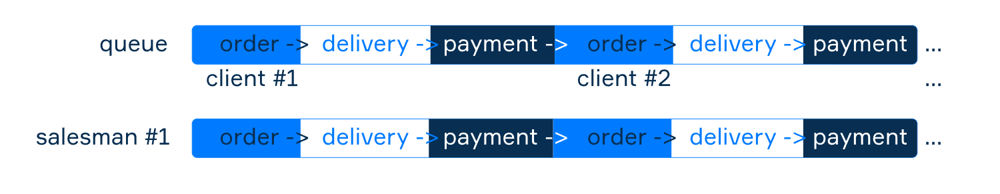
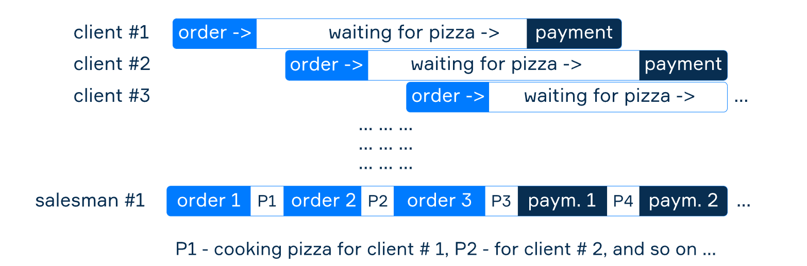
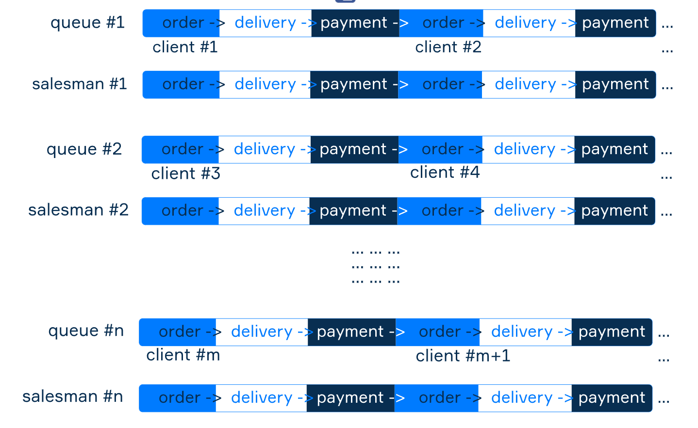

# Multithreading và đa xử lý

Khi chúng ta đang xem xét một số process phức tạp, hãy gọi nó là **quy trình công việc**, các phần khác nhau của nó có thể chạy khác nhau.

Đôi khi các hành động diễn ra lần lượt, đôi khi chúng chồng chéo lên nhau theo thứ tự ngẫu nhiên, và đôi khi mọi thứ diễn ra đồng thời và song song.

Quy trình làm việc có thể phát triển khác nhau. Có ba loại trình tự thực thi quy trình công việc: **đồng bộ, không đồng bộ và song song.**

## Quy trình làm việc đồng bộ

Ví dụ

Có nhiều mô hình để quản lý luồng khách hàng. Cách tiếp cận đơn giản nhất là một cửa hàng với một người bán.

Họ phục vụ từng client riêng biệt, nghĩa là chỉ bắt đầu phục vụ client tiếp theo sau khi kết thúc với khách hàng hiện tại. Chúng tôi đặt tên loại hành động này là **đồng bộ**.

## Quy trình làm việc không đồng bộ

Hãy tưởng tượng cửa hàng cũ của chúng ta trở nên sang trọng hơn, Sau khi khách hàng đầu tiên đặt mua pizza, họ cần đợi bánh chín. Tại thời điểm này, người bán để khách hàng đầu tiên yên một lúc và bây giờ khách hàng thứ hai có thể đặt hàng, sau đó là khách hàng thứ ba, v.v.

Khi bánh pizza của client đầu tiên đã sẵn sàng, người bán sẽ quay lại với họ để hoàn tất việc bán hàng. Đó là cách câu chuyện này sẽ lặp đi lặp lại.

Người bạn cũ của chúng tôi có thể phục vụ nhiều khách hàng cùng lúc trong những khoảng thời gian chồng chéo. Chúng tôi gọi đó là **hành vi không đồng bộ**.

## Xử lý song song

Khi doanh số bán hàng của cửa hàng pizza ngày càng tăng, giờ đây một công nhân không đủ cho toàn bộ hoạt động kinh doanh. Vì vậy, chúng ta nên thuê vài người. Nếu mỗi người bán có một lò nướng nhỏ gọn riêng biệt để chuẩn bị chính xác một chiếc bánh pizza mỗi lần thì chúng ta có thể chia hàng người mua cho những người bán.

Bây giờ, mỗi trong số chúng hoạt động độc lập và đây là trường hợp **xử lý song song**. Mỗi tác vụ trong xử lý song song đang chạy trong một khoảng thời gian liên tục dưới dạng toàn bộ đơn vị process.

## Tham khảo
- https://hyperskill.org/learn/step/9332