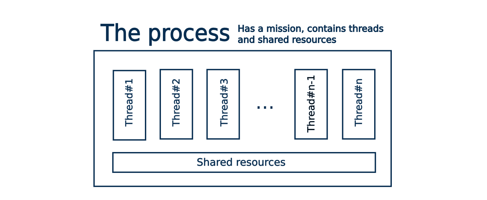

# Process và chủ đề

##Process

**process** là một đơn vị thực thi độc lập bao gồm mọi thứ cần thiết để hoàn thành nhiệm vụ của nó. 

**Nói tóm lại, process là nơi chứa các thread của nó, bao gồm tất cả những thứ cần thiết cho hoạt động và tài nguyên được chia sẻ của chúng**.

Việc sắp xếp quyền truy cập vào các tài nguyên được chia sẻ một lần sẽ rẻ hơn so với thực hiện mỗi lần thread mới được sinh ra. Mỗi process phải có ít nhất một thread vì chúng thực hiện tất cả công việc. Không có thứ gọi là thread mà không có process hoặc process mà không có ít nhất một thread.

##Thread

Trong khoa học máy tính, **thread** thực thi là một chuỗi hướng dẫn trong process có thể được lên lịch và chạy độc lập.

Mỗi thread có **người thực thi** riêng, mỗi lần chỉ có thể quản lý một thread.

Nhiều thread trong cùng một process có thể hoạt động đồng thời (chuyển đổi giữa các tác vụ) hoặc song song (đồng thời, nếu có nhiều người thực thi), tùy thuộc vào cách chúng được lên lịch và tài nguyên có sẵn.

## Concurrency và parallelism

**Concurrency** và **parallelism** là các khái niệm chính trong điện toán mô tả các phương pháp khác nhau để xử lý nhiều tác vụ một cách hiệu quả.

- **Concurrency**:
Concurrency là khả năng quản lý nhiều nhiệm vụ bằng cách chuyển đổi giữa chúng, đạt được tiến bộ trên từng nhiệm vụ theo thời gian. Nó không nhất thiết phải thực hiện các nhiệm vụ cùng một lúc mà thay vào đó là xen kẽ một cách hiệu quả giữa các nhiệm vụ để tối đa hóa năng suất tổng thể. Nó giống như một đầu bếp làm hai món ăn bằng cách chuyển đổi giữa các nhiệm vụ, không hoàn thành món này trước khi bắt đầu món kia.

- **Parallelism**: Parallelism liên quan đến việc thực hiện đồng thời nhiều tác vụ bằng cách sử dụng các tài nguyên riêng biệt. Nó giống như có hai đầu bếp, một người chuẩn bị món salad và người kia nướng gà, cả hai nhiệm vụ đều diễn ra cùng một lúc. Parallelism tập trung vào việc chạy các tác vụ song song, cải thiện tốc độ bằng cách sử dụng nhiều đơn vị xử lý.

Sự khác biệt chính:
- **Concurrency** chuyển đổi giữa các nhiệm vụ để tạo ảo giác về tiến trình đồng thời.
- **Parallelism** thực thi các tác vụ cùng lúc, sử dụng nhiều tài nguyên để nâng cao hiệu suất.

## concurrency bên trong hoặc nhẹ

Trong một số trường hợp, công nhân (thread) có thể thực hiện nhiều vai trò trong cùng một cửa hàng pizza (process). Ví dụ, một công nhân có thể vừa là nhân viên thu ngân vừa là đầu bếp vào những thời điểm khác nhau. Loại concurrency này không nói về nhiều công nhân thực hiện nhiệm vụ cùng lúc mà nói về một công nhân chuyển đổi giữa các vai trò một cách hiệu quả. Những vai trò này thường liên quan đến các nhiệm vụ nhanh chóng và không đòi hỏi nhiều thời gian hoặc tài nguyên dùng chung, được phân loại là **nhẹ**.

Khi các tác vụ nhẹ và yêu cầu tài nguyên được chia sẻ tối thiểu, sẽ hiệu quả hơn nếu thực thi chúng trong một thread bằng cách sử dụng tính năng cắt thời gian. Theo cách tiếp cận này, người thực thi nhanh chóng chuyển đổi giữa các nhiệm vụ, tạo ra ảo giác rằng chúng đang diễn ra đồng thời. Dạng concurrency này được gọi là **nội bộ** hoặc concurrency hạng nhẹ vì nó yêu cầu các tác vụ tối thiểu và không yêu cầu nhiều thread.

> [!IMPORTANT]
> Concurrency nội bộ tập trung vào việc quản lý concurrency trong một process duy nhất, trong khi Concurrency hạng nhẹ là một phương pháp để đạt được concurrency một cách hiệu quả, thường là trong cùng một process.

## Tham khảo
- https://hyperskill.org/learn/step/9420