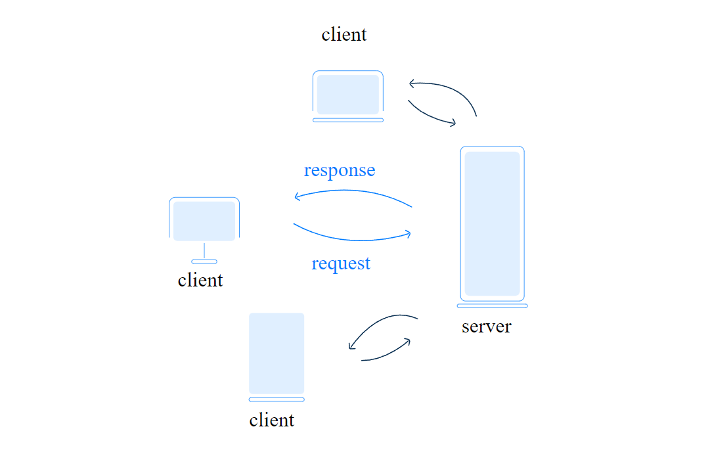

# HTTP: Giao thức truyền HyperText

##HTTP là gì

**máy khách** là khách hàng của một dịch vụ và **máy chủ** là máy tính phục vụ người dùng hoặc các máy tính khác. Nó có thể được định vị ở xa, cách xa bạn hàng chục nghìn km. Công nghệ trong đó tải mạng được phân bổ giữa các máy chủ và khách hàng sử dụng dịch vụ được gọi là **Kiến trúc Client-Server**.

Việc trao đổi dữ liệu giữa máy khách và máy chủ diễn ra nhờ **HTTP**. HTTP là viết tắt của **Giao thức truyền HyperText**. Nó chấp nhận các yêu cầu của bạn, đưa chúng đến máy chủ để xử lý và sau đó phản hồi lại cho bạn.

> [!NOTE]
> Giao thức là một tập hợp các quy tắc và quy ước xác định một cách thống nhất để trao đổi dữ liệu giữa các chương trình khác nhau và xử lý lỗi.

##HTTPS là gì

Để làm cho không gian Internet an toàn hơn, các lập trình viên đã quyết định phát triển một tiện ích bổ sung trên HTTP, giúp tránh việc encryption chặn dữ liệu. Tiện ích mở rộng HTTP có tên **HTTPS** và là viết tắt của **HyperText Giao thức truyền an toàn**.
