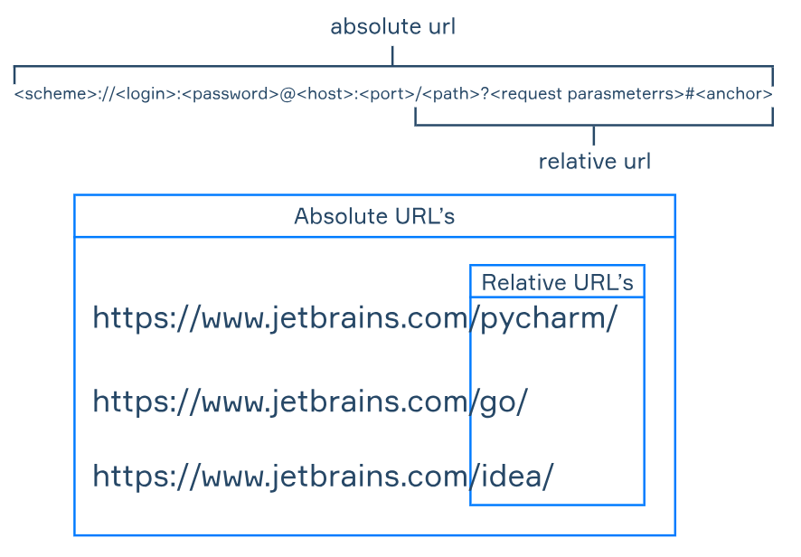

# HTTP URL

## Cấu trúc URL cơ bản

Địa chỉ URL có cấu trúc nhất định dựa trên mẫu sau:

`<scheme>://<login>:<password>@<host>:<port>/<path>?<request parameters>#<anchor>`

Bây giờ chúng ta hãy xem mẫu này chi tiết hơn:

- `<scheme>` là một cách trao đổi dữ liệu với tài nguyên. Có lẽ bạn quen thuộc nhất với các lược đồ http và https URL, nhưng vẫn có những lược đồ khác;

- `<login>` và `<password>` là tiền tố truyền dữ liệu xác thực cho một số giao thức, nếu cần;

- `<host>` là tên miền hoặc địa chỉ IP nơi đặt trang web. Tên miền là tên của trang web, IP là địa chỉ của nó trong mạng;

- Cần có `<port>` để kết nối trong máy chủ được chỉ định. Cổng mặc định chính thức cho các kết nối HTTP là 80 và cổng thay thế là 8080, nhưng cũng có thể sử dụng bất kỳ cổng nào khác. Cài đặt mặc định cho HTTPS là 443;

- `<path>` cho biết địa chỉ chính xác của một tệp hoặc trang cụ thể trong một miền;

- `<request parameters>` là các thông số được truyền về máy chủ. Tùy thuộc vào thông số yêu cầu, trang web có thể thay đổi hiển thị một chút. Ví dụ: có thể sắp xếp các mục của danh sách theo thứ tự khác;

- `<anchor>` cho phép bạn kết nối với một phần cụ thể của trang web hoặc tài liệu.

## URL tuyệt đối và tương đối

Bạn nên nhớ rằng nó sẽ chỉ hoạt động trên cùng một trang, trong khi bạn không thể tham chiếu đến trang khác bằng đường dẫn tương đối.

Chúng tôi biết rằng bằng các URL tuyệt đối, chúng tôi có thể dễ dàng tìm thấy tài nguyên thông qua Internet, nhưng tại sao chúng tôi lại cần các đường dẫn tương đối? Dưới đây là những lý do chính cho điều đó:

- Chúng ngắn gọn và việc viết mã dễ dàng hơn với chúng.

- Chúng ta có thể dễ dàng di chuyển trang web sang một máy chủ khác vì đường dẫn tương đối không phụ thuộc vào một miền cụ thể.

- Chúng được trình duyệt truy xuất nhanh hơn một chút.

