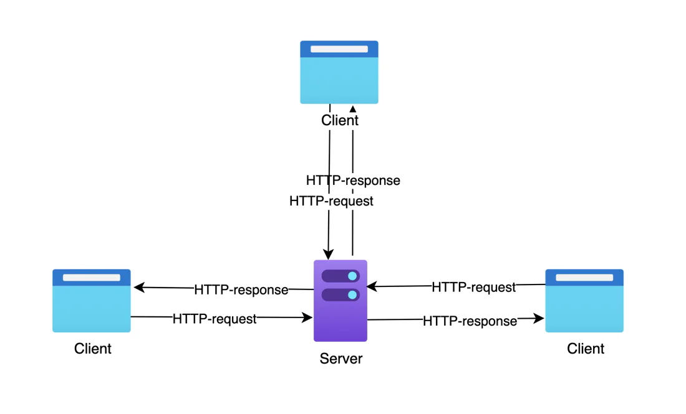
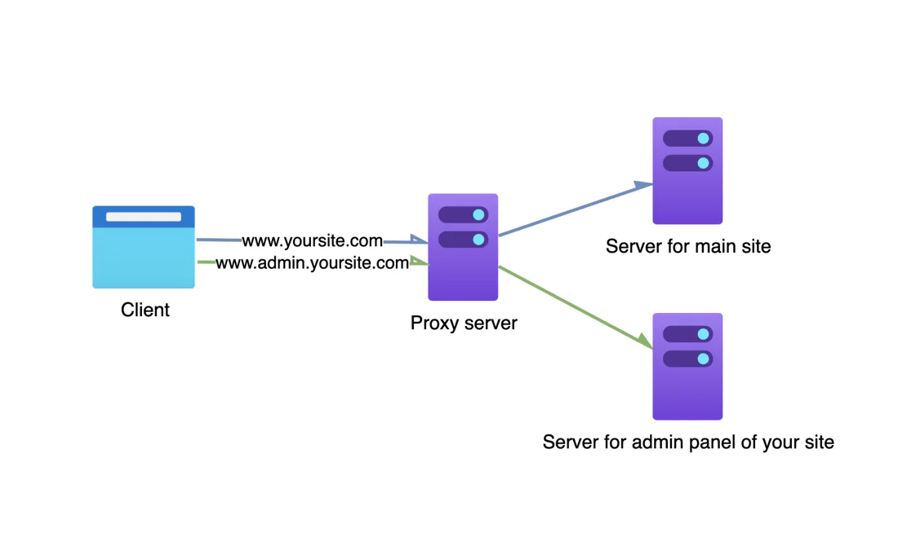

# Máy chủ HTTP

## Định nghĩa
Máy chủ web server hoặc HTTP là một chương trình trên máy tính có thể yêu cầu máy khách process và gửi câu trả lời lại cho máy khách. 

Khi máy chủ khởi động, nó luôn chờ yêu cầu và trả lời từng yêu cầu bằng cách gửi lại thông tin được yêu cầu.

Máy chủ HTTP là một phần của mô hình tương tác client-server.

## Kiến trúc Client-server.

Máy chủ lưu trữ các trang web **tĩnh**, **động** hoặc **kết hợp**.
- Các trang tĩnh được tạo sẵn. Khi khách hàng yêu cầu một trang, máy chủ sẽ trả về một tài liệu dựng sẵn hoàn chỉnh.
- Các trang động có phần dựng sẵn mà máy chủ có thể gửi cho máy khách.

Sau đó, JavaScript ở phía máy khách sẽ tạo các phần khác của trang web bằng cách yêu cầu thông tin bổ sung từ một máy chủ khác, chẳng hạn như máy chủ REST API.

## Ủy quyền

Máy chủ HTTP không chỉ có thể phản hồi yêu cầu mà còn có thể chuyển hướng yêu cầu đến các máy chủ khác. Các máy chủ như vậy được gọi là máy chủ proxy

Máy chủ proxy sẽ có ích nếu bạn có nhiều máy chủ web đằng sau một tên miền và muốn chuyển hướng yêu cầu đến đúng máy chủ.

Ví dụ: bạn có trang web của mình trên web server chính.
Bạn cũng có bảng quản trị cho trang web của mình trên một máy chủ khác. 
Máy chủ proxy có thể kiểm soát máy chủ nào sẽ nhận yêu cầu của khách hàng tùy thuộc vào tên miền.

Một khách hàng có thể gửi yêu cầu đến một máy chủ thông qua hai tên miền khác nhau. Nhưng nó sẽ nhận được phản hồi từ máy chủ đằng sau proxy.

## Cân bằng tải

Là một proxy, máy chủ HTTP có thể hoạt động như bộ cân bằng tải. 
Máy chủ HTTP có thể gửi yêu cầu của khách hàng đến các máy chủ riêng biệt để giảm tải cho máy chủ cuối.
Vì vậy, nếu một dịch vụ có nhiều máy khách thì nên đặt một máy chủ cân bằng tải để giảm tải cho các máy chủ mà máy khách process yêu cầu.
Máy chủ HTTP cung cấp cho quản trị viên cấu hình cài đặt cân bằng để cân bằng linh hoạt.

## Mã hóa

Khi yêu cầu của bạn được gửi đến máy chủ, nó thường đi qua nhiều nút trước khi đến máy chủ.
Và bất kỳ ai trên các nút này đều có thể xem dữ liệu bạn đã gửi. Họ cũng có thể đọc phản hồi của máy chủ.
Vì vậy, máy chủ HTTP có thể bảo mật kết nối bằng cách sử dụng chứng chỉ.

Kết nối HTTP an toàn được gọi là HTTPS (S là viết tắt của Secure). Giao thức HTTPS không phải là giao thức hoàn toàn khác với giao thức HTTP.
**Sự khác biệt là HTTPS hoạt động theo cơ chế truyền tải TLS và SSL.** TLS – Bảo mật lớp vận chuyển, dựa trên SSL (Lớp cổng bảo mật). TLS đưa ra hướng dẫn và quy tắc để tạo dữ liệu thực sự an toàn và bảo mật qua Internet.

Tất cả dữ liệu bạn gửi và nhận đều được mã hóa bằng chứng chỉ SSL.
Giấy chứng nhận được cấp bởi các tổ chức đặc biệt và cơ quan chứng nhận. Họ ký chứng chỉ bằng chữ ký số của riêng họ.
Trình duyệt có thể xem dấu chứng chỉ và xác minh rằng chứng chỉ hợp lệ.

Đây là một trong những chương trình bảo mật phổ biến nhất trên Internet. Khi bạn gửi nội dung nào đó đến máy chủ, trước tiên trình duyệt sẽ xác minh chứng chỉ, sau đó bạn mã hóa dữ liệu của mình bằng "khóa chung".
Và máy chủ có một "khóa riêng" cần thiết để giải mã dữ liệu bạn gửi. Khi máy chủ gửi câu trả lời, nó cũng mã hóa dữ liệu bằng "khóa chung" đó. Sau đó, trình duyệt của bạn có thể giải mã chúng bằng cách sử dụng "khóa riêng".

## Đang nén

Không ai thích tốc độ tải trang chậm. Máy chủ HTTP có thể nén dữ liệu được gửi.

Cũng giống như bạn có thể nén một thư mục chứa tài liệu vào một "kho lưu trữ", sau đó gửi cho ai đó bằng một tệp qua email.

Máy chủ nén tất cả các phản hồi gửi đến máy khách, sau đó máy khách (trình duyệt) giải nén dữ liệu.

Kích thước dữ liệu nén thấp hơn dữ liệu giải nén nên bạn cần tải xuống ít byte hơn để mở trang web.

## Bánh quy

Máy chủ web cũng có thể đọc dữ liệu trình duyệt của bạn, như cookie.
Cookie là các tệp dữ liệu nhỏ mà một trang web lưu trữ trên máy tính của người dùng thông qua trình duyệt web của họ.
Chúng cho phép trang web ghi nhớ thông tin về người dùng, chẳng hạn như tùy chọn hoặc trạng thái đăng nhập của họ, từ lần truy cập này sang lần truy cập tiếp theo.
Cookie giúp cải thiện trải nghiệm người dùng khi sử dụng một số ứng dụng web.
Ví dụ: nó giúp người bán/cửa hàng biết họ có thể giới thiệu sản phẩm nào cho bạn dựa trên lịch sử tìm kiếm của bạn.

> [!WARNING]
> Cookie có thể không an toàn vì chúng lưu trữ thông tin trên máy tính của người dùng mà một trang web có thể truy cập hoặc những kẻ tấn công giành quyền truy cập vào máy tính hoặc mạng của người dùng.
>Nếu cookie chứa thông tin nhạy cảm, chẳng hạn như thông tin xác thực đăng nhập của người dùng, thông tin này có thể bị đánh cắp và sử dụng để mạo danh người dùng.
>Ngoài ra, cookie có thể được sử dụng để theo dõi hoạt động của người dùng trên Internet.
>Điều này có thể gây lo ngại về quyền riêng tư của nhiều người dùng. Một số trang web có thể sử dụng cookie để lưu trữ thông tin về sở thích của người dùng và sử dụng thông tin này cho mục tiêu quảng cáo.
>Điều này cũng có thể được coi là xâm phạm quyền riêng tư.
>Điều quan trọng là phải cẩn thận về những thông tin nào được lưu trữ trong cookie và thường xuyên xóa chúng để duy trì cả quyền riêng tư và bảo mật.

## Bộ nhớ đệm

Máy chủ có thể lưu trữ các yêu cầu thường xuyên nhất.
Nếu yêu cầu hiện tại của bạn giống với yêu cầu trước đó, máy chủ sẽ trả về cho bạn bản sao đã lưu của câu trả lời.
Ngoài ra, máy chủ có thể đặt thuộc tính tiêu đề đặc biệt để lưu trữ một số dữ liệu trong bộ đệm cục bộ của trình duyệt của bạn.
Vì vậy, nếu bộ đệm của bạn có phản hồi cho yêu cầu của bạn, trình duyệt sẽ không phải gửi bất kỳ yêu cầu nào đến máy chủ.

