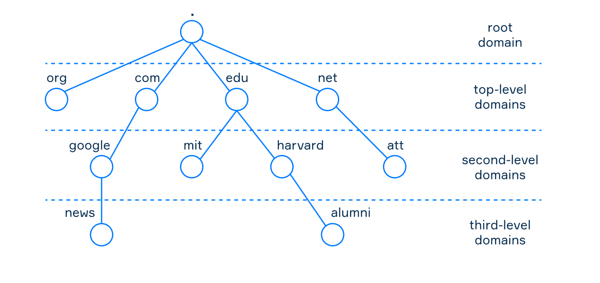

# Tên miền

Khi một máy tính kết nối Internet, nó được gán một số duy nhất gọi là **Địa chỉ IP**. 
Mỗi tài nguyên web cũng có một
Ví dụ: hãy xem địa chỉ `74.125.131.113`. Nếu bạn viết nó vào thanh địa chỉ, trình duyệt sẽ mở trang web của công cụ tìm kiếm Google.

Trừ khi bạn có trí nhớ siêu phàm, nếu không thì rất khó để nhớ các giá trị số dài khi truy cập một số trang web, đó là lý do tại sao tên miền được phát minh.
Việc viết `google.com` sẽ dễ dàng hơn nhiều thay vì một dãy số dài.

**Tên miền** hoạt động như một tên duy nhất trên Internet và là cách ghi địa chỉ IP đơn giản hơn và thân thiện hơn với con người.

Tất cả thông tin về tên miền được lưu trữ trong cơ sở dữ liệu phân tán **DNS (Hệ thống tên miền)**, là một mạng lưới các máy tính nằm rải rác trên khắp thế giới.

##Cấu trúc tên miền

Các miền được sắp xếp theo thứ bậc: chúng bao gồm các cấp độ.
Cấu trúc phân cấp cho phép trình duyệt nhanh chóng tìm và mở trang web.
Theo mặc định, mỗi miền bao gồm hai cấp độ, nhưng có thể có nhiều cấp độ hơn (ba, bốn, v.v.).

### Tên miền gốc

Miền **gốc** hoặc miền cấp cao nhất (không), được đánh dấu bằng **dấu chấm**. Trong cách sử dụng thông thường, dấu chấm không được hiển thị như một phần của tên miền.

`https://news.google.com.`

Bạn có thể bỏ qua tên miền gốc vì nó không cản trở việc truy cập vào trang web.

### Tên miền cấp cao nhất

**Miền cấp cao nhất** được chia thành **tên miền quốc gia** và **miền công cộng**.

- Nhóm đầu tiên xác định khu vực của địa điểm và vị trí địa lý của nó: `.us` dành cho Hoa Kỳ và `.eu` dành cho Liên minh Châu Âu.

- Nhóm thứ hai không phản ánh đặc điểm địa lý của tài nguyên mà phản ánh sự liên kết của nó với một lĩnh vực cụ thể. Ví dụ: một trang web thông tin sẽ có endpoint `.info`, một trang web thương mại sẽ có `.com` và một trang web phi lợi nhuận sẽ có `.org`.

- Có một số tên miền cụ thể hơn. Miền `.net` (từ mạng) ban đầu được dành cho các tổ chức công nghệ mạng. Ví dụ: các nhà cung cấp dịch vụ Internet. Miền `.edu` được sử dụng bởi các tổ chức giáo dục đại học liên kết với US-.

> [!NOTE]
> Ngày nay, các miền .com, .org và .net được sử dụng hầu như không có hạn chế nào. Bạn có thể tìm thấy bất kỳ loại hình tổ chức nào được đăng ký dưới những tên miền này. Tuy nhiên, miền .edu vẫn bị hạn chế sử dụng.

### Tên miền cấp hai

**Miền cấp hai** là địa chỉ trang web duy nhất mà mọi người ghi nhớ và sử dụng để lướt Internet như `google`, `facebook`, `uber` và các địa chỉ khác.

### Tên miền cấp ba

Tên cấp ba có sẵn để đăng ký tài nguyên với các công ty tên miền cấp hai.
Chủ sở hữu tên miền cấp hai có khả năng tạo nhiều tài nguyên cùng một lúc trên trang web bằng một tên miền chung. Ví dụ: nếu trang web có tên `google.com` thì blog tin tức sẽ là `news.google.com` .

> [!NOTE]
> Không phải tất cả các tổ chức đều sử dụng tên miền cấp ba vì đây không phải là cách duy nhất để sắp xếp tài nguyên.

Chúng tôi sẽ không xem xét các cấp độ miền sâu hơn (thứ 4, thứ 5, v.v.), nhưng chúng cũng có thể tồn tại trên Internet.

### Máy chủ cục bộ

Bạn có thể tự hỏi liệu bạn có thể gọi tên máy tính của mình trong mạng hay không. Bí danh phổ biến cho mục đích này là **localhost**.

**Localhost** là tên máy chủ dùng để chỉ máy tính bạn đang làm việc. Localhost cũng là miền cấp cao nhất dành riêng cho DNS, nhưng mục đích duy nhất của nó là truy cập vào máy hiện tại.

Địa chỉ từ `127.0.0.0` đến `127.255.255.255` được dành riêng cho máy chủ cục bộ. Trong mạng bao gồm một PC duy nhất, nghĩa là trên máy của bạn, localhost được đặt tại địa chỉ `127.0.0.1`. 

Khi bạn nhập địa chỉ này hoặc localhost vào thanh địa chỉ của trình duyệt, bạn sẽ tự động được định tuyến lại đến máy của mình. Cách sử dụng phổ biến nhất của process này là chạy và kiểm tra các dịch vụ web trong môi trường cục bộ. Điều này cho phép các nhà phát triển mô phỏng kết nối internet, duy trì tính bảo mật và tốc độ.