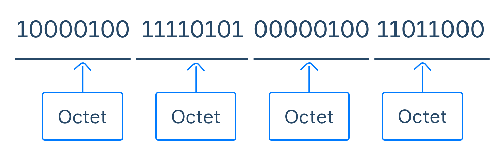

#IP

Bạn có thể kết nối Internet từ mọi thiết bị: máy tính, laptop, máy tính bảng, điện thoại thông minh, v.v. 
Điều này có thể thực hiện được vì phần mềm của họ thực thi các giao thức mạng, tức là các bộ quy tắc quy định cách các thiết bị trao đổi dữ liệu qua mạng. Một trong những giao thức quan trọng này là IP.

## Địa chỉ IP và IP

**IP (Giao thức Internet)** xác định địa chỉ của thông tin khi nó được truyền qua mạng và đảm bảo việc tổ chức vận chuyển thông tin này đến các điểm đến cụ thể.
Nó chỉ định cách thức, thời gian và địa điểm chuyển tiếp.

Để xác định chính xác địa chỉ nào cung cấp thông tin trên Internet, có một địa chỉ IP.
Khi một máy tính kết nối Internet, nó được gán một số duy nhất gọi là **địa chỉ **IP.**

Không chỉ các máy tính mới có địa chỉ IP.
Mỗi trang web trên Internet đều có địa chỉ IP riêng.
Nó tương đương với địa chỉ IP của máy chủ lưu trữ trang web.
Biết địa chỉ IP của các trang web mà bạn quan tâm, bạn có thể truy cập chúng bằng cách nhập địa chỉ IP vào thanh địa chỉ.

Có hai phiên bản của giao thức IP: **IPv4** và **IPv6**. Địa chỉ IP trên Internet có thể được biểu diễn theo một trong hai định dạng tùy thuộc vào phiên bản nào trong hai phiên bản giao thức IP này được sử dụng.

##IPv4

Chúng ta sẽ bắt đầu với IPv4, vì đây là phiên bản phổ biến nhất của giao thức trên Internet ở thời điểm hiện tại.
Bất kỳ địa chỉ nào theo định dạng này đều bao gồm bốn số từ `0` đến `255` được phân tách bằng dấu chấm. 

Ví dụ:

`132.245.4.216`

Đây là phiên bản con người có thể đọc được của địa chỉ IP.
Trong máy tính, một địa chỉ như vậy được biểu diễn bằng 
**4** chuỗi **8** bit có tổng cộng **32** bit.

Một chuỗi **8** bit thông tin thường được gọi là **octet**.
Đây là ví dụ tương tự về địa chỉ Internet được viết ở định dạng nhị phân:

Địa chỉ IP tại IPv4 ngắn và tương đối dễ nhớ, nhưng chúng có một điểm bất tiện.

Số lượng địa chỉ IP rất hạn chế và nhiều địa chỉ trong số đó được dành riêng cho các nhu cầu kỹ thuật.

Vì IPv4 sử dụng giá trị 32 bit cho các địa chỉ Internet của nó, điều đó có nghĩa là giao thức này có thể cung cấp hỗ trợ cho 
Tổng số địa chỉ `2^32` IP tương đương khoảng **4,29**
tỷ địa chỉ khác nhau.

Mặc dù khá lớn nhưng ngay cả giá trị này cũng không đủ để cung cấp địa chỉ cho tất cả người dùng có thể trong tương lai gần.

##IPv6

Với tất cả sự đơn giản và tiện lợi của nó, có một vấn đề lớn ngăn cản việc tiếp tục sử dụng IPv4 - sự cạn kiệt của dải địa chỉ. IPv6 được phát triển để giải quyết vấn đề này.

Phiên bản giao thức IP này sử dụng 
**128** bit để biểu thị một địa chỉ cho phép các địa chỉ `2^128` khác nhau.
Trong phiên bản này, một địa chỉ bao gồm tám nhóm bốn chữ số thập lục phân được phân tách bằng dấu hai chấm.

Đây là một ví dụ về địa chỉ IPv6:

`0de2:041a:7d43:65ab:9a63:a63e:aa78:34c2`

Để rút ngắn địa chỉ IPv6, chúng ta có thể bỏ đi các số 0 ở đầu. 

Ví dụ: địa chỉ `0000:0000:0000:0000:0000:0000:0000:0001` có thể được đơn giản hóa thành `0:0:0:0:0:0:0:1`. 

Sau thủ tục này, bạn có thể rút ngắn lại địa chỉ.
Để thực hiện việc này, hãy chọn hàng dài nhất gồm các số 0 thập lục phân liên tiếp và thay thế bằng hai dấu hai chấm (`::`). Do đó, `0:0:0:0:0:0:0:1` chuyển đổi thành `::1`.

Mặc dù thực tế là định dạng mới này cho phép lưu trữ một số lượng lớn địa chỉ nhưng nó có một nhược điểm đáng kể: **phiên bản này không tương thích ngược với IPv4**.

Tuy nhiên, bạn vẫn có thể bắt đầu sử dụng IPv6, vì vậy nếu quyết định sử dụng giao thức này trong mạng, bạn cần nâng cấp cơ sở hạ tầng và tất cả các thiết bị của mình để hỗ trợ phiên bản IPv6 này.

## Địa chỉ vòng lặp

Có các địa chỉ IP đặc biệt trỏ đến máy tính cục bộ, tức là máy tính bạn đang sử dụng.
Chúng được gọi là **địa chỉ vòng lặp**. Chúng rất hữu ích khi bạn muốn kết nối với máy chủ trên máy tính của mình.

Các địa chỉ IP được sử dụng phổ biến nhất để kết nối với máy chủ trên máy tính cục bộ của bạn là `127.0.0.1` cho IPv4 và `::1` cho IPv6.

