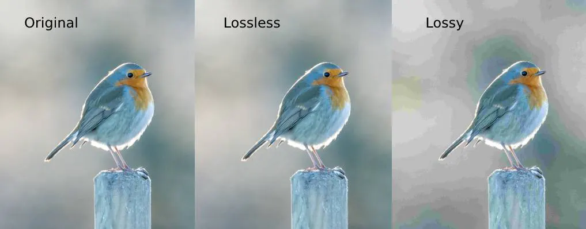

# Định dạng tệp đồ họa

**Định dạng tệp đồ họa** là cách tổ chức thông tin hình ảnh vào một tệp. Nó xác định cách lưu trữ thông tin trong tệp: ví dụ: raster hoặc vector, hai chiều hoặc ba chiều.

Đồ họa ba chiều được sử dụng rộng rãi trong lập trình kỹ thuật, mô hình hóa, trò chơi máy tính và quay phim. 

- Raster graphics rất hữu ích để tạo hình ảnh chân thực chất lượng cao, bản vẽ kỹ thuật số chi tiết và ảnh.
- Vector graphics được sử dụng để tạo biểu tượng, logo, không phải hình minh họa chi tiết và thường được sử dụng trong thiết kế web.

## Các định dạng phổ biến

- **JPEG**, định dạng tệp raster, không hỗ trợ độ trong suốt. Nó được sử dụng phổ biến nhất để process và lưu trữ ảnh.
- **WebP**, định dạng tệp raster. Nó được Google phát triển để giảm kích thước tệp hình ảnh giúp trang web tải nhanh hơn.
Nó được tạo ra để thay thế JPEG làm định dạng ảnh chính trên Internet.
Điểm đặc biệt của nó là một thuật toán nén tiên tiến cho phép bạn giảm kích thước của hình ảnh mà không làm giảm chất lượng rõ ràng. WebP hỗ trợ tính minh bạch.
- **PNG**, định dạng tệp raster.
Nó cho phép nén các tập tin mà ít hoặc không làm giảm chất lượng và hỗ trợ tính minh bạch. Nó chủ yếu được sử dụng để lưu trữ các phần tử đồ họa có độ trong suốt.
- **GIF**, định dạng tệp raster. Nó cung cấp tính năng nén mà không làm giảm chất lượng, hỗ trợ hoạt ảnh và độ trong suốt.
- **TIFF**, định dạng tệp raster. Nó được sử dụng phổ biến nhất trong ngành công nghiệp kiểu chữ và in ấn. Hình ảnh trong TIFF sẽ không bị giảm chất lượng sau mỗi lần lưu tệp. Nhưng thật không may, đây là lý do tại sao các tệp TIFF nặng hơn rất nhiều so với JPEG.
- **SVG**, định dạng tệp vectơ. Nó hỗ trợ độ trong suốt và cho phép bạn lưu cả hình ảnh tĩnh và hoạt hình. Nó cho phép chia tỷ lệ tập tin mà không thay đổi chất lượng của chúng. Thông thường nó được sử dụng để tạo logo, biểu tượng, v.v.

## Mất mát và không mất mát

Hầu như tất cả đồ họa web đều được nén để truyền hình ảnh qua Internet một cách hiệu quả.
**Nén hình ảnh** là một ý tưởng được sử dụng để giảm kích thước hình ảnh, đặc biệt khi bạn muốn cải thiện tốc độ và hiệu suất tải trang web của mình.
Có hai kiểu nén ảnh cơ bản:

- **Nén hình ảnh không mất dữ liệu** làm giảm kích thước của tệp chứa hình ảnh mà không làm giảm chất lượng của nó. Nó chỉ loại bỏ dữ liệu không cần thiết hoặc có thể bị xóa và khôi phục. Một ví dụ điển hình về tệp nén không mất dữ liệu là PNG.
- **Nén hình ảnh bị mất** khôi phục tệp lớn về dạng ban đầu nhưng bị mất một số dữ liệu có thể được coi là không đáng chú ý. Một ví dụ về định dạng phù hợp với phương pháp này là JPEG.

