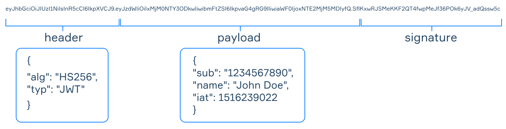

# Tìm hiểu về mã thông báo web JSON

Trong thế giới kỹ thuật số ngày nay, việc bảo mật và quản lý xác thực người dùng là điều cần thiết để đảm bảo các ứng dụng và dịch vụ web hoạt động liền mạch.
**Một cách hiệu quả để đạt được điều này là sử dụng Mã thông báo web JSON (JWT).**


## Sự định nghĩa
 
JSON Web Token (JWT) là một tiêu chuẩn mở xác định một phương pháp nhỏ gọn và khép kín để trao đổi thông tin một cách an toàn giữa các bên dưới dạng đối tượng JSON.
Thông tin có thể được xác minh và tin cậy vì nó được ký điện tử bằng khóa bí mật (sử dụng thuật toán HMAC) hoặc cặp khóa công khai/riêng tư (sử dụng RSA hoặc ECDSA).

Mã thông báo JWT đặc biệt hữu ích trong nhiều tình huống khác nhau đối với các ứng dụng và dịch vụ web.
Một số trường hợp sử dụng phổ biến bao gồm:

1. **Authentication**: Mã thông báo JWT được sử dụng rộng rãi để xác thực người dùng.
Sau khi người dùng đăng nhập bằng thông tin xác thực của họ, JWT token sẽ được tạo và gửi lại cho người dùng.
Sau đó, ứng dụng khách (trình duyệt hoặc ứng dụng) của người dùng sẽ gửi token này cùng với mỗi yêu cầu tiếp theo để truy cập các tài nguyên được bảo vệ, cho phép máy chủ xác thực người dùng mà không yêu cầu người dùng gửi lại thông tin xác thực của họ.

2. **Authorization**: Mã thông báo JWT cũng có thể được sử dụng để cấp quyền truy cập vào các tài nguyên hoặc hành động cụ thể trong một ứng dụng.
Bằng cách bao gồm các xác nhận quyền sở hữu cụ thể trong token, chẳng hạn như vai trò hoặc quyền, máy chủ có thể xác minh quyền truy cập của người dùng dựa trên thông tin có trong JWT token.

3. **Đăng nhập một lần (SSO)**: Mã thông báo JWT cho phép đăng nhập một lần trên nhiều hệ thống hoặc ứng dụng. Sau khi người dùng được xác thực trong một hệ thống, JWT token sẽ được tạo, sau đó có thể được sử dụng để xác thực người dùng trên các hệ thống khác mà không yêu cầu người dùng đăng nhập lại. Điều này tạo ra trải nghiệm liền mạch cho người dùng khi điều hướng giữa các ứng dụng hoặc dịch vụ khác nhau.

4. **API Authentication không trạng thái**: Mã thông báo JWT có thể được sử dụng để xác thực API RESTful hoặc vi dịch vụ.
Vì mã thông báo JWT độc lập và không yêu cầu phiên phía máy chủ nên chúng cho phép cơ chế xác thực không trạng thái và có thể mở rộng.
Máy khách API có thể gửi mã thông báo JWT với mỗi yêu cầu, cho phép máy chủ xác thực ứng dụng khách và process yêu cầu tương ứng.

5. **Ủy quyền truy cập vào các ứng dụng của bên thứ ba**: Mã thông báo JWT có thể được sử dụng để cấp quyền truy cập hạn chế vào tài nguyên hoặc dữ liệu của người dùng cho các ứng dụng của bên thứ ba mà không làm lộ thông tin xác thực của người dùng. Ví dụ: OAuth 2.0, một ủy quyền phổ biến framework, sử dụng mã thông báo JWT (được gọi là mã thông báo truy cập) để thay mặt người dùng cung cấp quyền truy cập tạm thời và có phạm vi vào các tài nguyên.

6. **Authentication tên miền chéo**: Mã thông báo JWT có thể được sử dụng để xác thực người dùng trên các miền hoặc dịch vụ khác nhau. Vì mã thông báo độc lập nên chúng có thể dễ dàng được chuyển giữa các hệ thống khác nhau mà không cần cơ chế xác thực nguồn gốc chéo, giúp xác thực người dùng trên nhiều dịch vụ và miền khác nhau.

## Cấu trúc của JWT

Web JSON Token (JWT) bao gồm ba phần riêng biệt, đó là các chuỗi được mã hóa Base64Url được nối với các dấu chấm `.` làm dấu phân cách.
Cấu trúc của JWT có thể được biểu diễn như sau: 
`Header.Payload.Signature`
Đây là sơ đồ cấu trúc JWT:



Hãy cùng tìm hiểu sâu hơn về cấu trúc của mã thông báo JWT và thảo luận chi tiết hơn về từng phần.

- **tiêu đề** chứa siêu dữ liệu về token, bao gồm loại token và thuật toán được sử dụng để ký. Nó là một đối tượng JSON với hai thuộc tính chính:

  - "alg": Thuộc tính này chỉ định thuật toán mã hóa được sử dụng để ký token.

  - "typ": Thuộc tính này biểu thị loại token, thường là "JWT" cho Mã thông báo Web JSON.


- **tải trọng** là cốt lõi của JWT và chứa các xác nhận quyền sở hữu truyền tải thông tin về chủ đề (thường là người dùng), cùng với mọi dữ liệu bổ sung mà ứng dụng yêu cầu. Xác nhận quyền sở hữu là cặp khóa-giá trị và có thể được chia thành ba loại:
    - Khiếu nại đã đăng ký: Đây là các khiếu nại được xác định trước được chỉ định bởi tiêu chuẩn JWT ([RFC7519](https://www.rfc-editor.org/rfc/rfc7519#section-4.1))
    - Khiếu nại công khai: Đây là các khiếu nại tùy chỉnh được các bên liên quan đến sàn giao dịch token đồng ý. Các xác nhận quyền sở hữu công khai phải được đăng ký với **IANA JSON Web Token Đăng ký** để tránh xung đột.
    - Tuyên bố riêng tư: Đây là những tuyên bố tùy chỉnh được sử dụng trong một tổ chức hoặc giữa các bên có sự hiểu biết lẫn nhau về ý nghĩa của chúng. Chúng không được đăng ký với bất kỳ cơ quan đăng ký nào và yêu cầu lựa chọn cẩn thận để ngăn ngừa xung đột đặt tên.

- **chữ ký** là phần cuối cùng của JWT và rất quan trọng để đảm bảo tính toàn vẹn và xác thực của token. Để tạo chữ ký, bạn nối tiêu đề và tải trọng được mã hóa, sau đó ký chúng bằng khóa bí mật (đối với thuật toán đối xứng) hoặc khóa riêng (đối với thuật toán bất đối xứng), sử dụng thuật toán đã chỉ định.

Ví dụ: sử dụng thuật toán HMAC SHA256:

```
HMACSHA256(
  base64UrlEncode(header) + "." +
  base64UrlEncode(payload),
  secret
)
```

## Các trường xác nhận quyền sở hữu tiêu chuẩn và các xác nhận quyền sở hữu thường được sử dụng

Tuyên bố tiêu chuẩn, còn được gọi là tuyên bố đã đăng ký, được xác định trước theo tiêu chuẩn JWT (RFC 7519) và đóng vai trò như một tập hợp các thuộc tính hữu ích.
Mặc dù không bắt buộc nhưng chúng được khuyến nghị cung cấp cấu trúc nhất quán và có khả năng tương tác cho mã thông báo.
Sau đây là các trường yêu cầu tiêu chuẩn:

- **iss** (Nhà phát hành): Xác nhận quyền sở hữu "iss" xác định chủ thể (ví dụ: ứng dụng hoặc dịch vụ) đã cấp JWT. Nó thường là một chuỗi hoặc URI, giúp theo dõi và phân biệt nguồn gốc của JWT trong trường hợp có nhiều nhà phát hành.
- phụ (Chủ đề): Yêu cầu "phụ" xác định nguyên tắc chính là chủ thể của JWT. Nó thường là mã định danh duy nhất cho người dùng hoặc hệ thống mà token đại diện. Khiếu nại này cho phép các hệ thống liên kết token với một người dùng hoặc tổ chức cụ thể.
- kiểm toán (Đối tượng): Xác nhận quyền sở hữu "kiểm toán" xác định người nhận hoặc đối tượng dự định của JWT. Nó có thể là một giá trị hoặc một mảng các giá trị, thường đại diện cho mã định danh hoặc URI cho các hệ thống được ủy quyền. Nó giúp đảm bảo rằng token chỉ được chấp nhận bởi các hệ thống mà nó được thiết kế, cung cấp thêm một lớp bảo mật.
- exp (Thời gian hết hạn): Xác nhận quyền sở hữu "exp" chỉ định một ngày dạng số (dấu thời gian UNIX) sau đó JWT không được chấp nhận để xử lý. Khiếu nại này cho phép hệ thống tự động từ chối mã thông báo hết hạn, giảm nguy cơ truy cập trái phép và đảm bảo mã thông báo không được sử dụng vô thời hạn.
- nbf (Không phải trước): Xác nhận quyền sở hữu "nbf" chỉ định một ngày dạng số (dấu thời gian UNIX) mà trước đó JWT không được chấp nhận để xử lý. Xác nhận quyền sở hữu này cho phép các hệ thống xác định thời điểm trong tương lai khi token sẽ trở nên hợp lệ, có khả năng giới hạn việc sử dụng token trong một khoảng thời gian cụ thể.
- iat (Được phát hành vào lúc): Yêu cầu "iat" xác định ngày bằng số (dấu thời gian UNIX) mà JWT được phát hành. Khiếu nại này có thể hữu ích để theo dõi thời gian tồn tại của token, triển khai tính năng ngăn chặn phát lại token hoặc tính toán tuổi của token trong hệ thống nhận.
- jti (JWT ID): Tuyên bố "jti" cung cấp mã định danh duy nhất cho JWT. Khiếu nại này có thể được sử dụng để ngăn chặn các cuộc tấn công phát lại token bằng cách cho phép hệ thống theo dõi các mã thông báo đã sử dụng và đảm bảo chúng không được sử dụng nhiều lần.

## JWE và JWS

**JSON Web Encryption** (JWE) và **JSON Web Signature** (JWS) là hai tiêu chuẩn bổ sung mở rộng lõi JSON Web Token (JWT). 
Họ cung cấp framework để bảo mật mã thông báo JWT thông qua encryption và chữ ký số tương ứng.

- **JWS** là tiêu chuẩn cho phép tạo và xác thực chữ ký số cho mã thông báo JWT. Trong phần trước, chúng ta đã thảo luận chi tiết về cấu trúc của tiêu chuẩn này. Bằng cách ký điện tử JWT, bạn có thể đảm bảo tính toàn vẹn và xác thực của token, xác minh rằng nó không bị giả mạo và nó có nguồn gốc từ một nguồn đáng tin cậy.

- **JWE** là tiêu chuẩn cho phép encryption của mã thông báo JWT bảo vệ nội dung của chúng. Bằng cách mã hóa JWT, bạn có thể đảm bảo rằng chỉ những bên được ủy quyền mới có thể xem tải trọng của token. JWE đặc biệt hữu ích khi bạn cần truyền thông tin nhạy cảm trong JWT token, chẳng hạn như thông tin nhận dạng cá nhân (PII) hoặc dữ liệu bí mật khác.


