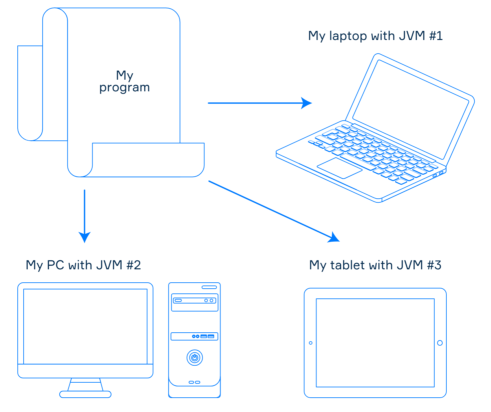
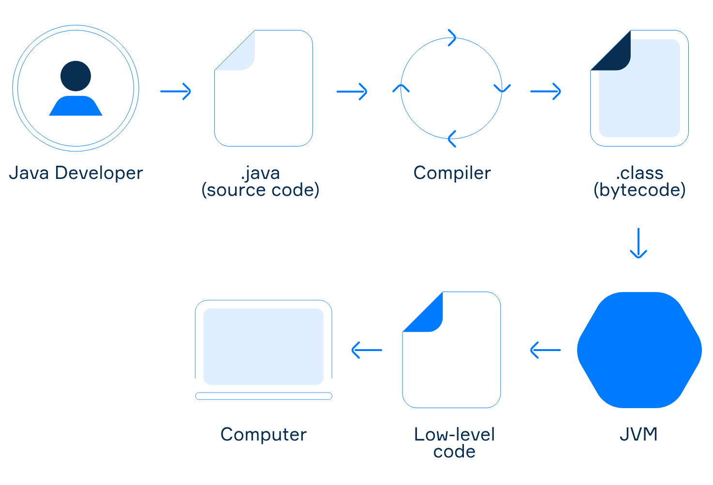
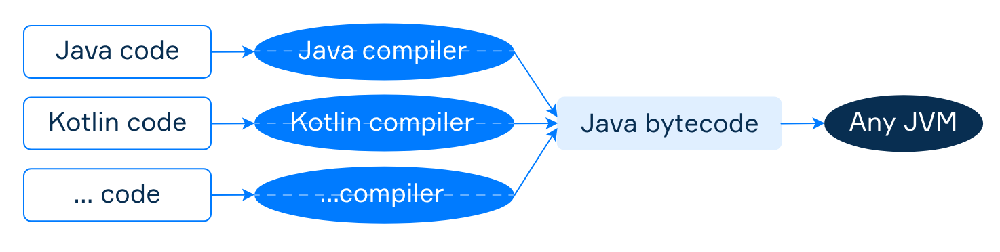

#Viết chương trình


Là nhà phát triển, điều đầu tiên bạn làm khi tạo chương trình là viết source code vào một tệp văn bản thuần túy và lưu nó với phần mở rộng tương ứng với programming language mà bạn đã chọn (.java cho ngôn ngữ Java, .kt cho Kotlin, v.v.).
Một chương trình bao gồm một hoặc nhiều tệp như vậy, chứa các hướng dẫn chỉ định chương trình thực hiện những gì.
source code phải tuân theo các quy tắc cú pháp của ngôn ngữ tương ứng và dễ đọc và dễ hiểu.

## Biên soạn
Sau khi viết mã, bạn cần làm cho máy tính chạy chương trình. Vì máy tính không hiểu source code nên nó cần được dịch sang định dạng mà máy tính có thể hiểu được.
Đó là lúc một chương trình đặc biệt có tên compiler phát huy tác dụng.
Mã thu được sau khi biên dịch được gọi là mã gốc hoặc mã cấp thấp. Mỗi nền tảng máy tính sử dụng các lệnh cấp thấp khác nhau, giống như mọi người trên thế giới nói các ngôn ngữ khác nhau.
Nó tạo thêm một thách thức khi sử dụng một chương trình trên các thiết bị khác nhau.

Trong thế giới Java, **a compiler (công cụ javac cho Java hoặc công cụ kotlinc cho Kotlin)** dịch source code thành dạng biểu diễn trung gian được gọi là **mã byte Java** được lưu trữ trong các tệp có phần mở rộng `.class`.
Máy tính không thể đọc mã byte mà không dịch, nhưng một hệ thống có tên Java Virtual Machine (JVM) có thể thực thi nó.

## Chạy một chương trình

**Java Virtual Machine** là một ứng dụng đại diện cho máy tính ảo theo tài liệu thông số kỹ thuật JVM.
Nó thực thi mã byte Java đã biên dịch và dịch nó thành các lệnh cấp thấp mà máy tính có thể hiểu được.
Mỗi nền tảng có phiên bản JVM riêng, nhưng vì tất cả các JVM đều khớp với cùng một thông số kỹ thuật nên chương trình của bạn sẽ hoạt động giống hệt nhau trên các thiết bị khác nhau.

Một trong những khái niệm chính của Nền tảng Java là "viết một lần, chạy mọi nơi".
Điều đó có nghĩa là một chương trình có thể chạy trên nhiều thiết bị khác nhau miễn là chúng được cài đặt JVM.
Khái niệm này cũng thường được gọi là **độc lập nền tảng** hoặc tính di động.

>[!NOTE]
>Điều quan trọng cần nhớ: mã đầu vào vào JVM không phụ thuộc vào nền tảng, trong khi mã đầu ra phụ thuộc vào nền tảng.




Nếu JVM được cài đặt trên máy tính, bạn có thể chạy chương trình JVM đã biên dịch bằng công cụ `java`. Nó sẽ mở một tệp có phần mở rộng `.class` để khởi chạy chương trình từ tệp này. Công cụ này giống nhau cho tất cả các ngôn ngữ JVM.

Hình ảnh bên dưới tóm tắt ngắn gọn chu trình làm việc của chương trình JVM.



## Ngôn ngữ JVM

Nền tảng Java cho phép sử dụng nhiều programming language để tạo chương trình. Điều này đạt được nhờ thiết kế của JVM: nó không biết gì về bất kỳ programming language cụ thể nào. Nó chỉ hiểu mã byte Java. Nếu các công cụ dành cho programming language có thể tạo mã byte thì các chương trình được viết bằng ngôn ngữ này có thể được thực thi trên JVM. Những ngôn ngữ như vậy thường được gọi là **ngôn ngữ JVM**. Chúng bao gồm chính Java, Kotlin, Scala, Groovy, Clojure và các thứ khác. Vì vậy, để tạo các chương trình trong thế giới Java, bạn có thể chọn ngôn ngữ thuận tiện nhất mà mình chọn.




## Tệp JAR

Lưu trữ Java (JAR) là định dạng tệp độc lập với nền tảng để đóng gói nhiều tệp (`.class`,`MANIFEST.MF`) lại với nhau và phân phối chúng dưới dạng một đơn vị. Vì vậy, nó rất hữu ích nếu ứng dụng của bạn chứa nhiều tệp.

Đây là những lợi ích chính của tệp JAR:
 - nó có thể tổng hợp nhiều tệp thuộc nhiều loại khác nhau;
 - đó là một kho lưu trữ nén (với thuật toán ZIP) giúp giảm kích thước của ứng dụng và giúp di chuyển nó qua mạng dễ dàng hơn;
 - bạn có thể ký điện tử (tính năng này sẽ không được thảo luận trong chủ đề này).

**JRE có thể khởi động một ứng dụng được đóng gói trong JAR, nhưng để tạo JAR, bạn cần sử dụng JDK.**


### Cấu trúc của file JAR

Tệp JAR chỉ đơn giản là tập hợp các tệp mã byte (.class), tệp cấu hình (ví dụ: .json, .xml), hình ảnh và thậm chí cả clip âm thanh thành một tệp nén duy nhất. Tất cả các tệp ngoại trừ tệp mã byte thường được gọi là tài nguyên. Chúng tôi cũng khuyến nghị rằng tệp JAR chứa một tệp đặc biệt có tên `MANIFEST.MF` trong một thư mục đặc biệt có tên `META-INF`. Tệp này phải mô tả chính tệp JAR (tệp kê khai là một loại siêu dữ liệu): phiên bản của nó, tác giả, v.v.

Dưới đây là ví dụ về cấu trúc của tệp JAR:

```
example.jar
├── META-INF
│   └── MANIFEST.MF
├── second
│   ├── Main.class
│   └── MyIcon.png
└── third
    └── another
        └── OneMore.class
```

### Chạy tệp JAR

Có hai cách để chạy tệp JAR, tùy thuộc vào việc bạn có muốn sử dụng tiêu đề Lớp chính trong tệp kê khai hay không.

- nếu tiêu đề này không xuất hiện hoặc bạn muốn chỉ định lớp chính theo cách thủ công, hãy chạy:

```bash
    java -cp app-without-main-class-header.jar path.to.Main
```

Tham số cuối cùng ở đây là tên lớp đầy đủ (có gói). Tùy chọn `-cp` có nghĩa là đường dẫn lớp, tức là.

đường dẫn đến tất cả các JAR mà JRE sẽ quét để tìm mã byte và tài nguyên. Nếu muốn, bạn có thể lặp lại nhiều cặp tham số -cp path-to-Nth.jar để cung cấp cho JRE nhiều tệp JAR khác nhau.
- nếu có tiêu đề này thì hãy chạy:

```bash
    java -jar app-with-main-class-header.jar
```


Bạn có thể xem cấu trúc bên trong của chúng - chỉ cần thay thế `.jar` bằng `.zip` và mở các tệp này dưới dạng kho lưu trữ.


