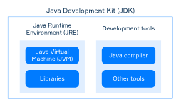

# Định nghĩa JVM

**Java Virtual Machine** hoặc JVM là mô phỏng ảo của máy tính vật lý.  Nó thực thi mã byte Java (hoặc tương thích với Java), xuất hiện sau quá trình biên dịch source code. Theo một nghĩa nào đó, JVM đóng vai trò trung gian giữa mã và máy thật. Theo một nghĩa nào đó, JVM đóng vai trò trung gian giữa mã và máy thật. Nó chạy trên một tập hợp các hướng dẫn mã byte thống nhất, sau đó được diễn giải và chuyển đổi thành các lệnh cấp máy.

JVM có sẵn cho nhiều nền tảng phần cứng và phần mềm, vì vậy bạn có thể chạy mã byte ở hầu hết mọi nơi.  Một chương trình được biên dịch thành mã byte hầu như luôn độc lập với nền tảng. Về cơ bản, khi bạn có mã ngôn ngữ JVM, bạn chỉ cần biên dịch nó một lần, lấy mã byte và bạn sẽ có thể chạy nó trên bất kỳ nền tảng nào có JVM.

## Bộ công cụ phát triển Java (JDK)

Bộ công cụ phát triển Java, hay JDK, là gói để phát triển các chương trình cho Nền tảng Java. Nó bao gồm JRE để chạy các chương trình và công cụ dành cho nhà phát triển: Java compiler, trình gỡ lỗi, trình lưu trữ, trình tạo tài liệu, v.v.

Ở giai đoạn biên dịch, compiler dịch source code thành các tệp `.class` chứa mã byte và có thể được thực thi bởi JVM.

> [!WARNING]
> Lưu ý rằng nếu bạn đang sử dụng các ngôn ngữ JVM không phải Java, bạn sẽ cần tải xuống compiler riêng vì chúng không đi kèm với JDK.

## Môi trường Java Runtime (JRE)

Môi trường Java Runtime, hay JRE, là một môi trường thực thi. Nó bao gồm các thành phần cần thiết để chạy các chương trình JVM đã biên dịch: chính JVM và Thư viện lớp Java (JCL).

JCL về cơ bản là một tập hợp các thư viện tiêu chuẩn cung cấp chức năng phổ biến nhất: các lớp cơ bản, đầu vào/đầu ra, gói toán học, collection, bảo mật, bộ công cụ user interface và nhiều bộ công cụ khác. Bạn có thể sử dụng các thư viện này trong các chương trình của mình.

> [!NOTE]
> Trước Java 11, nếu bạn chỉ muốn chạy một chương trình Java thì JRE là đủ cho bạn. Tuy nhiên, kể từ khi Java 11 được phát hành, đối với hầu hết các triển khai JVM, JRE không còn có thể tải xuống dưới dạng thành phần riêng biệt nữa. Nếu bạn muốn chạy các chương trình trong JVM 11 hoặc mới hơn, bạn phải cài đặt JDK.

Mối quan hệ giữa JVM, JRE và JDK
Hình ảnh sau đây minh họa mối quan hệ giữa JVM, JRE và JDK:

## Tham khảo
- https://hyperskill.org/learn/step/3499
