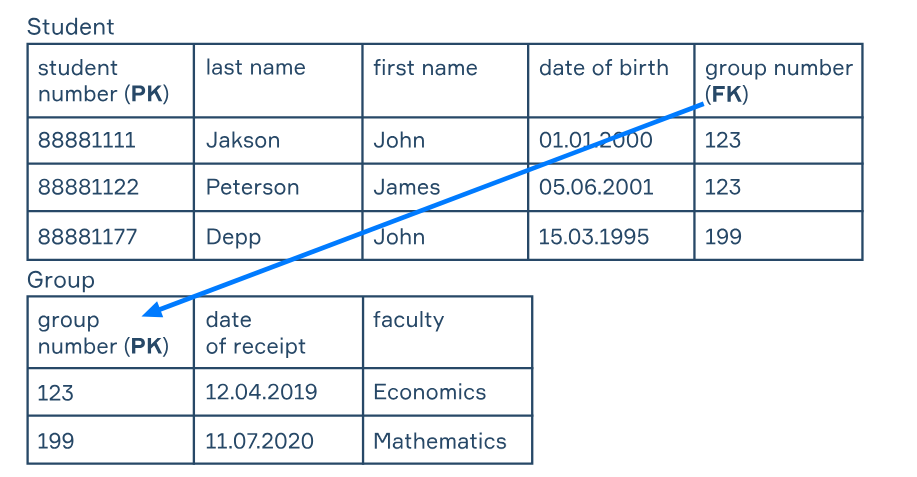

# Mô hình dữ liệu quan hệ

Mô hình dữ liệu quan hệ (RDM) là một mô hình toán học trừu tượng trên cơ sở thiết kế cơ sở dữ liệu hiện đại. Đây là danh sách một số DBMS quan hệ: Postgres, MySQL, Oracle, v.v.

## Điều khoản quan trọng

 RDM dựa trên khái niệm về mối quan hệ. **Mối quan hệ** về cơ bản là một bảng hai chiều đại diện cho một thực thể hoặc mối quan hệ nào đó.

**thực thể** là sự trừu tượng hóa của một số đối tượng (như một lớp trong OOP), ví dụ: một học sinh, một chiếc ô tô hoặc một tòa nhà. **Mối quan hệ** xác định cách các thực thể được kết nối với nhau.

Một mối quan hệ bao gồm **thuộc tính** và **bộ dữ liệu**. 

- **thuộc tính** là một cột trong bảng, trong đó một số thuộc tính có quan hệ. Ví dụ: liên quan đến một học sinh, có các thuộc tính sau: họ, tên, ngày sinh và mã số học sinh. 
- **Tuple** là một hàng trong bảng, collection có các giá trị thuộc tính cụ thể.

## Hạn chế

Các hạn chế sau đây được áp dụng đối với các mối quan hệ trong mô hình dữ liệu quan hệ:

- Không thể có hai quan hệ có cùng tên trong cơ sở dữ liệu.

- Tất cả các thuộc tính trong cùng một quan hệ phải có tên khác nhau.

- Mỗi ô chỉ được có một giá trị.

Thứ tự hàng và cột trong quan hệ không quan trọng.

## Chính trực

**Tính toàn vẹn** là sự tuân thủ của mô hình dữ liệu với các quy tắc nhất định. Có hai loại tính toàn vẹn: **tính toàn vẹn của thực thể** và **tính toàn vẹn tham chiếu**.

### Tính toàn vẹn của thực thể

Tính toàn vẹn của thực thể có nghĩa là không thể có hai bộ (hàng) giống hệt nhau trong bảng.
Như trong thế giới thực, chúng ta không thể có hai đối tượng hoàn toàn giống nhau, chẳng hạn không có học sinh giống hệt nhau, tất cả đều khác biệt.
Để duy trì tính toàn vẹn của một thực thể, khái niệm **khóa chính** (PK) được giới thiệu.

### Tính toàn vẹn tham chiếu

**Tính toàn vẹn tham chiếu** xảy ra khi chúng ta có hai quan hệ được kết nối. Mối quan hệ của các mối quan hệ được cung cấp bằng cách sử dụng **khóa ngoại (FK)**. Khóa ngoại là thuộc tính của một mối quan hệ (cấp dưới/phụ thuộc) trỏ đến khóa chính của một mối quan hệ khác (chính/chính). Tính toàn vẹn tham chiếu có nghĩa là không thể có khóa ngoại trong bảng chính trỏ đến bộ dữ liệu không tồn tại trong bảng phụ.

## Ưu và nhược điểm

- Một trong những lý do chính khiến RDM trở nên phổ biến là do có ngôn ngữ truy vấn SQL mà bạn có thể dễ dàng tương tác với dữ liệu.
- Một lý do nữa là nó dựa trên bộ máy toán học dựa trên lý thuyết tập hợp.
- Đối với khối lượng dữ liệu lớn, việc triển khai DBMS dựa trên các mô hình dữ liệu khác (thường đơn giản hơn và ít tổng quát hơn) có thể có khả năng mở rộng và hiệu suất cao hơn DBMS quan hệ.
- Một nhược điểm khác của mô hình dữ liệu quan hệ là nó khác với mô hình dữ liệu đối tượng và yêu cầu lớp tịnh tiến làm tăng độ phức tạp của mã.