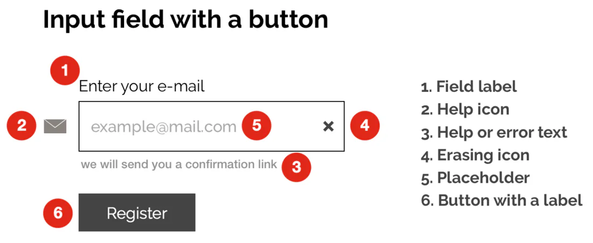
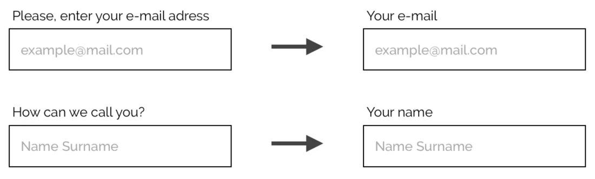

# Trường nhập và nhãn trường

Phiên bản tinh tế nhất

## Cách tạo nhãn tốt hơn

1. **Tạo nhãn càng ngắn càng tốt**: càng ít từ, người dùng sẽ hiểu được yêu cầu càng nhanh. Tránh những cụm từ phức tạp như "Bạn được giải quyết như thế nào?" thay vì "Tên của bạn".

2. Nhãn phải luôn hiển thị với người dùng để họ không phải tìm kiếm chúng.

3. Tránh trường hợp nhãn quá ngắn hoặc bị xê dịch dọc theo hàng.

