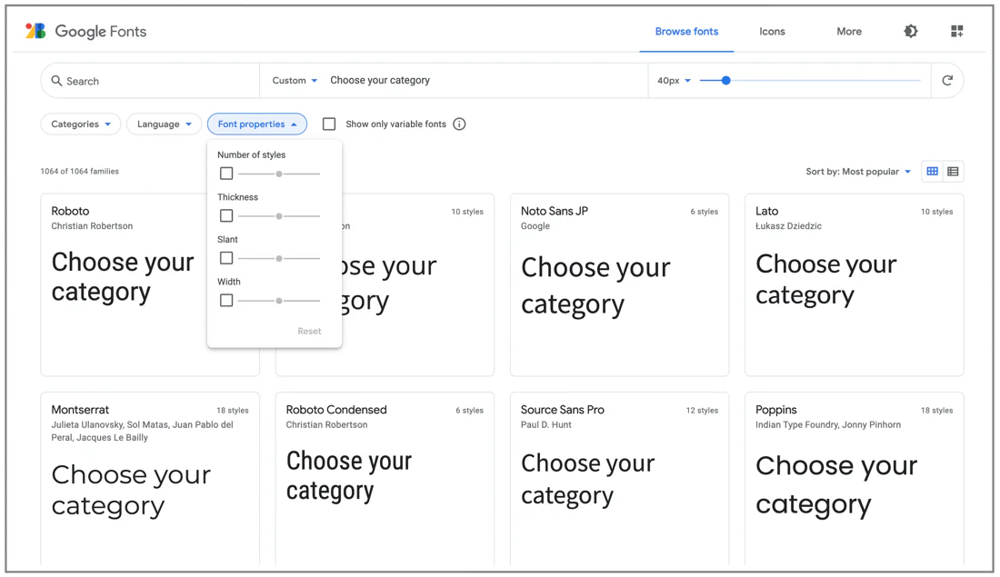
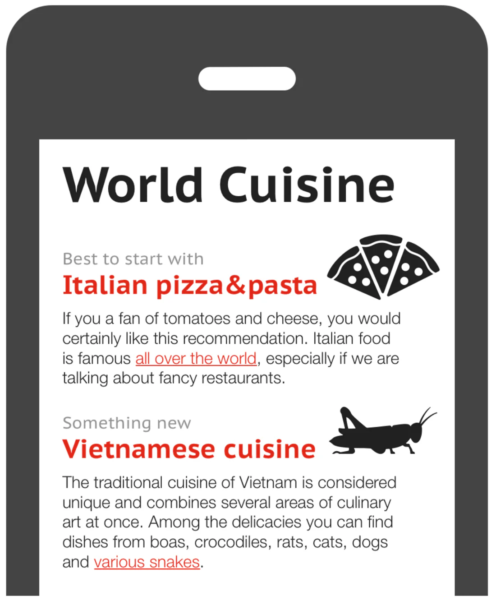

# Phông chữ

## Các loại phông chữ

Các loại phông chữ phổ biến nhất là **Sans-serif** và **Serif**.

Sự khác biệt chính là ở kiểu dáng của từng ký tự (chữ cái, số hoặc dấu chấm câu).
Sans-serif mượt mà, gọn gàng, thậm chí có thể "hiện đại".
Serif khá bảo thủ, cổ điển - nó được đặc trưng bởi các serif, những dòng nhỏ gắn liền với các ký tự

## Lựa chọn phông chữ

Việc chọn phông chữ (và chọn màu) cho một dự án có thể mất rất nhiều thời gian.
Vì vậy, thật hợp lý khi đơn giản hóa process bằng cách sử dụng một dịch vụ đặc biệt cho phép bạn so sánh các đoạn văn bản được hiển thị ở các kiểu phông chữ khác nhau.

bạn có thể sử dụng [Phông chữ Google](https://fonts.google.com/)

Dịch vụ này rất thuận tiện vì nó cho phép bạn chọn giao diện trực quan của văn bản cho dự án và tải xuống tất cả các kiểu phông chữ dưới dạng **kho lưu trữ**.
Nó thậm chí còn cho phép bạn chọn tùy chọn ưa thích của mình và xem **cặp phông chữ** nào phù hợp để sử dụng cùng nhau.

> [!NOTE]
> Điều đáng biết là Google Fonts cũng có Nhà phát triển API, điều này giúp bạn có thể kết nối nền tảng với dự án của mình. Điều này có thể được sử dụng cho những việc như cho phép người dùng chọn phông chữ tùy chỉnh bên trong dịch vụ của bạn.

## Cặp phông chữ

Sử dụng phông chữ thứ hai (**phụ trợ**) trong dự án là một cách làm khá phổ biến

Để tránh bị mắc kẹt khi chọn phông chữ phù hợp hoặc vô tình chọn kết hợp khiến người dùng căng thẳng khi đọc, bạn có thể truy cập [trang web cặp phông chữ](https://www.fontpair.co/)
Nó chứa các cặp đôi tuyệt vời cùng với các ví dụ minh họa hữu ích.

## Phân cấp kiểu chữ

**Bộ công cụ UI** mà bạn đã tìm hiểu trong chủ đề Thành phần giao diện đôi khi còn được gọi là **hướng dẫn kiểu**. Điều này cho phép các nhà thiết kế và nhà phát triển chỉ định trước kiểu dáng của tất cả các thành phần giao diện để sản phẩm được thiết kế thống nhất.

Bộ công cụ UI thường xác định kiểu văn bản bên cạnh tất cả các thành phần giao diện.

Ví dụ: họ có thể chỉ định kích thước và kiểu dáng của tiêu đề, định dạng của văn bản chính, hình thức của văn bản phụ, v.v.

Hệ thống phân cấp typographic tốt giúp người dùng lướt qua giao diện mà không cần đọc hết nội dung.
Nhờ kiểu **heading** thống nhất, người dùng biết rằng họ đang chuyển từ bài viết này sang bài viết khác.
Định dạng **thẻ** và tiêu đề theo kiểu văn bản phụ trợ sẽ giúp đảm bảo chúng không bị nhầm lẫn với nội dung chính. **Văn bản hiển thị** thường là văn bản lớn nhất, theo sau là tiêu đề, sau đó là **nội dung** và **văn bản dòng trên** (như thẻ, ngày tháng, v.v.).

## Đánh dấu văn bản

Nếu muốn giao diện của mình hiệu quả, bạn cần cho phép người dùng tương tác với một số thành phần văn bản của nó.
Đây có thể là các liên kết đến màn hình khác, bộ lọc danh mục hoặc các nút có gợi ý.

Nếu bạn cũng làm nổi bật các tiêu đề bằng màu sắc, người dùng có thể sẽ muốn nhấp vào chúng, nghĩa là chúng có thể được sử dụng làm phần chuyển tiếp sang các trang nội dung chi tiết hơn.

