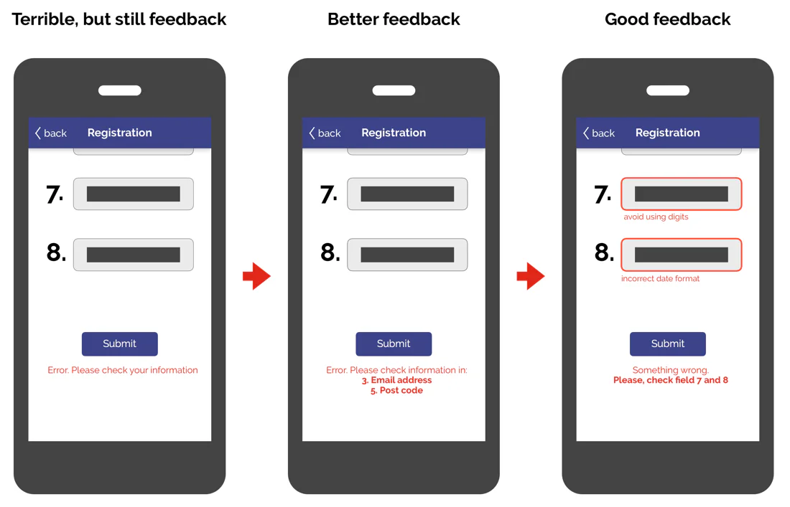
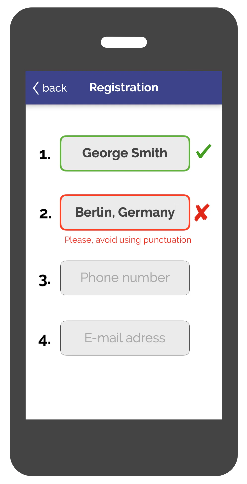
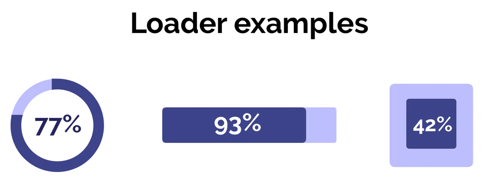

# Nhận xét

## Phản hồi trực quan tối thiểu

Người dùng cần được đảm bảo thường xuyên rằng hệ thống vẫn hoạt động.
Họ cũng muốn được biết nếu có sự cố xảy ra.
Ngay cả các yếu tố đơn giản như siêu liên kết và nút cũng có thể cung cấp cho người dùng những phản hồi đáng khích lệ rằng ứng dụng đang hoạt động.

## Làm nổi bật lỗi của người dùng

Các trường văn bản để nhập dữ liệu. Chúng được sử dụng cho những việc như đăng ký, hoàn thành bảng câu hỏi, tìm kiếm và thanh toán.

Thật không may, người dùng thường mắc lỗi khi cố gắng gửi thông tin họ đã thêm vào các trường và họ cần được cung cấp phản hồi về những lỗi này.

Cách tốt nhất để chỉ ra lỗi là đánh dấu các trường bị ảnh hưởng, chỉ cho người dùng cách họ có thể khắc phục sự cố và chuyển chúng trực tiếp đến phần liên quan của màn hình.

## Phản hồi tức thì

Bạn có muốn dịch vụ của mình thân thiện hơn với người dùng không? Sau đó hãy cân nhắc việc triển khai **xác thực trường ngay lập tức**.

Bạn có thể thực hiện việc này bằng cách đánh dấu các trường đã hoàn thành chính xác cũng như những trường có lỗi.
Điều này sẽ mang lại cảm giác yên tâm, tích cực và giúp bạn dễ dàng phát hiện ra vấn đề ngay lập tức.
Sự hài lòng về mặt tâm lý khi giải quyết được những nhiệm vụ nhỏ!

Thay vì sử dụng một tác vụ riêng biệt để xác minh xem mọi thứ có chính xác cùng một lúc hay không, bạn có thể đưa ra phản hồi ngay lập tức.

## Máy xúc

Server cần thời gian khi chuyển đổi giữa các cửa sổ khác nhau và xử lý dữ liệu.
- Vì vậy, nếu có bất kỳ sự tạm dừng đáng kể nào, người dùng phải thấy rõ rằng ứng dụng không bị treo và mọi thứ đang tiến triển như bình thường.
- Điều này có thể đạt được bằng cách thêm các phần tử đặc biệt gọi là **loaders** — biểu tượng động hoặc thanh tiến trình thể hiện ứng dụng đang ở chế độ xử lý dữ liệu.
- Cũng có thể triển khai chúng dưới dạng thông báo "vui lòng đợi" đơn giản.

Người dùng sẽ nhanh chóng trở nên lo lắng nếu không có phản hồi này. Họ sẽ bắt đầu tự hỏi liệu ứng dụng đã ngừng hoạt động hay họ đã làm sai điều gì đó.

## Thông báo

Thông báo hệ thống có thể được sử dụng để giúp mọi người biết rằng các quy trình đã hoàn tất hoặc các bước cần được thực hiện.

