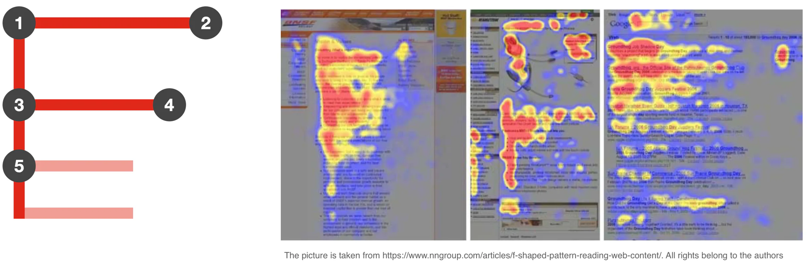
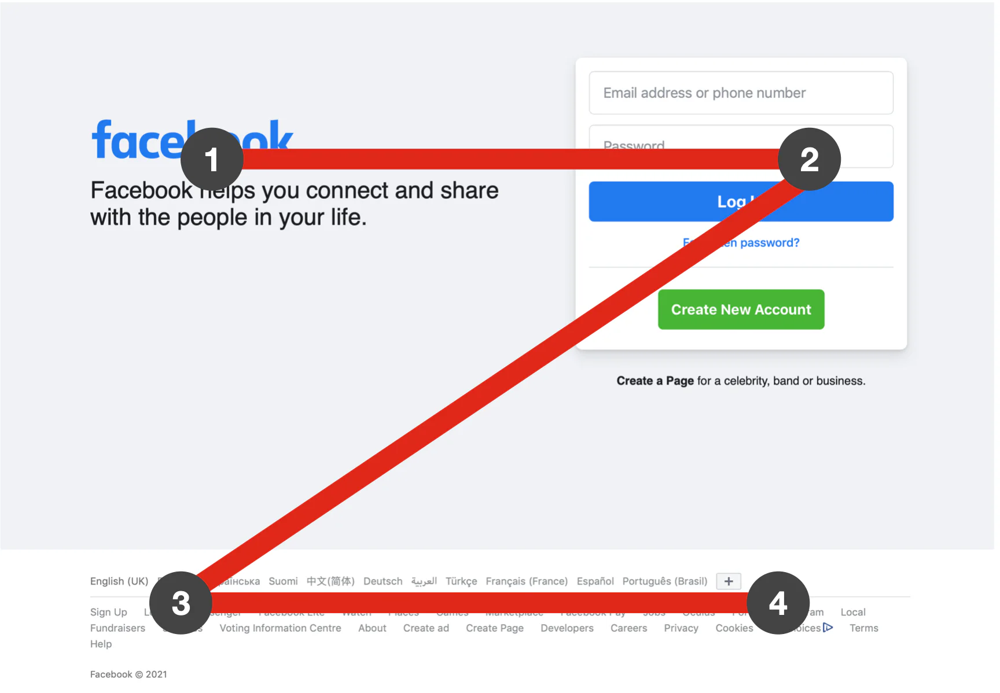
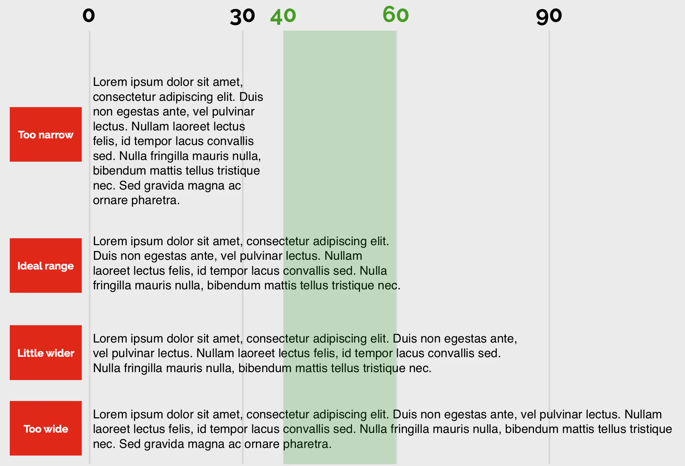
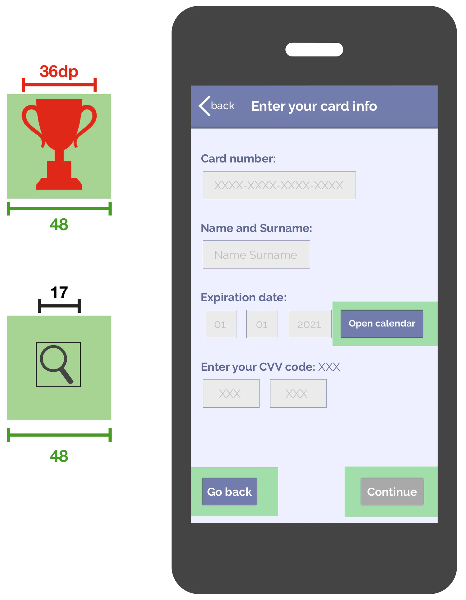

# Mẹo và quy tắc thiết kế

## Mô hình nhận thức

Bạn nhìn vào đâu khi mở một trang web mới lần đầu tiên? Hoặc nếu bạn đang đọc một bài báo?

Làm thế nào bạn có thể đảm bảo rằng mọi người không bối rối khi mở trang?

Rằng họ không bị kiệt sức về nhận thức và đóng cửa dịch vụ của bạn ngay lập tức?

Người dùng cảm nhận thông tin trên màn hình theo những cách có thể dự đoán được và hiểu được những mẫu này chính là chìa khóa.

Mọi người quét thông tin khi họ đọc sách hoặc bài báo - họ thường không đọc từng từ một.
Thay vào đó, đôi mắt nhìn dọc theo toàn bộ dòng và não nắm bắt được ý nghĩa chính của câu bằng cách phân tích các từ đã nhìn thấy.
Điều tương tự cũng xảy ra khi bạn xem các trang trên internet hoặc màn hình của mobile application

Các nhà nghiên cứu tương tác giữa con người và máy tính ban đầu Jakob Nielsen và Don Norman đã nghiên cứu cách người dùng quét một trang bằng cách theo dõi chuyển động của mắt họ trên một giao diện.
Năm 2000, họ đã xác định được kiểu chuyển động của mắt.
Nó cho thấy rằng khi hầu hết người dùng mở một trang, trước tiên họ sẽ xem nội dung theo một trình tự cụ thể và sau đó trực tiếp đọc nội dung mà họ quan tâm.
Trình tự này được gọi là **mẫu hình chữ F.**

Biết về mẫu này có thể giúp bạn đặt thông tin quan trọng ở nơi nó sẽ được nhìn thấy ngay lập tức.

Tùy thuộc vào vị trí của các thành phần màn hình, người dùng có thể sử dụng một lộ trình thay thế — **mẫu hình chữ Z.**

**Khi có nhiều nội dung văn bản trên trang, hình chữ F sẽ được sử dụng. Nhưng khi nội dung bị pha loãng với một bức ảnh hoặc sơ đồ lớn, mẫu hình chữ Z sẽ phát huy tác dụng.**

# Độ dài văn bản và tải nhận thức

Như bạn đã biết, người dùng không thích tải nhận thức. 
Ngoài ra còn có nhiều cách trực quan khác nhau để đơn giản hóa việc nhận thức thông tin.

## Hãy tập trung vào văn bản.

Sự phân bổ chiều rộng của văn bản đóng một vai trò quan trọng đối với tốc độ đọc và nhận thức thông tin nói chung.

> [!NOTE]
> Nếu bạn làm cho các đoạn văn quá hẹp, người dùng sẽ phải đảo mắt qua lại rất thường xuyên, gây buồn nôn nhẹ.
> Nhưng nếu các dòng thực sự rộng, người dùng sẽ phải thực hiện một chuyển động dài mỗi lần để quay lại đầu dòng tiếp theo.
> Để giải quyết những vấn đề này, Robert Bringhurst đã nghĩ ra phương pháp tính toán độ rộng tối ưu của văn bản trên màn hình.

Để tính độ dài văn bản chính xác, bạn cần nhân kích thước phông chữ với 30. Ví dụ: nếu kích thước phông chữ của bạn là 14, thì kết quả là 420 pixel, đây là chiều rộng lý tưởng của văn bản.

## Văn bản có thể truy cập được

Để công nghệ này hoạt động, cần có văn bản thay thế (văn bản thay thế) thường không hiển thị.

- Sử dụng một cụm từ nhỏ nhưng đầy đủ thông tin để mô tả một bức tranh hoặc sơ đồ.
- Văn bản càng ngắn thì hệ thống đọc màn hình sẽ đọc càng nhanh, vì vậy tốt nhất bạn nên giữ độ dài mô tả dưới 130 ký tự.
- Bao gồm các từ khóa trong văn bản cung cấp ngữ cảnh chính xác cho hình ảnh, nhưng không chỉ liệt kê chúng cách nhau bằng dấu phẩy.

## Mục tiêu con trỏ

Khi phát triển giao diện, các thành phần đôi khi cần được giảm kích thước để phù hợp với một vị trí cụ thể.
Nhưng nếu phần tử quá nhỏ, người dùng có thể khó nhấp vào nó bằng chuột hoặc màn hình cảm ứng.
Để giải quyết vấn đề này, bạn cần đặt các thông số liên quan của các trường có thể nhấp vào, được gọi là **mục tiêu con trỏ.**

Trong quá trình phát triển thiết bị di động, một nguyên tắc hay là tạo không gian đích con trỏ có kích thước tối thiểu là 48x48 dp. Điều này sẽ cho phép người dùng thực hiện hành động ngay cả khi họ nhấp nhẹ sang một bên.

Đảm bảo các phần tử có thể nhấp có kích thước mục tiêu con trỏ tối thiểu là 48x48 dp để có khả năng sử dụng tốt hơn. Nếu không gian cho phép, hãy tăng diện tích tương tác để cải thiện khả năng tiếp cận và dễ sử dụng. 

# tài liệu tham khảo

- [Mẹo và quy tắc thiết kế](https://hyperskill.org/learn/step/15205)

