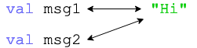

# Đối tượng và thuộc tính của chúng

Đối tượng là những cấu trúc phức tạp có thể lưu trữ một số dữ liệu và thực hiện một số việc.

## Trạng thái và hành vi

Một đối tượng là một phần của bộ nhớ lưu trữ một số loại thông tin. Các biến và giá trị chỉ trỏ đến các đối tượng. Vì vậy, bạn có thể làm việc với các đối tượng với sự trợ giúp của các biến.


Một ví dụ đơn giản về một đối tượng là `String` lưu trữ tin nhắn. Chúng ta hãy xem xét kỹ hơn về nó.

Trước hết, một tin nhắn có **trạng thái**:
nó không chỉ chứa một chuỗi ký hiệu mà còn chứa cả kích thước của chuỗi đó, tức là độ dài của tin nhắn.
Trong Kotlin, thứ cho phép bạn truy cập trạng thái của một đối tượng được gọi là **thuộc tính**.
Một số **hàm** được liên kết với một loại cụ thể.
Điều này làm cho việc sử dụng các đối tượng trở nên hợp lý hơn vì các hàm thể hiện hành vi của các đối tượng đó.
Các hàm này còn được gọi là **hàm thành viên** hoặc **phương thức**.

## Sao chép theo tham chiếu

Trong lập trình, sao chép một cái gì đó là một thao tác rất phổ biến. Chúng tôi sử dụng `=` trong hầu hết các trường hợp.

Nếu bạn tạo một biến và gán một đối tượng cho nó thì một biến khác cũng có thể trỏ đến cùng một đối tượng. 

Trong Kotlin, các quy tắc tương tự cũng được áp dụng. Nếu bạn tạo một biến và gán một đối tượng cho nó, một biến khác cũng có thể trỏ đến cùng một đối tượng



**Nói cách khác, dấu = không sao chép chính đối tượng mà chỉ sao chép một tham chiếu đến đối tượng đó.**

## Khả năng thay đổi

Một đối tượng có thể là mutable hoặc immutable.

Bạn đã biết rằng `Int`, `String`, `Float` và `Double` trong Kotlin là các đối tượng. Nhưng có một sắc thái. Các biến này hoạt động giống như các loại dữ liệu nguyên thủy trong các ngôn ngữ lập trình khác, nhưng đồng thời, **chúng là các đối tượng – nói cách khác là các đối tượng không thể thay đổi.**

## Bình đẳng về cấu trúc và tham chiếu

### So sánh

Khi nào bạn có thể sử dụng toán tử so sánh `==`. 
Ví dụ: print(msg1 == msg2) cho kết quả đúng và `print(msg1 == "Hello")` cho kết quả `false`. 
Các biến msg1 và msg2 có cùng trạng thái, được gọi là **bình đẳng cấu trúc**.

Hãy xem một ví dụ về sao chép một đối tượng **mutable**.

Hãy tạo một đối tượng Box, sao chép nó và thay đổi bản gốc của nó:

```kotlin
val blueBox = Box(3)          // box with 3 balls
val azureBox = blueBox 
println(blueBox == azureBox ) // true, it's a copy
blueBox.addBall()             // add a ball to the first box
println(blueBox == azureBox ) // true, the second box also contains 4 balls
```

### Bình đẳng tham chiếu

Kotlin cung cấp một toán tử đặc biệt === để kiểm tra xem các biến có trỏ đến cùng một đối tượng hay không.

Ví dụ:

```kotlin
    val blueBox = Box(3)
    val azureBox = blueBox 
    val cyanBox = Box(3)
    println(blueBox == azureBox)  // true
    println(blueBox === azureBox) // true, azureBox points to the same object
    println(blueBox == cyanBox)   // true
    println(blueBox === cyanBox)  // false, cyanBox points to another object
``` 

Ngoài ra, bạn có thể kiểm tra bất đẳng thức tham chiếu bằng toán tử `!==` . Ví dụ: `print(blueBox !== cyanBox)` mang lại `true`.

```kotlin
    var two = 2
    var anotherTwo = 2
    println(two === anotherTwo) // true
```

Các biến này trỏ đến cùng một đối tượng! Đừng lo lắng về điều này: như bạn nhớ, bạn không thể thay đổi đối tượng immutable.
vì vậy nếu bạn cố gắng làm điều gì đó với biến đó, nó sẽ trỏ đến một đối tượng mới và các biến khác sẽ vẫn trỏ đến đối tượng cũ.


### Kiểu cơ sở và đẳng thức

```kotlin
var a: Int = 100
val anotherA: Int = a
println(a == anotherA)  // true
println(a === anotherA) // true
a = 200
println(a == anotherA)  // false
println(a === anotherA) // false
```

Như bạn có thể thấy, khi chúng ta thay đổi giá trị của biến `a = 200`, 
chúng ta không thay đổi đối tượng của nó, biến a được gán một tham chiếu mới cho đối tượng với giá trị `200`.

 Bây giờ, hãy xem một ví dụ với các đối tượng có thể sửa đổi:

 ```kotlin
val list1: MutableList<Int> = mutableListOf()
val list2: MutableList<Int> = list1
list1.add(1)
println("list1 $list1") // list1 [1]
println("list2 $list2") // list2 [1]
list2.add(5)
println("list1 $list1") // list1 [1, 5]
println("list2 $list2") // list2 [1, 5]
```

Như bạn có thể thấy trong ví dụ này, các biến `list1` và `list2` đề cập đến cùng một đối tượng. 
**Khi bạn thay đổi đối tượng thông qua biến đầu tiên, chúng tôi sẽ thấy dữ liệu được cập nhật thông qua biến thứ hai.**

## Người truy cập thuộc tính

### Người nhận tài sản

Bạn đã biết cách lấy tên thuộc tính, chỉ cần gõ dấu chấm và tên thuộc tính sau tên đối tượng: `client.name`

nhưng trên thực tế, khi bạn muốn lấy giá trị của một thuộc tính nào đó, bạn gọi một hàm `get()` đặc biệt được gọi là getter. Đây là những gì nó thực sự trông giống như:

```kotlin
class Client {
    val name = "Unknown"
        get() {
            return field
        }
}
```

Khi bạn cố gắng truy xuất một giá trị, bạn sẽ nhận được kết quả của hàm `get()`. Vậy `field` là gì? Mọi thuộc tính trong Kotlin đều có bản sao lưu `field` riêng, chứa giá trị thuộc tính có thể được truy cập bằng từ khóa đặc biệt `field`.

> [!NOTE]
> Trong Kotlin, trường sao lưu là thuộc tính riêng được tạo để lưu trữ giá trị của thuộc tính, cho phép bạn bổ sung thêm quyền kiểm soát đối với hành vi của thuộc tính.

chúng ta có thể sử dụng nó để có giá trị mutable nhằm lưu thông tin và luôn trả về giá trị chỉ đọc.

```kotlin
class IntegerRepository {
    private val _list = mutableListOf<Int>()
    val list: List<Int> get() = _list // backing property
}
```

### Trình thiết lập thuộc tính

Khi bạn muốn đặt giá trị của một số thuộc tính, bạn nên gọi hàm `set()` đặc biệt được gọi là setter. Đây là những gì nó trông giống như:

```kotlin
class Client {
    var name = "Unknown"
        set(value) {
            field = value
        }
}
```

### Tính năng bổ sung

Nếu bạn muốn thêm getter và/hoặc setter vào một thuộc tính trong hàm tạo, chỉ cần "di chuyển" thuộc tính đó ra ngoài.
Hãy nhớ rằng trong trường hợp này, bạn cần sử dụng một biến khác, không phải thuộc tính từ hàm tạo:
Hãy nhớ rằng khi khởi tạo thuộc tính của bạn, trình thiết lập sẽ không được gọi.
Vì vậy, nếu bạn có thuộc tính đặc biệt, vui lòng tự gọi nó trong khối init.
```kotlin
fun increment(count: Int) = count + 1

    class Client(name: String) {
        var name: String = name
            set(value) {
                println("The name is changing. Old value is $field. New value is $value.")
                field = value
            }
    }

fun main() {


    val client = Client("Annie")  // without output
    println(client.name)   // Annie
    client.name = "Tom"           // The name is changing. Old value is Annie. New value is Ann.

}
```

> [!WARNING]
> Bạn không thể sử dụng setter cho các biến val: hàm set() gán lại biến, điều này không thể thực hiện được đối với val