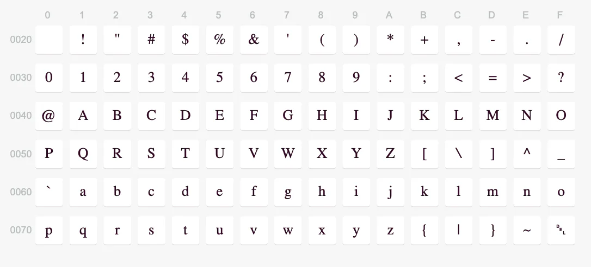
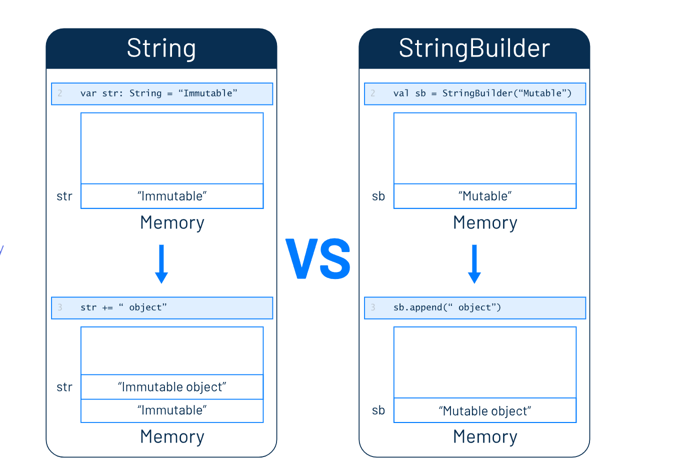
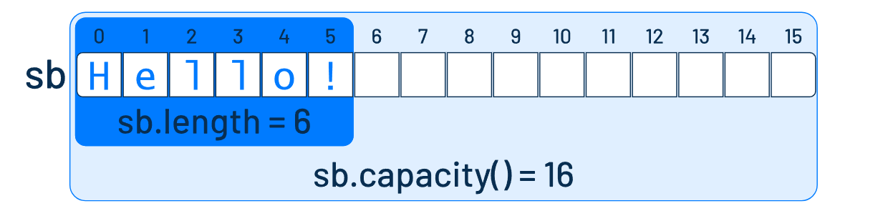

## Sợi dây 

Để viết chuỗi, chúng ta gói các ký tự trong dấu ngoặc kép thay vì dấu ngoặc đơn. Dưới đây là một số ví dụ hợp lệ: "văn bản", "Tôi muốn tìm hiểu Kotlin", "123456", "e-mail@gmail.com". Vì vậy, chuỗi có thể bao gồm các chữ cái, chữ số, khoảng trắng và các ký tự khác.

### Unicode

<details>
  <summary>
    Giải pháp cho tất cả những vấn đề này phải là một hệ thống thống nhất và đó là lúc Unicode xuất hiện.
  </summary>
    Như bạn đã biết, máy tính hoạt động bằng mã nhị phân nên tất nhiên, các loại ký hiệu khác nhau mà chúng ta sử dụng cần phải được chuyển đổi thành số. Với mục đích này, các bảng mã khác nhau đã được tạo ra và triển khai trong nhiều năm.

    Một trong những cách sớm nhất là mã hóa ASCII. Đó là mã hóa 7 bit chứa 128 (2^7) ký hiệu dựa trên bảng chữ cái tiếng Anh. Nó không hoàn hảo cho tất cả mọi người vì nhiều lý do.

    - Đầu tiên, máy tính bắt đầu sử dụng chuỗi 8 bit, byte để lưu trữ thông tin và chuỗi ASCII có thêm bộ nhớ nhưng không được sử dụng.
    - Thứ hai và quan trọng nhất, 128 ký hiệu là không đủ cho tất cả mọi người, ngay cả đối với chính hệ thống chữ viết tiếng Anh

    Rõ ràng có nhu cầu về các mã hóa mới, cải tiến và nhiều mã hóa trong số đó bắt đầu xuất hiện sau ASCII. Có các phần mở rộng của ASCII (như ISO 8859-1) hoặc mã hóa cho các tập lệnh cụ thể (ví dụ: Windows-1251 cho Cyrillic). Tuy nhiên, trong các bảng mã khác nhau, cùng một số có thể biểu thị các ký hiệu khác nhau và điều đó sẽ làm phức tạp việc liên lạc. 
</details>

Unicode là một tiêu chuẩn để mã hóa và biểu diễn văn bản. Nó không phải là một mã hóa vì nó không xác định cách các ký hiệu được chuyển đổi thành byte. **Nó chỉ đơn giản là một thông số kỹ thuật xác định ánh xạ giữa các ký hiệu và số.**

Unicode cũng có thể được xem như một phần mở rộng của bảng `ASCII`: trên thực tế, 128 số đầu tiên trong Unicode biểu thị các ký hiệu ASCII. Nhìn chung, Unicode có thể chứa 1.112.064 điểm mã, nhưng tính đến tháng 5 năm 2019, chỉ có 137.994 điểm được sử dụng. Thực tế là hầu hết các điểm mã chưa được chỉ định cũng là một trong những lợi thế của Unicode. Điều đó có nghĩa là trong nhiều năm tới, chúng ta có thể thêm các chữ cái, chữ viết, dấu chấm câu và chữ tượng hình mới vào tiêu chuẩn mà không bị hết dung lượng.

Unicode bao gồm hai phần: **Bộ ký tự chung**(UCS) và **Định dạng chuyển đổi chung** (UTF).

UCS về cơ bản là chỉ mục của tất cả các ký hiệu được Unicode hỗ trợ và mã cho các ký hiệu đó. Đây là một phần của tiếng Latin cơ bản, các ký hiệu đã đi từ ASCII:

Trong Unicode, mỗi ký hiệu tương ứng với một số—**điểm mã**. Một điểm mã thường được trình bày với `U+` theo sau là giá trị thập lục phân của nó. 
Số thập lục phân trong mã có từ 4 đến 6 chữ số tùy thuộc vào vị trí của nó trong tiêu chuẩn. Ví dụ: mã cho Chữ in hoa Latinh Q là `U+0051`.


Các điểm mã Unicode được chia thành 17 mặt phẳng có số từ 0 đến 16. Mỗi mặt phẳng là một nhóm liên tục gồm 65 536 (2^16) điểm mã. Mặt phẳng có số 0 được gọi là **Mặt phẳng đa ngôn ngữ cơ bản** (BMP) và nó chứa các ký tự cho hầu hết các hệ thống chữ viết và ngôn ngữ hiện đại cũng như nhiều ký hiệu. Phần ASCII của BMP bao gồm 128 ký tự đầu tiên, từ `U+0000` đến `U+007F`.

> [!NOTE]
> Các mặt phẳng còn lại (1 đến 16) được gọi là "mặt phẳng bổ sung". 
> Hầu hết các mặt phẳng bổ sung đều chưa được chỉ định và trống để có chỗ cho các bổ sung.

**Mặt phẳng đa ngôn ngữ bổ sung** (SMP) (mã từ `U+10000` đến `U+1FFFF`) là mặt phẳng tiếp theo sau BMP. Nó bao gồm nhiều chữ viết lịch sử và điều khá thú vị là các ký tự và biểu tượng đặc biệt.

> [!TIP]
> SMP có các ký hiệu âm nhạc, ký hiệu giả kim, hình dạng hình học và thậm chí cả biểu tượng cảm xúc! Nếu programming language yêu thích của bạn hỗ trợ chuỗi Unicode, rất có thể bạn có thể đặt biểu tượng cảm xúc hoặc các ký tự thú vị khác vào chuỗi của mình!

### Triển khai Unicode

Chúng tôi đã đề cập rằng cùng với UCS, Unicode có **UTF — Định dạng chuyển đổi phổ quát**.
UTF là bộ mã hóa hỗ trợ Unicode. Mã hóa mô tả cách các ký hiệu (hay nói đúng hơn là các điểm mã của chúng) được chuyển đổi thành byte theo một bộ ký tự cụ thể và ngược lại.

UTF-8 là mã hóa được sử dụng phổ biến nhất trên thế giới vì khoảng 94% Internet được mã hóa theo UTF-8. UTF-8 sử dụng từ 1 đến 4 byte cho mỗi điểm mã và có khả năng biểu diễn tất cả các điểm mã của Unicode. UTF-8 cũng tương thích ngược với ASCII.

>[!NOTE]
> UCS Xác định bộ ký tự Unicode, 
> trong khi UTF đề cập đến các phương pháp mã hóa và lưu trữ các ký tự đó trong bộ nhớ hoặc qua mạng

## Lấy chuỗi con

> [!WARNING]
> Đừng quên rằng chuỗi là immutable, do đó, các hàm thay đổi chuỗi sẽ trả về một chuỗi mới.

Thông thường, bạn chỉ cần lấy một phần nhất định của chuỗi. Kotlin cung cấp chức năng `substring` cho việc này.

Hàm `substring` chấp nhận `startIndex` và `lastIndex` làm đối số và trả về một chuỗi bắt đầu tại `startIndex` và kết thúc ngay **trước** `lastIndex`.

Tham số `lastIndex` có thể được bỏ qua; sau đó bạn sẽ nhận được `substring` từ phần tử `startIndex` đến cuối chuỗi gốc.

```kotlin
val greeting = "Hello"
println(greeting.substring(0, 3)) // "Hel"
println(greeting.substring(1, 3)) // "el"
println(greeting.substring(2))    // "llo"
println(greeting.substring(4, 5)) // "o"
```
Phương thức `substring` không phải là cách duy nhất để lấy một phần của chuỗi. Bạn cũng có thể sử dụng các hàm `substringAfter` và `substringBefore`:

>[!NOTE]
> Hầu hết các hàm trong chủ đề này không chỉ chấp nhận các ký tự mà còn cả chuỗi làm đối số.
Hàm chấp nhận đối số thứ hai. 
Chỉ cần lưu ý rằng với tư cách là đối số thứ hai, bạn có thể chỉ định thông báo sẽ được trả về nếu đối số `delimiter` không có trong chuỗi. 
Ví dụ: .`substringBefore('z', "can't find a character")`.

Các hàm `substringBeforeLast` và `substringAfterLast` có logic tương tự như `substringBefore` và `substringAfter` nhưng trả về một chuỗi trước hoặc sau lần xuất hiện cuối cùng của `delimiter`.

## Thay thế các phần của chuỗi

Hàm `replace` **thay thế tất cả** lần xuất hiện của đối số đầu tiên trong chuỗi bằng đối số thứ hai.
Nếu bạn chỉ cần thay thế **lần xuất hiện đầu tiên** của một đối số, hãy sử dụng `replaceFirst`.

## Thay đổi trường hợp

trong Kotlin bạn có thể sử dụng chức năng `lowercase`:

```kotlin
val example = "UPPERCASE String"
println(example.lowercase()) // uppercase string
```
Nếu bạn cần làm ngược lại, hãy sử dụng hàm `uppercase`:

```kotlin
val example = "Lowercase String"
println(example.uppercase()) // LOWERCASE STRING
```

## Tách chuỗi

Một chuỗi có thể được phân tách bằng dấu phân cách thành danh sách các chuỗi. Để thực hiện việc này, hãy gọi phương thức `split()` , nó chia một chuỗi thành các chuỗi con bằng **dấu phân cách**.
Phương thức trả về `List` của tất cả các chuỗi con. 

```kotlin
val sentence = "a long text"
val wordsList: List<String> = sentence.split(" ") // ["a", "long", "text"]
```


## Trình tạo chuỗi

### Chuỗi Mutable

Trong các đối tượng Kotlin, `String` là immutable, nghĩa là một khi đã được tạo thì chúng không thể thay đổi được. 

> [!CAUTION]
> Mỗi khi chúng tôi thực hiện các thao tác như ghép nối bằng toán tử `+` hoặc hàm `plus()`, 
> một đối tượng chuỗi mới được tạo, điều này có thể dẫn đến việc phân bổ bộ nhớ không cần thiết và tiêu tốn hiệu năng.

Để giải quyết những thách thức này, Kotlin có một lớp đặc biệt có tên `StringBuilder` đại diện cho **chuỗi ký tự **mutable**.

Nó có thể được sử dụng để thực hiện hiệu quả nhiều thao tác thao tác chuỗi, cho phép bạn sửa đổi nội dung của nó mà không cần tạo đối tượng mới. Điều này có thể giúp giảm chi phí bộ nhớ và cải thiện hiệu suất.




> [!CAUTION]
> Đừng nhầm lẫn tính bất biến với việc sử dụng val hoặc var khi khai báo biến. Tính bất biến đề cập đến một số loại dữ liệu nhất định không thể thay đổi trong bộ nhớ khi chúng đã được tạo. Mặt khác, val hoặc var xác định xem một biến có thể được gán lại hay không.


### Trình xây dựng của StringBuilder

Có hai cách chính để xây dựng đối tượng `StringBuilder` trong Kotlin:

1. Sử dụng hàm tạo `StringBuilder`

```kotlin

val sb = StringBuilder()

val sb1 = StringBuilder("Kotlin")
val sb2 = StringBuilder(sb1)

val sb3 = StringBuilder(100)
```

2. Sử dụng chức năng `buildString`

```kotlin
val str = buildString {
    append("Hello")
    append(' ')
    append("Kotlin")
}
println(str) // Output: Hello Kotlin


val str1 = buildString(100) {
    // some code here
}
```

> [!CAUTION]
> Điều quan trọng cần lưu ý là hàm buildString trả về một Chuỗi chứ không phải StringBuilder.

### Các phương thức của StringBuilder

- Phương thức `append`: cho phép bạn thêm ký tự hoặc chuỗi vào cuối `StringBuilder`. Phương thức này bị quá tải để chấp nhận các loại đối số khác nhau.

```kotlin
val str = buildString {
    append("Kotlin v") // Appending a String
    append(1.8)        // Appending a Double
}
println(str) // Output: Kotlin v1.8
```

- Phương thức `insert`: cho phép bạn chèn ký tự hoặc chuỗi vào một vị trí cụ thể trong `StringBuilder`. Phương thức này cũng bị quá tải để chấp nhận các loại đối số khác nhau.

```kotlin
val str = buildString {
    append("Hello World")
    insert(5, ",")
}
println(str) // Output: Hello, World
```

- Phương thức `delete`: cho phép bạn xóa các ký tự hoặc chuỗi khỏi một phạm vi cụ thể trong `StringBuilder`. Phương thức này nhận hai đối số: chỉ mục bắt đầu (được bao gồm) và chỉ mục kết thúc (bị loại trừ) của phạm vi cần xóa.

```kotlin
val str = buildString {
    append("That's impossible!")
    delete(7, 9)
}
println(str) // Output: That's possible!
```

- Phương thức `replace`: cho phép bạn thay thế các ký tự hoặc chuỗi trong một phạm vi cụ thể trong `StringBuilder`. Phương thức này lấy ba đối số: chỉ mục bắt đầu (được bao gồm), chỉ mục cuối của dải ô cần thay thế (bị loại trừ) và chuỗi cần thay thế.

```kotlin
val str = buildString {
    append("one, two, two, ...")
    replace(10, 13, "three")
}
println(str) // Output: one, two, three, ...
```

- Phương pháp `reverse`: cho phép đảo ngược các ký tự trong `StringBuilder`. Phương thức này không có đối số và đảo ngược toàn bộ chuỗi ký tự.

```kotlin
val str = buildString {
    append("Hello, Kotlin!")
    reverse()
}
println(str) // Output: !niltoK ,olleH
```

### Chiều dài so với dung lượng

Lớp `StringBuilder` có hai thành viên quan trọng: `length` và `capacity()`. Thuộc tính **length** biểu thị số ký tự mà đối tượng `StringBuilder` chứa, trong khi phương thức **capacity** trả về số ký tự mà nó có thể giữ trước khi cần thay đổi kích thước.

```kotlin
val sb = StringBuilder()
println("Length: ${sb.length}, Capacity: ${sb.capacity()}") // Output: Length: 0, Capacity: 16
sb.append("Hello!")
println("Length: ${sb.length}, Capacity: ${sb.capacity()}") // Output: Length: 6, Capacity: 16
```



Khi bạn tạo `StringBuilder` mới, **dung lượng** ban đầu của nó được xác định bởi hàm tạo mà bạn sử dụng. Nếu bạn sử dụng hàm tạo mặc định, dung lượng ban đầu sẽ là các ký tự `16`. Nếu bạn truyền một chuỗi khi xây dựng `StringBuilder`, nó sẽ thêm độ dài của chuỗi đó vào dung lượng ban đầu.

Khi bạn thêm các ký tự mới vào `StringBuilder`, `length` của nó sẽ tăng lên. Nếu `length` vượt quá `capacity` hiện tại thì `StringBuilder` **tự động tăng** `capacity` của nó để chứa các ký tự bổ sung.

Công suất mới được tính theo công thức sau: `newCapacity = max(oldCapacity * 2 + 2, newLength)`.

Ví dụ minh họa dung lượng của `StringBuilder` được tạo bằng hàm tạo mặc định như thế nào:

```kotlin
val sb = StringBuilder()              // Capacity = initial capacity = 16
println("Capacity: ${sb.capacity()}") // Output: Capacity: 16

sb.append("0123456789abcdef")         // (oldCapacity >= newLength) then: newCapacity = oldCapacity
println("Capacity: ${sb.capacity()}") // Output: Capacity: 16

sb.append('g')                        // // (oldCapacity < newLength) then: newCapacity = max(oldCapacity * 2 + 2, newLength) = oldCapacity * 2 + 2
println("Capacity: ${sb.capacity()}") // Output: Capacity: 34
```

Ví dụ với `StringBuilder` được tạo bằng cách chuyển một chuỗi tới hàm tạo của nó:

```kotlin
val sb = StringBuilder("Kotlin!")   // Capacity = initial capacity + "Kotlin!".length = 16 + 7
println("Capacity: ${sb.capacity()}")   // Output: Capacity: 23

sb.append("0123456789abcdef")           // (oldCapacity >= newLength) then: newCapacity = oldCapacity
println("Capacity: ${sb.capacity()}")   // Output: Capacity: 23

sb.append("0123456789abcdef0123456789abcdef") // (oldCapacity < newLength) then: newCapacity = max(oldCapacity * 2 + 2, newLength) = newLength
println("Capacity: ${sb.capacity()}, Length: ${sb.length}") // Output: Capacity: 55
```

### Các phương pháp hay nhất

Dưới đây là một số phương pháp hay nhất để sử dụng lớp `StringBuilder`:

1. Sử dụng `StringBuilder` cho các tác vụ thao tác chuỗi **phức tạp**.
2. **Phân bổ trước** dung lượng của `StringBuilder`. Nếu biết kích thước gần đúng của chuỗi cuối cùng, bạn có thể phân bổ trước dung lượng của `StringBuilder` để giảm số lần cần thay đổi kích thước. Điều này có thể giúp cải thiện hiệu suất bằng cách giảm số lượng phân bổ bộ nhớ.

3. **Tái sử dụng** đối tượng `StringBuilder` tương tự. Nếu bạn cần thực hiện nhiều thao tác thao tác chuỗi, hãy xem xét việc sử dụng lại cùng một đối tượng `StringBuilder` thay vì tạo một đối tượng mới mỗi lần. Điều này có thể giúp giảm chi phí bộ nhớ và cải thiện hiệu suất. Để làm điều đó, bạn có thể đặt lại `StringBuilder` về trạng thái trống bằng cách gọi phương thức `setLength` của nó với đối số là `0`. Thao tác này sẽ xóa nội dung của `StringBuilder` mà không thay đổi dung lượng của nó, cho phép bạn sử dụng lại nội dung đó cho các thao tác thao tác chuỗi tiếp theo. 

```kotlin
val sb = StringBuilder()
sb.append("Java")
println(sb.toString()) // Output: Java
sb.setLength(0)
sb.append("Kotlin")
println(sb.toString()) // Output: Kotlin
```

4. **Chuyển đổi** `StringBuilder` thành `String` khi hoàn tất. Khi bạn đã hoàn tất thao tác với `StringBuilder`, bạn có thể muốn chuyển đổi nó thành Chuỗi. Điều này có thể được thực hiện dễ dàng bằng cách gọi phương thức toString trên đối tượng `StringBuilder`. Hãy nhớ rằng việc gọi phương thức này sẽ tạo ra một đối tượng `String` mới, vì vậy nếu bạn cần thực hiện thêm các thao tác thao tác chuỗi, việc tiếp tục sử dụng `StringBuilder` có thể hiệu quả hơn.


Ngoài ra, đây là một số phương pháp hay nhất để sử dụng hàm `buildString`:

1. Sử dụng `buildString` để xây dựng chuỗi **đơn giản**.
2. **Tránh** tạo đối tượng không cần thiết.
3. **Tận dụng** phạm vi của lambda. Hàm buildString lấy lambda làm đối số, cung cấp phạm vi thuận tiện để xây dựng chuỗi. Hãy tận dụng phạm vi này bằng cách khai báo các biến và hàm cục bộ có thể giúp đơn giản hóa mã của bạn.


## toString()

### Hành vi mặc định

Hàm `toString()` được xác định cho loại `Any?`. Điều này có nghĩa là tất cả các lớp kế thừa tất cả các phương thức `Any?`, bao gồm `toString()`.

Vấn đề là `toString()` cho `Any?` trả về **tên lớp và vị trí bộ nhớ** dưới dạng một chuỗi. Đối với một số lớp, hành vi mặc định được điều chỉnh để xử lý chính xác. Ví dụ: lấy `Int` hoặc `Double`.

### Ghi đè toString()

Có vẻ như vấn đề của chúng tôi có thể được giải quyết bằng cách xác định lại phương pháp `toString()`. `toString()` được xác định tự động cho tất cả các lớp bạn tạo và bạn có thể ghi đè nó cho bất kỳ lớp nào

### Ghi đè toString(): Inheritance

Một lý do khác để ghi đè phương thức the` toString()` là làm việc với siêu lớp hoặc lớp cha. Ở đây, các quy tắc chung của inheritance cũng được áp dụng. Nếu phương thức `toString()` được xác định trong lớp cha, thì lớp dẫn xuất sẽ sử dụng ghi đè cụ thể này.

### Sử dụng định nghĩa siêu lớp

Có thể cần phải gọi triển khai cha `toString()` trong lớp con. Nó có thể được thực hiện với `super`, như bạn nhớ từ inheritance:

```kotlin
class Author(id: Int, login: String, email: String, val books: String): User(id, login, email) {
        override fun toString(): String {
            return "Author: ${super.toString()};\nBooks: $books"
    	}
}
```

## Định dạng chuỗi

Trong Kotlin, phương thức `String.format()` trả về một chuỗi được định dạng bằng chuỗi định dạng và một số đối số. Chuỗi định dạng xác định cách các đối số tạo thành chuỗi kết quả. Ví dụ: hãy tạo một chuỗi và in nó:

```kotlin
val string = String.format("%s %s", "Hello", "World")
println(string)
//Hello World
```

Một cú pháp thay thế có cùng kết quả là:

```kotlin
val string = "%s %s".format("Hello", "World")
println(string)
//Hello World
```

Để in tất cả các ký tự chuỗi ở dạng chữ hoa, chúng ta có thể sử dụng trình xác định định dạng `%S`

> [!CAUTION]
> Trong trường hợp cú pháp của chuỗi định dạng không chính xác, IllegalFormatException sẽ được đưa ra.

Bạn có thể thay đổi thứ tự bằng cách sử dụng các tham số cho nó: `%n\$s`, trong đó `n` biểu thị số lượng tham số mà chúng ta muốn chèn vào Chuỗi kết quả và `s` là tham số thuộc loại `String`.

```kotlin
val str1 = "Kotlin"
val str2 = "the best language"
    
// %s is used to represent the String value,
// %1 is used to represent first argument
// %2 is used to represent second argument
var str = String.format("%1\$s is %2\$s", str1, str2)
println(str) // // Kotlin is the best language
    
// you can change the order of arguments
str = String.format("%2\$s is %1\$s", str1, str2)
println(str) // the best language is Kotlin
```

có một số chỉ định đặc biệt. Do đó, `%%` chèn ký hiệu `%`, trong khi `%n` chèn một dòng mới.

Lưu ý rằng `%n` có thể được hiểu là `\r\n` hoặc `\n`, tùy thuộc vào nền tảng. 

### Định dạng số nguyên

Công cụ xác định định dạng chính cho số nguyên (`Int`), bao gồm `Long`, `Short`, `Byte` và `BigInteger`, là `%d`

- **%0Nd**: Các số 0 đứng đầu điền vào chiều rộng được chỉ định.
- **%,d**: Ước số hàng nghìn.
- **%+d**: Số luôn có dấu, kể cả số dương.
- **% d**: Đối với số dương, chèn một khoảng trắng ở đầu.
- **%(d** : Đặt số âm trong ngoặc đơn, không có dấu trừ.
Lưu ý rằng `-` không tương thích với `0`.


```kotlin
val int1 = 1234
val int2 = -4567

println(String.format("%d", int1))       //1234
println(String.format("%8d", int1))      //    1234
println(String.format("%-8d", int1))     //1234  
println(String.format("%+d", int1))      //+1234

println(String.format("%+d", int2))      //-4567
println(String.format("%09d", int1))     //000001234
println(String.format("%,10d", int1))    //     1,234
println(String.format("%+,010d", int1))  //+00001,234

println(String.format("%-+,10d", int1))  //+1,234  
println(String.format("% d", int1))      // 1234
println(String.format("% d", int2))      //-4567
println(String.format("%(d", int2))      //(4567)
```

### Định dạng số dấu phẩy động

Để biểu diễn số thập phân thông thường, chúng tôi sử dụng `%f`.

```kotlin
val double1 = 1234.5678
val double2 = -1234.5678

println(String.format("%f", double1))      //1234.567800
println(String.format("%f", double2))      //-1234.567800
println(String.format("% f", double1))     // 1234.567800
println(String.format("% f", double2))     //-1234.567800

println(String.format("%(f", double1))     //1234.567800
println(String.format("%(f", double2))     //(1234.567800)
println(String.format("%+f", double1))     //+1234.567800
println(String.format("%,f", double1))     //1,234.567800

println(String.format("%-15f", double1))   //1234.567800    
println(String.format("%015f", double1))   //00001234.567800
println(String.format("%15.2f", double1))  //        1234.57
println(String.format("%.3f", double1))    //1234.568
println(String.format("%.6f", double1))    //1234.567800
```

