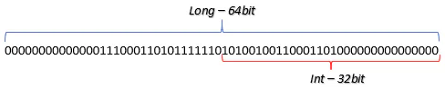
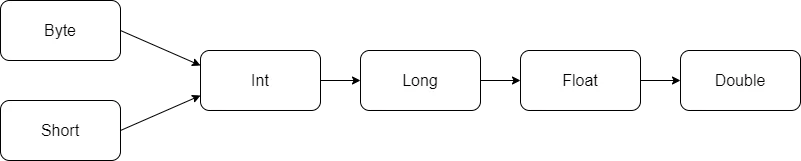

## Chuyển đổi loại

Chuyển đổi loại hoặc type casting, liên quan đến việc chuyển đổi một giá trị từ loại dữ liệu này sang loại dữ liệu khác.
Điều này đặc biệt quan trọng trong Kotlin vì đây là ngôn ngữ được gõ tĩnh, biểu thị rằng các loại được xác định và áp dụng nghiêm ngặt tại thời gian biên dịch.

### Chuyển đổi giữa các kiểu số

Ba loại số phổ biến nhất là: `Int`, `Long` và `Double`. Đôi khi, bạn có thể cần gán giá trị của một kiểu số này cho một biến có kiểu số khác. Trong trường hợp này, bạn cần thực hiện **chuyển đổi loại** bằng cách gọi một hàm đặc biệt, ví dụ: `toInt()`, `toLong()`, `toDouble()`, v.v.

>[!CAUTION]
> Hãy nhớ rằng bạn cần thực hiện các thao tác này khi loại đích lớn hơn loại nguồn

### Chuyển đổi sang loại Short và Byte

Như bạn đã biết, loại `Short` và `Byte` thực sự rất nhỏ. 
Những loại này hiếm khi được sử dụng và nếu bạn cần lưu trữ số nguyên, bạn nên sử dụng `Int`.
Để chuyển đổi thứ gì đó sang loại này Bạn cần chuyển đổi `Double` hoặc `Float` thành `Int` và sau đó chuyển đổi kết quả thành `Short` hoặc `Byte`:

```kotlin
val floatNumber = 10f
val doubleNumber = 1.0

val shortNumber = floatNumber.toShort() // avoid this
val byteNumber = doubleNumber.toByte()  // avoid this

val shortNumber = floatNumber.toInt().toShort() // correct way
val byteNumber = doubleNumber.toInt().toByte()  // correct way
```

### Chuyển đổi chuỗi

Đôi khi bạn cần lấy một chuỗi biểu diễn một giá trị thuộc loại khác. Kotlin cung cấp chức năng `toString()` cho việc đó.
Một chuỗi có thể được chuyển đổi thành số hoặc thậm chí thành giá trị boolean **nhưng không được chuyển đổi thành một ký tự đơn.**

Tuy nhiên, nếu bạn chuyển đổi một chuỗi thành giá trị boolean thì sẽ không có lỗi xảy ra. Nếu chuỗi là `"true"` (không phân biệt chữ hoa chữ thường), nó sẽ tạo ra giá trị boolean `true`, nếu không thì sẽ tạo ra giá trị `false`.

### Sự cố khi chuyển đổi loại

Ví dụ: nếu bạn có giá trị thuộc loại động, giá trị `Double`, bạn có thể chuyển đổi nó thành giá trị của loại số nguyên, chẳng hạn như `Int` hoặc `Long`, phần phân số sẽ bị loại bỏ. 
Hãy cẩn thận với việc chuyển đổi này!

```kotlin
val d: Double = 12.5
val n: Long = d.toLong() // 12
```

Một vấn đề khác có thể xảy ra khi bạn muốn chuyển đổi một số từ loại lớn hơn sang loại nhỏ hơn ( `Long` hoặc `Double` sang `Int`) bằng cách sử dụng các chức năng được đề cập ở trên:

```kotlin
// If the values are quite small, it works fine
val d: Double = 10.2
val n: Long = 15

val res1: Int = d.toInt() // 10
val res2: Int = n.toInt() // 15
// However, this conversion may truncate the value, as Long and Double can store numbers larger than the truncated Int number.
// The same problem may occur if you try to convert Int to Short or Byte. 
val bigNum: Long = 1_000_000_000_000_000

val n: Int = bigNum.toInt() // -1530494976
```

**Vấn đề này được gọi là tràn loại.**


Trong ví dụ này, chúng tôi đã thử đặt biến Long trong Int. Một sự cắt xảy ra, các bit thấp hơn của số vẫn còn và các bit cao hơn bị mất, kết quả lại không thể đoán trước được. Hãy xem điều này xảy ra như thế nào:



**Điều quan trọng cần nhớ là những điểm sau:**
- Lỗi tràn kiểu dữ liệu là lỗi của lập trình viên.
- Hành vi của chương trình trong trường hợp tràn kiểu dữ liệu là không thể đoán trước được.
- compiler sẽ không cảnh báo bạn về tình trạng tràn loại nên bạn cần phải chọn đúng kiểu dữ liệu cho các biến, cũng như theo dõi cẩn thận quá trình chuyển đổi kiểu dữ liệu.

Vì vậy, nếu bạn muốn chuyển đổi một giá trị loại lớn hơn thành một giá trị loại nhỏ hơn, hãy đảm bảo rằng việc cắt bớt sẽ không làm rối chương trình của bạn.


### Khi các loại khác nhau gặp nhau: gõ ép buộc

Điều gì xảy ra nếu chúng ta tính tổng của biến Int và Long? 

Trong những trường hợp như vậy, **compiler tự động đặt tất cả các thành phần (được gọi là ép buộc kiểu) và loại kết quả thành loại rộng nhất trong biểu thức**
Ví dụ:
```kotlin
val num: Int = 100
val longNum: Long = 1000
val result = num + longNum // 1100, Long
```

Tuy nhiên, các loại `Byte` và `Short` không bình thường về mặt này.
Nếu bạn cần thực hiện một số phép tính với các loại này, kết quả của phép tính là `Int` Hình dưới đây minh họa hướng của quá trình truyền này:



`Byte` và `Byte`, `Short` và `Short`, `Short` và `Byte`.

Vậy chúng ta nên làm gì nếu muốn tính tổng hai biến `Byte` và nhận được kết quả `Byte`? Chà, trong trường hợp này, bạn phải thực hiện chuyển đổi loại theo cách thủ công:

```kotlin
val one: Byte = 1
val five: Byte = 5
val six = (one + five).toByte() // 6, Byte
```