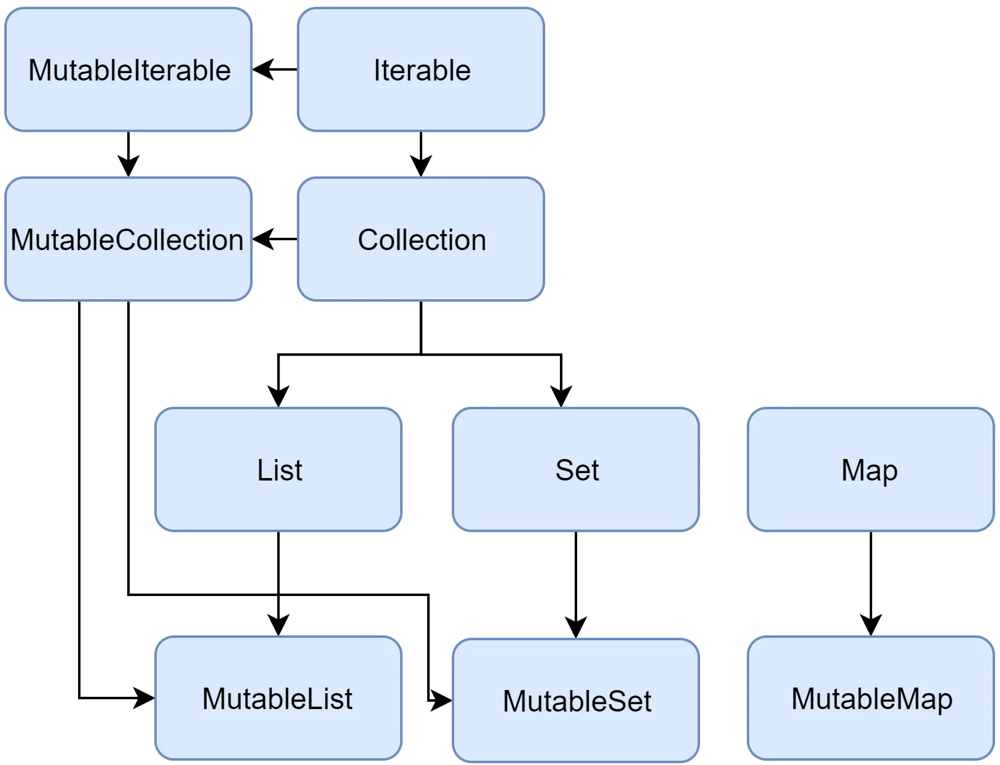

#Giới thiệu về bộ sưu tập

   Bộ sưu tập là **vùng chứa** hỗ trợ nhiều cách khác nhau để lưu trữ và sắp xếp các đối tượng khác nhau, đồng thời giúp chúng dễ dàng truy cập. collection thường chứa một số đối tượng (con số này có thể bằng 0) cùng loại. Các đối tượng trong collection được gọi là **phần tử** hoặc **mục**. 
Bộ sưu tập là việc triển khai các cấu trúc dữ liệu trừu tượng có thể hỗ trợ các hoạt động sau:

- lấy một phần tử;

- loại bỏ một phần tử;

- thay đổi hoặc thay thế một phần tử;

- thêm một yếu tố mới.


Tuy nhiên, điều quan trọng cần lưu ý là các thao tác như thêm, xóa và thay đổi các phần tử chỉ áp dụng cho các bộ sưu tập **mutable**.


## Khả năng thay đổi

Bộ sưu tập có thể là **mutable** hoặc **immutable**.

Không thể thay đổi bộ sưu tập Immutable. Tức là họ chỉ cho phép những thao tác không làm thay đổi các phần tử.
Tính bất biến có thể hữu ích khi bạn muốn lưu trữ các mục cùng nhau mà không cho phép chúng được sửa đổi trong tương lai.

Thư viện chuẩn Kotlin cung cấp cách triển khai cho các loại bộ sưu tập cơ bản: **list**, **set** và **map**. 
Cả ba đều tồn tại ở dạng mutable và immutable.


## Bản đồ collection

`Map` **là immutable collection chứa các cặp đối tượng** (**khóa** và **giá trị**) và hỗ trợ truy xuất hiệu quả các giá trị tương ứng với từng khóa. Như bạn nhớ, 

> [!TIP]
> immutable ngụ ý rằng kích thước và nội dung của collection không thể thay đổi sau khi được khởi tạo.

Điều quan trọng cần nhớ là các khóa `Map` là duy nhất: nói cách khác, `Map` chỉ có thể giữ một giá trị cho mỗi khóa riêng lẻ, cả khóa và giá trị đều không thể thay đổi sau khi khởi tạo, nhưng trong `MutableMap`, các giá trị có thể được cập nhật

## Kiểm tra vị từ: kiểm tra các phần tử trong collection

**vị ngữ** là hàm trả về `true` hoặc `false` dựa trên đầu vào.

> [!TIP]
> Một vị từ duy nhất luôn kiểm tra cùng một điều kiện; các điều kiện khác nhau được kiểm tra bởi các vị từ khác nhau.


Vị từ được xác định dựa trên hàm lambda: `(T) -> Boolean`. Ngoài ra, một vị từ có thể được chuyển dưới dạng tham chiếu hàm

```kotlin
val isEven: (Int) -> Boolean = { x -> x % 2 == 0 }

fun main() {
    val numbers = listOf(1, 2, 3, 4, 5, 6, 7, 8, 9, 10)

    // any number is even?
    println(numbers.any { x -> x % 2 == 0 }) // true
    println(numbers.any { isEven(it) }) // true
    println(numbers.any(isEven)) // true
}
```

### Bất kì

Với một vị từ, hàm `any()` sẽ trả về `true` nếu ít nhất một phần tử collection khớp với vị từ mà chúng ta đã xác định trong `any()`. 

> [!TIP]
> Hàm này cũng có thể được gọi mà không cần vị ngữ để kiểm tra tính trống rỗng.

### Không có

Với một vị từ, hàm `none()` sẽ trả về true nếu không có phần tử collection nào khớp với vị từ được chỉ định trong `none()`. Giống như `any()`,

> [!TIP]
> Điều này cũng có thể được gọi mà không cần vị ngữ để kiểm tra tính trống rỗng.

### Tất cả

Hàm `all()` sẽ chỉ trả về true nếu tất cả các phần tử trong collection thỏa mãn vị từ đã cho. 

> [!TIP]
> Điểm đặc biệt của chức năng này là nó sẽ luôn trả về true trên collection trống; Đặc điểm này còn được gọi là sự thật trống rỗng trong toán học.

## Thứ tự các phần tử trong collection

### Sắp xếp đối tượng

Trong Kotlin, chúng ta có hai hàm: `sorted()` và `sortedDescending()` để sắp xếp các phần tử của collection một cách tự nhiên

```kotlin
    val numbers = listOf(3, 5, 6, 4, 1, 8, 2, 7)
    println(numbers.sorted()) // [1, 2, 3, 4, 5, 6, 7, 8]
    println(numbers.sortedDescending()) // [8, 7, 6, 5, 4, 3, 2, 1]
```

### Đảo ngược thứ tự

Chúng ta có thể lấy collection theo thứ tự ngược lại (dựa trên các vị trí chỉ mục) bằng cách sử dụng hai hàm: `reversed()` và `asReversed()`

- Hàm `reversed()` trả về bản sao của collection gốc theo thứ tự chỉ mục ngược. Nếu bạn thay đổi collection gốc thì những thay đổi đó sẽ không ảnh hưởng đến bản sao.

> [!NOTE]
> Hãy nhớ trong ASCII hoặc UTF-8, các chữ in hoa được gán mã số thấp hơn các chữ cái viết thường tương ứng. Vì vậy, các chữ cái viết hoa đứng trước các chữ cái viết thường khi được sắp xếp theo mã thập phân của chúng.

Bán tại:
```kotlin
val numbers = mutableListOf(3, 5, 6, 4, 1, 8, 2, 7)
    val reversedNumbers = numbers.reversed()
    
    println(numbers) // [3, 5, 6, 4, 1, 8, 2, 7]
    println(reversedNumbers) // [7, 2, 8, 1, 4, 6, 5, 3]

    val words = listOf("racecar", "mom", "dad", "abracadabra", "MANDRAKE")
    val wordsReversed = words.reversed()
    
    println(words) // [racecar, mom, dad, abracadabra, MANDRAKE]
    println(wordsReversed) // [MANDRAKE, abracadabra, dad, mom, racecar]
```
- Phương thức `asReversed()` trả về tham chiếu đến collection ban đầu theo thứ tự chỉ mục ngược. Nó nhẹ hơn vì nó không tạo ra bản sao mới, nhưng nếu collection ban đầu thay đổi, những thay đổi đó sẽ được phản ánh trong danh sách đảo ngược. **Vì vậy, chúng ta phải cẩn thận nếu làm việc với các bộ sưu tập mutable.**

Bán tại:
```kotlin
fun main() {
    val numbers = mutableListOf(3, 5, 6, 4, 1, 8, 2, 7)
    val numbersAsReversed = numbers.asReversed()
    
    println(numbers) // [3, 5, 6, 4, 1, 8, 2, 7]
    println(numbersAsReversed) // [7, 2, 8, 1, 4, 6, 5, 3]
    
    numbers.add(9)
    
    println(numbers) // [3, 5, 6, 4, 1, 8, 2, 7, 9]
    println(numbersAsReversed) // [9, 7, 2, 8, 1, 4, 6, 5, 3]

    val words = listOf("racecar", "mom", "dad", "abracadabra", "MANDRAKE")
    val wordsAsReversed = words.asReversed()
    println(words) // [racecar, mom, dad, abracadabra, MANDRAKE]
    println(wordsAsReversed) // [MANDRAKE, abracadabra, dad, mom, racecar]
}
```

### Thứ tự ngẫu nhiên

Phương pháp `shuffled()` cung cấp cho bạn collection mới trong đó các mục gốc được xáo trộn ngẫu nhiên. Bạn có thể sử dụng nó mà không cần đối số hoặc sử dụng phiên bản Random làm nguồn của tính ngẫu nhiên.
Bán tại:

```kotlin
fun main() {
    val numbers = mutableListOf(3, 5, 6, 4, 1, 8, 2, 7)
    val shuffledNumbers = numbers.shuffled()

    println(numbers) // [3, 5, 6, 4, 1, 8, 2, 7]
    println(shuffledNumbers) // [5, 3, 6, 7, 1, 8, 2, 4]
    
    val words = listOf("racecar", "mom", "dad", "abracadabra", "MANDRAKE")
    val shuffledWords = words.shuffled(Random(1))

    println(words) // [racecar, mom, dad, abracadabra, MANDRAKE]
    println(shuffledWords) // [MANDRAKE, abracadabra, mom, dad, racecar]
}
```

### Thứ tự tùy chỉnh

Để thực hiện sắp xếp tùy chỉnh các phần tử trong collection và sắp xếp các phần tử thuộc bất kỳ loại nào theo cách bạn muốn, Kotlin cung cấp các chức năng sau: `sortedBy()` và `sortedByDescending()`.

Họ lấy lambda làm hàm chọn, ánh xạ phần tử hoặc một số thuộc tính của phần tử thành các thuộc tính có thể so sánh được. Kết quả là, nó trả về collection được sắp xếp theo thứ tự tự nhiên đã xác định. `sortedBy()` trả về collection trong đó các phần tử được sắp xếp theo thứ tự tăng dần và `sortedByDescending()` trả về collection theo thứ tự giảm dần.

### Xác định thứ tự mới

bạn có thể triển khai thứ tự tùy chỉnh cho các phần tử hoặc thuộc tính không thể so sánh được. Chúng ta có thể xác định cách sắp xếp tùy chỉnh bằng giao diện `Comparator`. Các giao diện `Comparator` giúp chúng ta xác định phương thức `compare()`, trả về kết quả số nguyên của phép so sánh giữa hai giá trị

```kotlin
  val words = listOf("peter", "anne", "michael", "caroline")

    // define a comparator for the list of words
    val wordsLengthComparator = Comparator { str1: String, str2: String -> str1.length - str2.length }
    // Ordered list according to the comparator
    println(words.sortedWith(wordsLengthComparator)) // [anne, peter, michael, caroline]
```

### Truy xuất theo vị trí

Để lấy phần tử ở vị trí chỉ mục cụ thể, bạn có thể sử dụng `elementAt()`. Chúng ta cũng có thể tìm nạp một phần tử theo cách tương đương với hàm `get()`.

Tuy nhiên, trong thế giới Kotlin, mọi thứ sẽ dễ dàng hơn nếu chúng ta sử dụng toán tử truy cập được lập chỉ mục `[]`, tương đương với hàm `get()` trong danh sách.

Tất cả chúng sẽ ném `IndexOutOfBoundsException` nếu chỉ số không nằm trong giới hạn được chỉ định (`0`.. `size-1`).

Để không gặp vấn đề với các ngoại lệ khi cố gắng lấy phần tử chỉ mục không hợp lệ, chúng ta có thể sử dụng các lệnh gọi an toàn sau:

`elementAtOrNull()`: nó sẽ trả về null khi vị trí chỉ mục nằm ngoài giới hạn collection.

`elementAtOrElse()`: nó nhận hàm lambda trả về kết quả của lambda nếu vị trí chỉ mục nằm ngoài giới hạn collection.

`getOrNull()`: tương đương với `elementAtOrNull()` cho một danh sách.

`getOrElse()`: tương đương với `elementAtOrElse()` cho một danh sách.

`firstOrNull()`: nó được sử dụng để lấy phần tử đầu tiên hoặc null nếu collection trống.

`lastOrNull()`: nó được sử dụng để lấy phần tử cuối cùng hoặc null nếu collection trống.

### Truy xuất theo điều kiện

Một số hàm cho phép bạn lấy các phần tử dựa trên một vị từ: `first()` và `last()`. Bạn sẽ chỉ nhận được phần tử nếu vị ngữ là đúng. Để tránh ngoại lệ, bạn có thể sử dụng các cuộc gọi an toàn: `firstOrNull()` và `lastOrNull()`.

### Truy xuất bằng bộ chọn

Đôi khi, sẽ rất hữu ích khi sử dụng bộ chọn để ánh xạ collection trước khi lấy một phần tử. Phương thức `firstNotNullOf()` thực hiện các hành động sau: ánh xạ collection với hàm chọn và trả về giá trị không null đầu tiên trong kết quả. Tuy nhiên, nó sẽ ném `NoSuchElementException` nếu không có phần tử khác null. Để tránh điều đó, bạn có thể sử dụng `firstNotNullOfOrNull()`.

### Phần tử ngẫu nhiên
Nếu bạn cần lấy một giá trị ngẫu nhiên từ collection.
Chúng ta có thể sử dụng hàm `random()`. Tuy nhiên, hãy nhớ rằng hàm này sẽ gửi `NoSuchElementException` nếu mảng trống. Để tránh điều đó, bạn có thể sử dụng lệnh gọi an toàn hơn `randomOrNull()`, lệnh này trả về null nếu collection trống.

### Kiểm tra xem một phần tử có tồn tại không

bạn có thể sử dụng phương thức `contains()` - phương thức này trả về true nếu phần tử được tìm thấy trong collection.
Để kiểm tra xem collection có chứa nhiều phần tử hay không, bạn có thể sử dụng phương thức `containsAll()`.

## Bộ sưu tập làm giao diện



`Collection<T>` là gốc cho hệ thống phân cấp của các bộ sưu tập immutable — `List` và `Set`. Nó cung cấp các phương thức như `size`, `get()`, `find()`, `filter()`, `count()`, v.v.

`MutableCollections<T>` là root cho `MutableList` và `MutableSet`, đồng thời nó hỗ trợ thêm và xóa các phần tử với sự trợ giúp của các phương pháp sau: `add()`, `addAll()`, `remove()`, `removeAll()`, `retainAll()` và `drop()`.

`Collection` và `MutableCollection` kế thừa từ `Iterable` và `MutableIterable`. Vì vậy, các giao diện này hỗ trợ tất cả các phương thức có sẵn cho cha mẹ chúng.

Tuy nhiên, bản đồ không đại diện cho giao diện `Collection` hoặc `Iterable`, mặc dù chúng tôi cũng gọi chúng là bộ sưu tập. Điều đó có nghĩa là họ có các phương pháp khác với các bộ sưu tập khác. Và điều này hợp lý vì chúng chứa các cặp khóa-giá trị — trái ngược với các phần tử đơn lẻ trong `Set` hoặc `List`, vì vậy chúng ta cần tách các phương thức cho chúng. Thật không may, chúng tôi không thể sử dụng `Map` với giao diện `Collection`.


### Có thể lặp lại

có hai giao diện phổ biến trong Kotlin: `Iterable` và `MutableIterable`. Chúng cung cấp các phương pháp để làm việc với chuỗi các phần tử.

Các lớp kế thừa từ `Iterable` có một tập hợp các phương thức phổ biến: `iterator()`, `forEach()`, `contains()`, `count()`, `drop()`, `filter()`, v.v.

`MutableIterable`, không giống như `Iterable`, **cũng hỗ trợ loại bỏ các phần tử trong quá trình lặp**. Ví dụ: `remove()` và `removeAll()`.

> [!NOTE]
> Điều thú vị là cả hai đều chứa phương thức drop() loại bỏ một phần tử nhất định. Nhưng không giống như delete() khỏi MutableIterable, vốn thực sự loại bỏ một phần tử nhất định trong một đối tượng nhất định, drop() trả về một đối tượng mới.

### Collection

Có một số phương pháp chung cho tất cả các bộ sưu tập.

- `count()` trả về số phần tử thỏa mãn điều kiện.

- `drop()` trả về Danh sách phần tử mới không có n phần tử đầu tiên.

`containsAll()` kiểm tra xem collection có chứa tất cả các phần tử từ một collection khác hay không và trả về `true` hoặc `false`.
- `joinToString()` trả về collection dưới dạng một chuỗi có dấu phân cách cụ thể.

- `find()` trả về phần tử đầu tiên phù hợp với mẫu.

- `filter()` trả về `List` của các phần tử thỏa mãn điều kiện.

- `minus()` trả về collection không có phần tử hoặc các phần tử được chỉ định trong điều kiện.

- `random()` trả về một phần tử ngẫu nhiên của collection.

> [!NOTE]
> Lưu ý rằng drop() hoặc trừ() không thay đổi collection ban đầu; thay vào đó, họ tạo một collection mới, do đó, họ cũng hoạt động với Collection<T>, một loại immutable.

### MutableCollection

việc sử dụng `MutableCollection`. Nó có thể sử dụng tất cả các phương thức từ `Collection`, nhưng nó cũng có một số thao tác cụ thể.

Lưu ý rằng các phương thức `MutableCollection` cụ thể, không giống như `drop()` hoặc `minus()`, thay đổi collection ban đầu. Vì vậy, hàm có các phương thức này sẽ trả về giá trị boolean - `true` nếu thao tác thành công và `false` nếu thao tác thất bại.

- `addAll()` thêm tất cả các phần tử từ collection này sang collection khác.

- `add()` thêm một phần tử vào collection.

- `clear()` loại bỏ tất cả các phần tử khỏi collection.

- `remove()` loại bỏ lần xuất hiện đầu tiên của một phần tử nhất định khỏi collection.

- Phương thức `retainAll()` để lại các phần tử duy nhất trong collection — chỉ những phần tử cũng có trong collection được chỉ định.


## Chuyển đổi ánh xạ

Với các hàm `map()` và `mapIndexed()`, **chúng ta có thể tạo collection mới bằng cách áp dụng hàm lambda** chuyển đổi cho nguồn collection của chúng ta.

- `map()` biến đổi một collection đã cho thành một collection mới bằng cách áp dụng hàm lambda biến đổi cho từng phần tử.
- `mapIndexed()` biến đổi một collection đã cho thành một collection mới bằng cách áp dụng hàm lambda biến đổi cho từng phần tử và sử dụng chỉ mục phần tử làm đối số đầu tiên của lambda.

> [!TIP]
> Khi nào chúng ta cần chuyển đổi bản đồ? Bạn cần chúng bất cứ khi nào bạn muốn có một chiếc collection mới dựa trên các thành phần của chiếc ban đầu.

Nếu bạn áp dụng hàm chuyển đổi cho các phần tử và phép biến đổi không thể thực hiện được trên một số phần tử trong số chúng thì kết quả cho các phần tử đó là `null`.

Bạn có thể tránh những kết quả này bằng cách sử dụng `mapNotNull()` hoặc `mapIndexedNotNull()`.

Tại sao chúng ta cần hai chức năng này?
Nếu chúng tôi không thể thực hiện thao tác ánh xạ, chúng tôi sẽ có `null`, vì vậy collection của chúng tôi là `T?`.
Điều cần thiết là phải có các hoạt động như vậy cho phép chúng tôi tránh các giá trị `null` để collection của chúng tôi sẽ thuộc loại `T`.

Bạn có hai tùy chọn để thực hiện chuyển đổi:
chuyển đổi các khóa bằng `mapKeys()` hoặc chuyển đổi các giá trị được liên kết với các khóa nói trên bằng `mapValues()`.

### Làm phẳng (làm phẳng/flatMap)

Hàm `flatten()` trả về một danh sách tất cả các phần tử từ tất cả các bộ sưu tập trong collection đã cho. Sẽ rất hữu ích nếu chúng tôi có một số bộ sưu tập và chúng tôi muốn có một collection duy nhất kết hợp chúng.

Tuy nhiên, chức năng này không hợp lệ cho tất cả các loại bộ sưu tập. Hãy nhớ rằng, `flatten` trả về `List` hoặc `Sequence`.

Ví dụ:

```kotlin
    val nestedNumbers = listOf(
        listOf(1, 2, 3),
        listOf(4, 5, 6),
        listOf(7, 8, 9)
    )
    println(nestedNumbers.flatten())  // [1, 2, 3, 4, 5, 6, 7, 8, 9]
```

Hàm `flatMap()` có chức năng ánh xạ các phần tử của một collection này sang một phần tử khác và trả về danh sách tất cả các giá trị trong các phần tử đó.
Nó rất hữu ích nếu chúng ta phải đối mặt với nhiệm vụ ánh xạ **mối quan hệ một-nhiều.**

Ví dụ:
```kotlin
    val nestedNumbers = listOf(
        listOf(1, 2, 3),
        listOf(4, 5, 6),
        listOf(7, 8, 9)
    )
    // FlatMap example
    println(nestedNumbers.flatMap { 
        it.map { it * 2 } }
    ) // [2, 4, 6, 8, 10, 12, 14, 16, 18]
```

## Nhóm collection

Nó nhận một hàm lambda và trả về một Bản đồ được nhóm theo các khóa, với trường giá trị chứa tất cả các phần tử tương ứng của collection.

```kotlin
fun main() {
    val names = listOf("John", "Jane", "Mary", "Peter", "John", "Jane", "Mary", "Peter")
    
    // Grouping by the first letter of the name
    val groupedNames = names.groupBy { it.first() }
    println(groupedNames) // {J=[John, Jane, John, Jane], M=[Mary, Mary], P=[Peter, Peter]}
}
```

Bạn có thể sử dụng `groupBy()` với đối số lambda thứ hai làm hàm chuyển đổi. 
Kết quả là một bản đồ trong đó các khóa do hàm **keySelector** tạo ra được ánh xạ với các giá trị, 
và mỗi giá trị là kết quả của việc áp dụng hàm biến đổi **valueTransform** cho từng phần tử của nhóm.


```kotlin
fun main() {
    val names = listOf("John", "Jane", "Mary", "Peter", "John", "Jane", "Mary", "Peter")
   
    // Grouping by the length of the name and values transformed to uppercase
    val groupedNames2 = names.groupBy(keySelector = { it.length },
        valueTransform = { it.uppercase() })
    println(groupedNames2) // {4=[JOHN, JANE, MARY, JOHN, JANE, MARY], 5=[PETER, PETER]}
}
```

Đôi khi khi làm việc với các bộ sưu tập, chúng ta muốn áp dụng một thao tác cho tất cả các nhóm cùng một lúc.
Chúng tôi có thể thực hiện tác vụ này bằng `groupingBy()`.
Nó trả về một thể hiện nhóm, cho phép bạn áp dụng các thao tác cho tất cả các nhóm một cách lười biếng: 
nghĩa là các nhóm được xây dựng trước khi thực hiện thao tác
Chúng ta có thể sử dụng phương pháp này với việc nhóm:
- `eachCount()`
- `fold()`
- `reduce()`