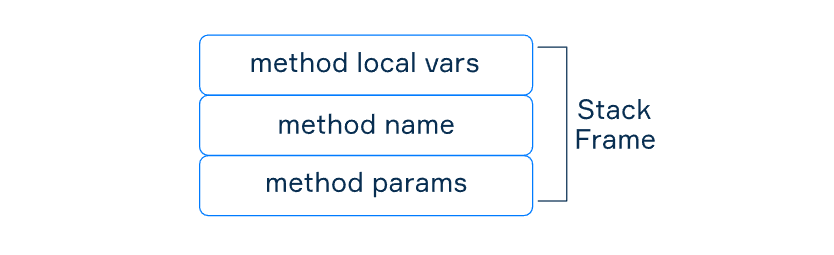
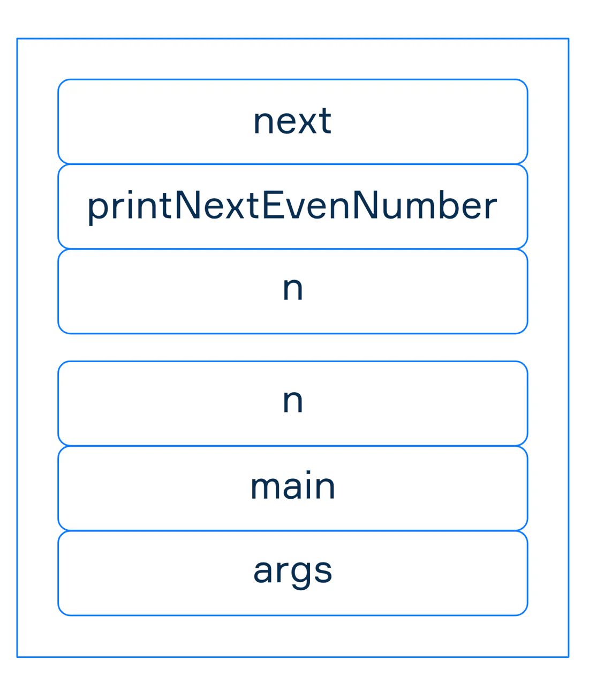

#Call Stack

Khi bạn viết một chương trình, nó có thể chứa một số hàm gọi lẫn nhau, hàm do người lập trình xác định hoặc hàm tiêu chuẩn, và tất cả chúng đều cần được thực thi.

Làm sao máy hiểu được thứ tự thực hiện?
Làm thế nào nó chuyển đổi giữa các chức năng khác nhau?
Làm sao nó biết khi nào quá trình thực hiện chương trình kết thúc?

## Cấu trúc Call stack

JVM sử dụng call stack (hoặc ngăn xếp thực thi) để hiểu chức năng nào sẽ được gọi tiếp theo và truy cập thông tin liên quan đến chức năng đó.

call stack bao gồm **khung xếp chồng**
 
> [!NOTE] 
> Stack Frame là data structure đại diện cho một phương thức duy nhất trong call stack. lưu trữ thông tin về các chức năng chưa kết thúc. Thông tin bao gồm địa chỉ trả về của hàm, tham số, biến cục bộ, tính toán trung gian và một số dữ liệu khác.




Là một ngăn xếp thông thường, call stack tuân theo quy tắc Vào trước ra trước (LIFO). Điều đó có nghĩa là các khung ngăn xếp được đẩy lên trên cùng và di chuyển mọi thứ xuống dưới.
- Một khung ngăn xếp mới được thêm vào khi thực thi vào hàm mới.
- Và khung ngăn xếp sẽ bị xóa khỏi call stack nếu việc thực thi một chức năng được thực hiện.

Ví dụ:

```kotlin
fun printNextEvenNumber(n: Int) {
    val next = if (n % 2 == 0) n + 2 else n + 1
    println(next)
}

fun main(args: Array<String>) {
    val n = 99
    printNextEvenNumber(n)
}
```

Chương trình khai báo hai hàm: `printNextEvenNumber` và `main`.

Như thường lệ, hàm đầu tiên được gọi là `main`. Mỗi khi một hàm được gọi, một khung ngăn xếp mới sẽ được tạo.

Khung ngăn xếp cho `main` được cấu trúc theo cách sau:

1. Các thông số chức năng (`args`) được đẩy lên khung.
2. Địa chỉ hàm (được hiển thị trong sơ đồ dưới dạng tên hàm - main) được thêm vào khung ngăn xếp để giữ tham chiếu đến nơi quay về từ các lệnh gọi hàm sau.
3. Các biến cục bộ (n) được thêm vào khung.

Trên thực tế, ngăn xếp chỉ lưu trữ một tham chiếu đến mảng args vì tất cả các kiểu tham chiếu đều được lưu trữ trong bộ nhớ heap.

Hàm tiếp theo được gọi là `printNextEvenNumber`.

Như mọi khi, một khung ngăn xếp mới được tạo. Các tham số hàm (n), địa chỉ (`printNextEvenNumber` để đơn giản) và các biến cục bộ (tiếp theo) được thêm vào khung ngăn xếp mới.

Chúng tôi có hai khung ngăn xếp hoàn chỉnh cho các hàm `main` và `printNextEvenNumber` trong ngăn xếp thực thi:



> [!NOTE]
> Lưu ý, cả hai khung đều có các biến có tên n, nhưng các biến này không giống nhau vì chúng thuộc các hàm khác nhau.

Bây giờ chương trình thực thi chức năng ở đầu call stack (`printNextEvenNumber`).
Sau khi thực thi, khung hiện tại `printNextEvenNumber` sẽ bị xóa khỏi call stack và khung chính trước đó tiếp tục thực thi.

Khi ngăn xếp trống, quá trình thực thi sẽ dừng lại. 


## Tràn ngăn xếp

Số lần gọi hàm có thể phụ thuộc vào dung lượng bộ nhớ được phân bổ cho ngăn xếp. Khi ngăn xếp của bạn chứa quá nhiều khung ngăn xếp, nó có thể bị tràn.
Nó dẫn đến `StackOverflowError` sẽ dừng thực thi. Kích thước ngăn xếp có thể được đặt bằng tùy chọn dòng lệnh -Xss để thực thi một chương trình cụ thể:

```kotlin
kotlin YourProgramName -Xss256k
```

Nhưng chúng tôi khuyên bạn nên cẩn thận với nó và đọc một số bài viết trên Internet trước khi sửa đổi kích thước ngăn xếp mặc định.
Ngoài ra, đôi khi StackOverflowError trỏ đến lệnh gọi recursion không chính xác trong chương trình của bạn. Trong trường hợp này, việc tăng kích thước của ngăn xếp sẽ không giúp ích gì cho bạn.
