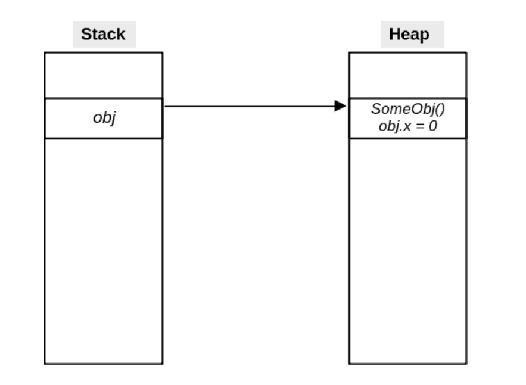
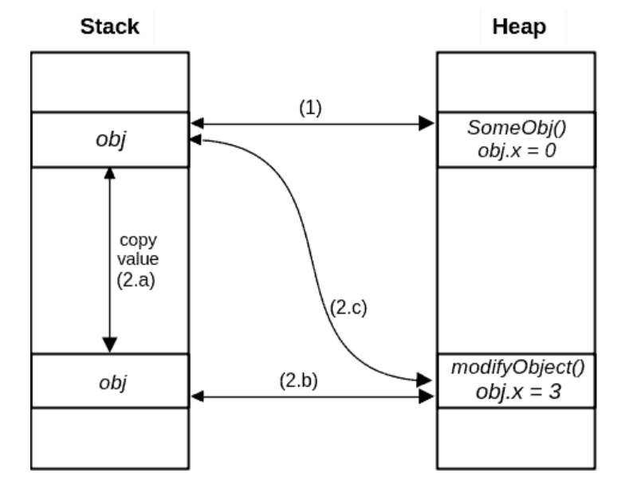

# Đối số chuyển tiếp

Hiểu hành vi của Kotlin khi nói đến truyền theo giá trị và tham chiếu truyền qua là rất quan trọng để làm việc hiệu quả với ngôn ngữ.

## 1. Truyền theo giá trị

Trong các hàm Kotlin, cũng như các phương thức Java, các đối số được truyền theo giá trị theo mặc định. 

**các tham số nguyên thủy trong Kotlin không thể được gán lại**. Khi chúng tôi cố gắng làm như vậy, mã sẽ không được biên dịch. Bạn sẽ nhận được "val không thể được chỉ định lại." lỗi biên dịch.

## 2. Tham khảo truyền qua

Tham chiếu truyền qua là hành vi trong đó một hàm nhận địa chỉ bộ nhớ của một đối số, cho phép truy cập và sửa đổi.

Java và Kotlin luôn sử dụng giá trị truyền theo.

Tuy nhiên, khi truyền đối tượng hoặc **loại không nguyên thủy**, hàm sẽ sao chép tham chiếu, mô phỏng truyền theo tham chiếu.
Những thay đổi bên trong phương thức sẽ ảnh hưởng đến đối tượng bên ngoài do tham chiếu được chia sẻ.


Hãy minh họa hành vi này bằng một ví dụ đơn giản:

```kotlin
data class SomeObj(var x: Int = 0)

private fun modifyObject(someObj: SomeObj) {
    someObj.x = 3
}
```

hãy viết unit test:


```kotlin
@Test
fun `Test using pass-by-reference`() {
    val obj = SomeObj()
    
    assertEquals(0, obj.x) // before modify

    modifyObject(obj)

    assertEquals(3, obj.x) // after modify
}
```
chúng tôi khẳng định rằng `x` trong `obj` vẫn là `0` trước khi gọi hàm `modifyObject()`.

Kotlin và Java đều sử dụng cùng một mô hình bộ nhớ, trong đó ngăn xếp lưu trữ biến tham chiếu và vùng heap lưu trữ các đối tượng.
Đối tượng mới được tạo của chúng tôi chứa tham chiếu đến `obj`:



Cuối cùng, chúng ta gọi hàm `modifyObject()` và xác nhận rằng `x` đã đổi thành `3`.

Trong mô hình bộ nhớ của chúng ta, bây giờ chúng ta có hai đối tượng trên heap: một đối tượng bên trong hàm và một đối tượng bên ngoài. 
Khi biến bên trong hàm được tạo, một biến tham chiếu mới sẽ được sao chép vào ngăn xếp. Hai biến tham chiếu hiện tồn tại trên ngăn xếp có giá trị giống hệt nhau, 
Tham chiếu cũ sẽ bị mất nếu không còn biến nào trỏ đến nó nữa (nó có thể được thu thập rác - GC):



> [!WARNING]
> Khi gọi một hàm trong Kotlin, tham chiếu của một đối tượng sẽ được sao chép và truyền dưới dạng đối số.
> Điều này không giống như tham chiếu truyền qua truyền thống, trong đó hàm sẽ nhận chính tham chiếu ban đầu.


