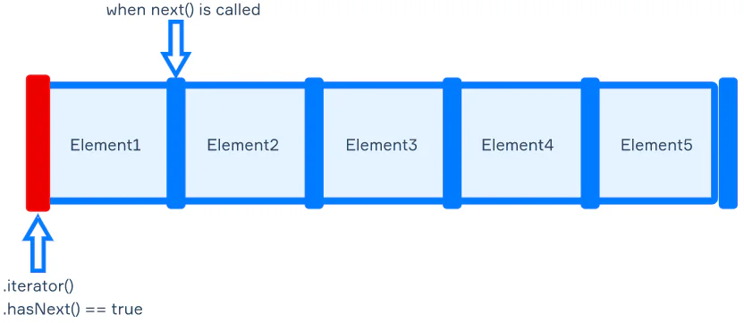

# Bộ tương tác

## Collection Iterator và immutable
Một trình vòng lặp cung cấp quyền truy cập vào các phần tử collection một cách tuần tự, bất kể loại của chúng. Nó có thể được xem như một con trỏ di động tới một phần tử của collection.
`iterator()` trả về một đối tượng đặc biệt có thể lặp qua collection.

Khi biến của một trình vòng lặp được tạo, nó sẽ trỏ đến vị trí **trước** phần tử đầu tiên của collection. Nếu bạn muốn chuyển sang phần tử tiếp theo, hãy gọi hàm `next()`. 
nó trả về `true` nếu phép lặp vẫn còn một số phần tử.

> [!WARNING]
> Lưu ý rằng khi trình vòng lặp đi qua phần tử cuối cùng của collection, nó không thể truy xuất các phần tử nữa.

Nếu bạn cố gắng gọi `next()` từ trình lặp sau khi chuyển phần tử cuối cùng trong collection (hoặc đối với collection trống), `NoSuchElementException` sẽ bị loại bỏ.
Trong tình huống này, bạn nên tạo một trình vòng lặp mới cho collection.



Thay vì sử dụng vòng lặp `for`, **iterators** hỗ trợ hàm `forEach()`. 

```kotlin
var map = mapOf("John" to "chocolate", "Mary" to "sweets", "Sara" to "marmalade")
var iterator = map.iterator()

iterator.forEach { (key, value) ->
    println("$key likes $value")
}


/*
  John likes chocolate
  Mary likes sweets
  Sara likes marmalade
*/
```

## Collection Iterator và mutable

Một biến thể lặp đặc biệt khác là `MutableIterator`.
Nó khác với phiên bản trước ở chỗ nó hoạt động với các collection mutable, tức là với những bộ sưu tập có thể được thay đổi sau khi tạo.

`MutableIterator` mở rộng `Iterator` và cung cấp hàm `remove()`, **loại bỏ phần tử collection cuối cùng được trình vòng lặp trả về.**

Bán tại:

```kotlin
fun main() {
    val numbers = mutableListOf(1, 2, 3, 4, 5)
    val iterator = numbers.iterator() // This is a MutableIterator for a mutable list

    while (iterator.hasNext()) {
        val number = iterator.next()
        if (number % 2 == 0) {
            iterator.remove() // Removes the last returned element if it's even
        }
    }

    println(numbers) // Output: [1, 3, 5]
}
```

## Trình lặp danh sách


Danh sách có một loại trình vòng lặp đặc biệt gọi là `ListIterator`. Nó cho phép bạn lặp qua danh sách theo cả hai hướng: tiến và lùi, trong khi các trình vòng lặp cho `Set` hoặc `Map` chỉ có thể lặp chuyển tiếp. Ngoài ra, `ListIterator` có thể lấy vị trí của các phần tử tiếp theo và trước đó.

Ngoài các phương thức `Iterator` phổ biến, `ListIterator` còn có các phương thức riêng sau:

- fun `nextIndex()`: Int trả về chỉ mục của phần tử sẽ được trả về bằng cách gọi hàm `next()`;

- fun `previous()`: T trả về phần tử trước đó của danh sách và di chuyển con trỏ của trình lặp về phía sau;

- fun `hasPrevious()`: `Boolean` trả về "true" nếu có các phần tử trong vòng lặp trước phần tử hiện tại;

- fun `previousIndex()`: Int trả về chỉ mục của phần tử sẽ được trả về bằng cách gọi hàm `previous()`.

Hãy xem một ví dụ:
```kotlin
val strings = listOf("i", "like", "donuts")
val listIterator = strings.listIterator()

println("Iterating forwards:")
while (listIterator.hasNext()) listIterator.next()

println("Iterating backwards:")
while (listIterator.hasPrevious()) {
    print("index: ${listIterator.previousIndex()}")
    println(", value: ${listIterator.previous()}")
}
```

Như bạn có thể thấy, `ListIterator` vẫn có thể được sử dụng sau khi đạt đến phần tử cuối cùng.

Danh sách Mutable có phiên bản `Iterator` riêng được gọi là `MutableListIterator`. `MutableListIterator` độc đáo vì không chỉ có thể loại bỏ các phần tử mà còn có thể thay thế chúng và thêm các phần tử mới khi duyệt qua collection.


```kotlin
val words = mutableListOf("i", "know", "Claire")
val mutableListIterator = words.listIterator()

mutableListIterator.next()
mutableListIterator.next()
mutableListIterator.set("don't know")// i , don't know, Claire
mutableListIterator.add("John")
println(words)// i, don't know, John, Claire
```