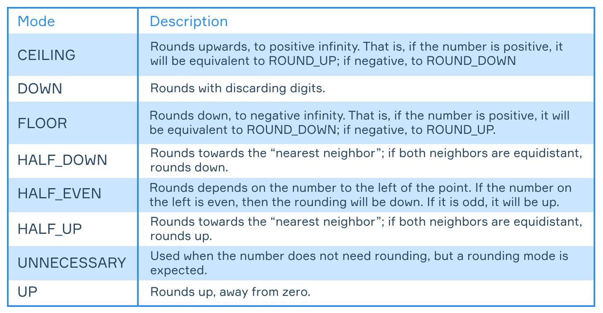
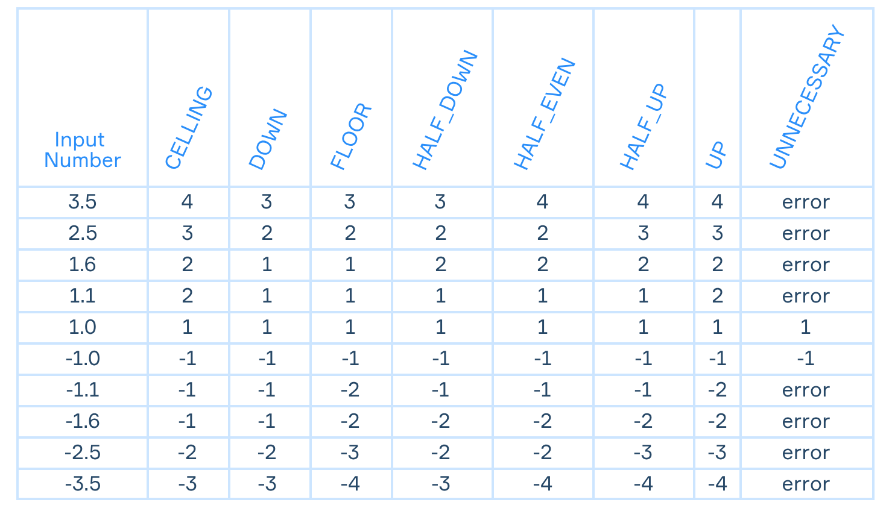

#BigDecimal

Đôi khi lập trình viên phải làm việc với số lượng cực lớn. `BigInteger` dành cho số nguyên và `BigDecimal` dành cho số **dấu phẩy động**.

bạn có thể có bao nhiêu chữ số sau dấu phẩy tùy thích, điều này rất quan trọng để tính toán chính xác. Có những chương trình mà độ chính xác của tính toán là rất quan trọng, chẳng hạn như máy bay hoặc phần mềm y tế, hoặc lưu trữ và xử lý các khoản tiền, v.v.

## Tạo đối tượng của BigDecimal

bạn có một số tùy chọn khác nhau để tạo `BigDecimal`

- Cách đầu tiên là tạo nó từ đối tượng String và chỉ định số mong muốn trong dấu ngoặc kép.
```kotlin
val firstBigDecimal = BigDecimal("10000000000000.5897654329")
```
- Tùy chọn thứ hai là tạo nó từ `Double`:

```kotlin
val bigDecimal = BigDecimal(10000000000000.5897654329)
```

- Bạn có thể chuyển đổi số loại khác sang `BigDecimal` như sau:

```kotlin
val number = 100000.50000
val bigDecimal = number.toBigDecimal()
```

> [!IMPORTANT]
> Điều cực kỳ quan trọng cần lưu ý là `BigDecimal` là lớp immutable. 
> Tính bất biến ngụ ý rằng bạn không thể thay đổi phiên bản hiện có của `BigDecimal`, ngay cả khi nó được khai báo bằng từ khóa var. Nếu bạn cố gắng sửa đổi một đối tượng hiện có, nó sẽ được tạo lại.

Bạn có thể nhớ rằng trong trường hợp `Double` và `Float`, có một số vấn đề tiềm ẩn khi biểu diễn dấu phẩy động. 
Ví dụ: kết quả của việc thêm `0.2` và `0.1` sẽ không là `0.3`, điều này ảnh hưởng đến độ chính xác của các phép tính tiếp theo:

```kotlin
println(0.1 + 0.2) // 0.30000000000000004
```

`BigDecimal` không gặp phải vấn đề như vậy: kết quả của tất cả các thao tác sẽ hoàn toàn chính xác.

```kotlin
val first = BigDecimal("0.2")
val second = BigDecimal("0.1")

val addition = first + second   // 0.3
```

Các phép toán nhị phân và đơn nguyên có sẵn cho `BigDecimal`. Trong đoạn mã bên dưới, bạn có thể xem một số ví dụ về các phép toán nhị phân với `BigDecimal`:

```kotlin
val first = BigDecimal("0.2")
val second = BigDecimal("0.1")

val addition = first + second   // 0.3
val subtraction = first - second   // 0.1
val multiplication = first * second // 0.02
val division = first / second   // 2.0
val remainder = first % second // 0.0

// decrement
val decrement = --first //  -0.8
// increment
val increment = ++first //  0.2
// unary minus, turning to opposite sign
val reverse = -first  //  -0.2
// absolute value
val module = first.abs()  //  0.2
// raise to the power, works only with Int
val power = first.pow(3) 
```

## Điều khiển làm tròn


`setScale()` cho phép chúng ta điều chỉnh độ chính xác của số phân số lớn:

```kotlin
bigDecimal.setScale(newScale, RoundingMode)
```

Bảng bên dưới liệt kê tất cả các chế độ làm tròn `BigDecimal` có thể có cùng với các mô tả ngắn gọn của chúng:



Bảng dưới đây minh họa sự khác biệt về hành vi tùy thuộc vào chế độ làm tròn. Bạn sẽ có thể dễ dàng so sánh chúng:



> [!NOTE]
> Lưu ý rằng UNNECESSARY sẽ thêm các số 0 không đáng kể vào số nếu bạn chỉ định quá nhiều chữ số trong setScale(). Nhưng nếu bạn chỉ định quá ít chữ số thì sẽ xảy ra lỗi.

## Làm tròn trong các phép tính số học

Hãy nói về việc xác định tính chính xác của kết quả chia. Thang đo của kết quả giống với thang đo của cổ tức và theo mặc định, `RoundingMode.HALF_EVEN` được sử dụng. Tuy nhiên, bạn có thể chỉ định tỷ lệ theo cách thủ công nếu cần:

```kotlin
val dividend = BigDecimal("0.9865745")
val divisor = BigDecimal("3.543")

var quotient = dividend / divisor    // 0.2784574
quotient = dividend.setScale(4, RoundingMode.CEILING)/ divisor   // 0.2785
```

Hãy xem một ví dụ khác. Giả sử chúng ta cần chia một số nguyên BigDecimal cho một số nào đó và kết quả là chúng ta muốn nhận được một số phân số. Trong những tình huống như vậy, điều quan trọng là phải chỉ rõ quy mô cổ tức:

```kotlin
val intDividend = BigDecimal("10")
val divisor = BigDecimal("3")

var quotient = intDividend / divisor    // 3
quotient = intDividend.setScale(4, RoundingMode.CEILING)/ divisor   // 3.3333
```

Phép cộng, phép trừ và phép nhân không có tính đặc thù như vậy. Mặc dù độ chính xác cũng là một yếu tố ở đó và nó được sử dụng trong các phép tính số học, nhưng nó khá trực quan:

```kotlin
val first = BigDecimal("7.7777")
val second = BigDecimal("3.3")

val addition = first + second   // 11.0777; The result scale is 4 (max of the scales)
val subtraction = first - second   // 4.4777; The result scale is 4 (max of the scales)
val multiplication = first * second // 25.66641; The result scale is 5 (sum of the scales)
```

Vì vậy, đối với các thao tác này, chúng ta có thể mô tả độ chính xác của kết quả như sau:

- **Bổ sung**: tỷ lệ tối đa của các phép bổ sung;

- **Phép trừ**: tỷ lệ tối đa của phép trừ và phép trừ;

- **Phép nhân**: tổng của thang số nhân và thang số nhân;

- **Chia**: tỷ lệ chia cổ tức.