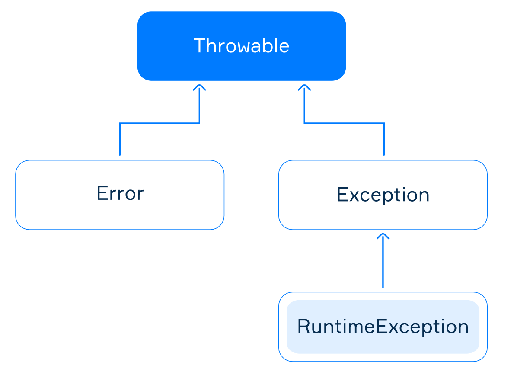
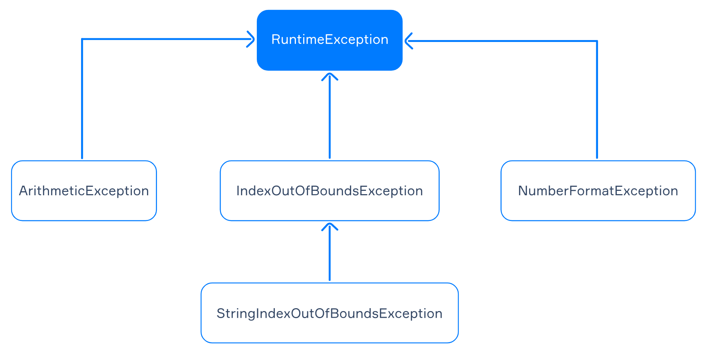
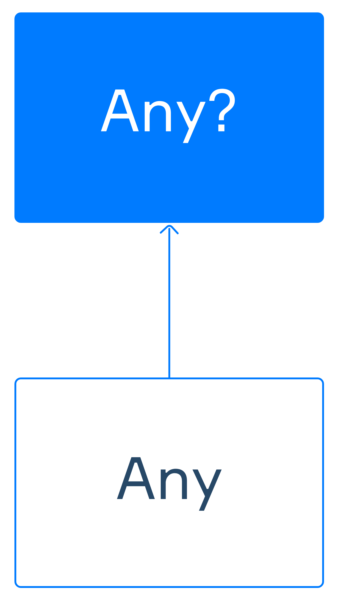
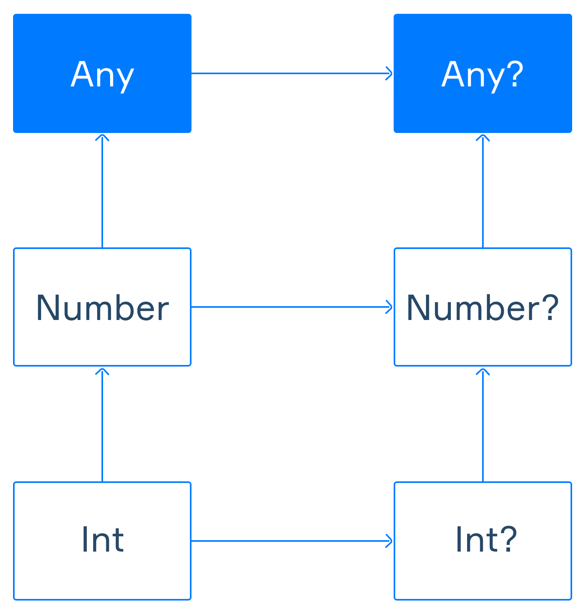
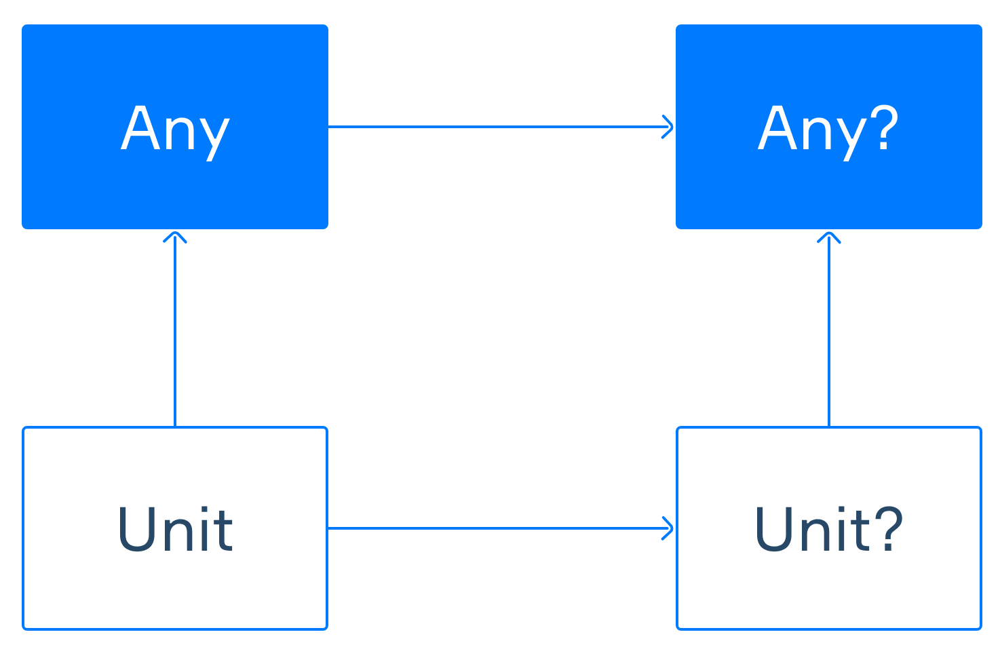

# Ngoại lệ

Do đó, lỗi có thể xảy ra khi chương trình đang chạy, ngay cả khi chương trình đó đúng về mặt cú pháp và đã được biên dịch mà không gặp vấn đề gì. Những tình huống như vậy được gọi là Ngoại lệ trong Kotlin và chúng ta sẽ khám phá khái niệm này.

## Phân cấp ngoại lệ

Đối với các tình huống bất ngờ khác nhau, có các loại ngoại lệ chuyên biệt khác nhau. Tất cả chúng đều có liên quan với nhau, tạo thành một hệ thống phân cấp các loại

### Kiểu con và siêu kiểu

Trước hết chúng ta hãy tìm hiểu thuật ngữ. Các loại trong Kotlin được tổ chức thành một hệ thống phân cấp các mối quan hệ kiểu con-siêu kiểu

 Các kiểu con và siêu kiểu là gì?

Chúng ta có thể khẳng định một thực tế là cà phê và trà đều liên quan đến một loại cụ thể: đồ uống. Theo thuật ngữ Kotlin, cà phê và trà là **loại phụ** của đồ uống, trong khi đồ uống là **siêu loại** cho hai loại này

- **subtype** là kiểu dữ liệu có liên quan đến một kiểu dữ liệu khác (siêu kiểu) và kế thừa các đặc điểm, quy tắc ứng xử chung từ đó.
- Về mặt logic, **siêu kiểu** là một loại có các thuộc tính và phương thức xác định các đặc điểm và quy tắc hành vi mà các kiểu con của nó sẽ tuân theo.

### Tổng quan về hệ thống phân cấp ngoại lệ

Hình ảnh sau đây minh họa một hệ thống phân cấp ngoại lệ đơn giản:



Như bạn có thể thấy, nền tảng của hệ thống phân cấp này là loại `Throwable`. Nó là gốc của hệ thống phân cấp và tất cả các ngoại lệ bằng cách nào đó đều thuộc loại này. Nó cung cấp một tập hợp các phương pháp hữu ích để xử lý các trường hợp ngoại lệ.

Loại `Throwable` có hai loại phụ trực tiếp: `Error` và `Exception`. `Error` chỉ ra các vấn đề nghiêm trọng mà một ứng dụng hợp lý không nên thử process. 

Chúng ta không nên nghĩ đến việc xử lý lỗi trong mã chương trình. Ở đây chúng tôi sẽ tập trung vào `Exception`; Khi bạn phát triển một ứng dụng, thông thường bạn sẽ nắm bắt được chính xác các ngoại lệ của process

Hãy nhớ rằng **subtype** và **supertype** là các thuật ngữ tương đối, do đó, một loại nhất định không nhất thiết phải là loại này hay loại kia. Trong trường hợp này, `Exception` là kiểu con của `Throwable` và cũng là siêu kiểu của `RuntimeException`.

Các loại phụ của loại `Exception`, chẳng hạn như `RuntimeException` và `IOException`, xử lý các sự kiện đặc biệt bên trong các ứng dụng. 


####RuntimeException

Loại `RuntimeException` là một loại phụ khá đặc biệt của Ngoại lệ. Các kiểu con của `RuntimeException`, chẳng hạn như `ArithmeticException` và `NumberFormatException`, có thể bị loại bỏ trong quá trình thực thi chương trình thông thường.



- `ArithmeticException` là ngoại lệ runtime được đưa ra khi mã thực hiện một phép tính số học bất hợp pháp. Hãy xem xét một ví dụ cực kỳ phổ biến:

```kotlin
val example = 2 / 0 // throws ArithmeticException
```

- `NumberFormatException` Trong quá trình tính toán, bạn có thể nhận được một loại ngoại lệ khác: NumberFormatException. Nó được ném ra khi một phương thức mong đợi nhận được một số, nhưng đầu vào thực tế lại là một thứ khác.

```kotlin
val string = "It's not a number"
val number = string.toInt() // throws NumberFormatException
```

- `IndexOutOfBoundsException` IndexOutOfBoundsException xảy ra khi bạn truy cập một số chỉ mục không tồn tại.

```kotlin
val sequence = "string"
println(sequence[10])   // throws StringIndexOutOfBoundsException
```

#### Ném ngoại lệ

Tại sao chúng ta nên viết `Exception`(...)? Đó là câu hỏi đúng! Trên thực tế, tất cả các ngoại lệ đều nằm trong cây phân cấp. Theo cách này, Ngoại lệ đại diện cho một loại phổ biến mà không có bất kỳ chi tiết cụ thể nào.

### Loại gốc Bất kỳ

Trong Kotlin, loại Any là **siêu kiểu** cho tất cả các loại (**Any nằm ở đầu phân cấp loại Kotlin**) không hỗ trợ `null`. Điều này có nghĩa là mọi loại `non-nullable` đều là **loại con** của Bất kỳ.

Trong khi loại `Any` là siêu kiểu cho tất cả các loại không hỗ trợ null, thì `Any?` là siêu kiểu cho các loại có thể là `null` hoặc không. **Từ thực tế này, nó theo loại Bất kỳ? là siêu kiểu cho loại Any**



Loại không null là kiểu con của các giá trị tương đương có thể rỗng của nó, ví dụ: kiểu `Number` là kiểu con của kiểu `Number?` và kiểu `Int` là kiểu con của kiểu `Int?`. Hãy xem nó trông như thế nào:



Đây là lý do tại sao bạn có thể lưu trữ giá trị `Number` không rỗng trong biến `Number?` có thể rỗng, nhưng bạn không thể lưu trữ giá trị `Number?` không rỗng trong biến `Number` không rỗng.

### Đơn vị

Loại `Unit` có thể được sử dụng làm kiểu trả về của hàm không trả về bất kỳ giá trị có ý nghĩa nào

Giống như bất kỳ loại nào khác, `Unit` là một loại con của `Any`. Nó cũng có thể là `Unit?` có thể rỗng, là một kiểu con của `Any?`.

