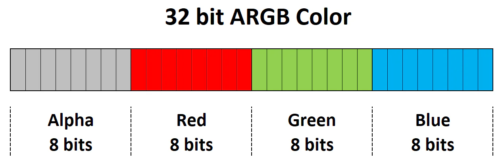
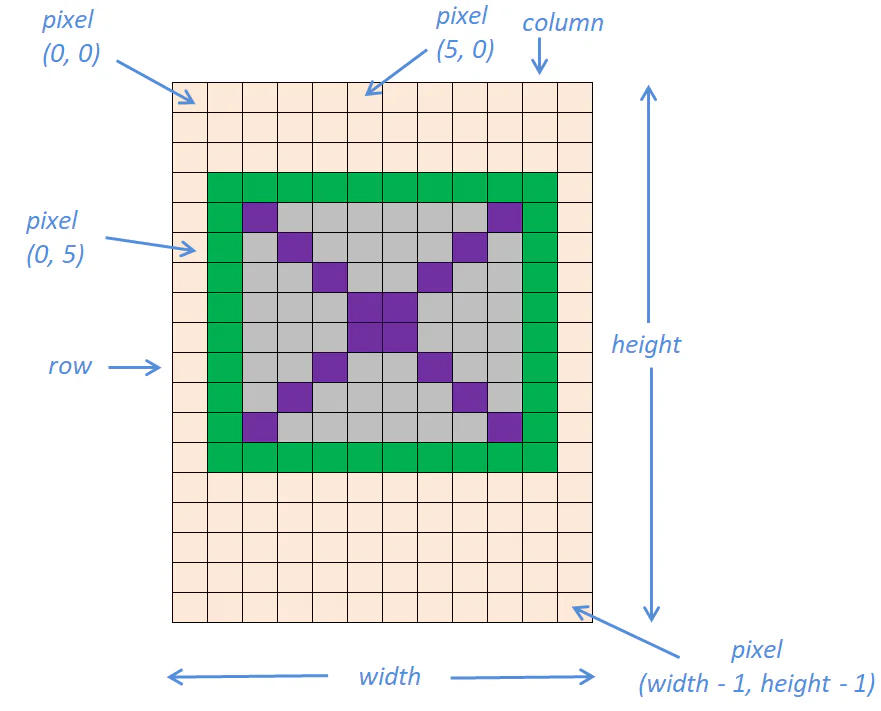
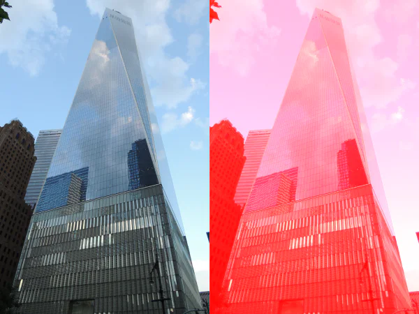

# Màu sắc hình ảnh

## Màu RGB, kênh Alpha

Trong hầu hết các trường hợp, mô hình màu RGB được sử dụng với dữ liệu 24 bit cho mỗi pixel.
Do đó, mỗi pixel có thể có 16.777.216 màu khác nhau. Cách phối màu này được gọi là True Color.

Một phần mở rộng cho RGB là chế độ màu ARGB, tương tự như các màu RGB nhưng cũng chứa thông tin về độ mờ.
‘A’ là viết tắt của kênh Alpha hoặc Alpha và biểu thị độ trong suốt của từng pixel.
Giá trị Alpha bằng 0 cho biết pixel rõ ràng, trong khi giá trị tối đa cho biết pixel mờ.

Thông thường nhất, ARGB được sử dụng với dữ liệu 32 bit cho mỗi pixel. Mỗi kênh màu và alpha dài 8 bit.



##Hệ tọa độ ảnh

Java và do đó Kotlin sử dụng lớp BufferedImage để xử lý hình ảnh.
Nó thuộc gói `import java.awt.image.BufferedImage` và là lớp con của lớp Hình ảnh.
Vì vậy, nó phải được nhập vào một chương trình:

- Vị trí pixel được xác định bởi một cặp số tự nhiên tương ứng với cột và hàng pixel, với các cột chạy từ trái sang phải và các hàng chạy từ trên xuống dưới

- Số vị trí hàng và cột bắt đầu bằng 0.



## Đọc và đặt màu pixel

Màu của pixel có thể được đọc/đặt dưới dạng số nguyên bằng cách sử dụng hàm `getRGB(x, y)`/`setRGB(x, y, rgb)`, trong đó `x` và `y` lần lượt là vị trí pixel cột và hàng và `rgb` là màu pixel dưới dạng số nguyên.

> [!NOTE]
> Số nguyên Kotlin có kích thước 32 bit, do đó, nó có thể chứa các giá trị màu cho cả sơ đồ màu RGB 24 bit và ARGB 32 bit.

Trong ví dụ mã sau đây, một tệp hình ảnh được đọc. Sau đó, đối với mỗi pixel trong phiên bản `BufferedImage` đã tạo, màu đỏ được đặt thành `255`, trong khi màu xanh lục và xanh lam không thay đổi. Sau đó, phiên bản `BufferedImage` được lưu dưới dạng tệp mới. Lưu ý rằng phải tạo một phiên bản `Color` mới.

```kotlin
import java.io.File                   // Import the File class for file handling
import javax.imageio.ImageIO          // Import the ImageIO class for reading and writing images
import java.awt.image.BufferedImage   // BufferedImage Class
import java.awt.Color                 // Color class

fun main() {
   val inputFile = File("24bit.png")  // Create a file instance in order to read the "24bit.png" image file

   // Create a BufferedImage instance from the 24-bit image file data
   val myImage: BufferedImage = ImageIO.read(inputFile)  

   // myImage.width is the image width
   // myImage.height is the image height
   for (x in 0 until myImage.width) {               // For every column.
       for (y in 0 until myImage.height) {          // For every row
           val color = Color(myImage.getRGB(x, y))  // Read color from the (x, y) position

           val g = color.green              // Access the Green color value
           val b = color.blue               // Access the Blue color value
           // Use color.red in case the Red color is needed

           val colorNew = Color(255, g, b)  // Create a new Color instance with the red value equal to 255
           myImage.setRGB(x, y, colorNew.rgb)  // Set the new color at the (x, y) position
       }
   }
   val outputFileJpg = File("newImageFile.jpg")  // Output the file
   ImageIO.write(myImage, "jpg", outputFileJpg)  // Create an image using the BufferedImage instance data
}
```



## Thẩm quyền giải quyết

- https://hyperskill.org/learn/step/14484


