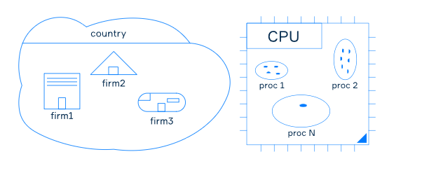
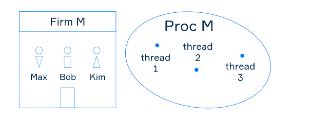
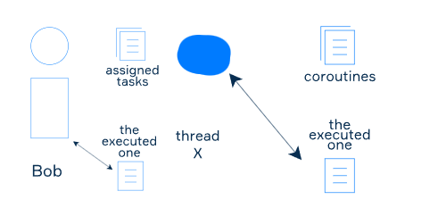

#Concurrency

## Quy trình

Trong máy tính, **các thực thể lớn nhất có thể chạy cùng lúc được gọi là tiến trình**, thường đại diện cho các ứng dụng khác nhau. 
Tuy nhiên, các nhà phát triển Kotlin hiếm khi làm việc với các tiến trình vì chúng khá nặng, Một máy tính hiện đại có thể xử lý hàng trăm tiến trình. 
và thông thường các lập trình viên muốn ứng dụng của họ nhỏ gọn hơn. 
Vì lý do này, chúng tôi sẽ không trình bày chi tiết chúng ở đây.

Nếu bạn muốn một phép ẩn dụ, hãy nghĩ về các quy trình như các doanh nghiệp (công ty) trong một quốc gia.
Một số người trong số họ làm việc trong các lĩnh vực hoàn toàn khác nhau, những người khác cạnh tranh trong cùng một lĩnh vực.

## Chủ đề

**Một cách thuận tiện hơn để chạy các tác vụ đồng thời trong một chương trình** là phân luồng. 
Nó được hỗ trợ bởi hầu hết các ngôn ngữ lập trình bao gồm Kotlin.

**Mọi thread đều được liên kết với process và process có thể tạo các luồng của nó.** 
Ví dụ: các ứng dụng thường sử dụng thread đặc biệt để vẽ đồ họa trên màn hình,
trong khi logic của chương trình được thực thi ở một chương trình khác.
Các luồng chia sẻ một số bộ nhớ nên việc giao tiếp giữa chúng tương đối đơn giản.

**Luồng nhẹ hơn quy trình và ngày nay một máy tính thông thường có thể thực thi hàng chục nghìn luồng.**

thread trong process giống như một nhân viên trong một công ty.
Một người và thread chịu trách nhiệm về vai trò của mình.

Trong Kotlin, các luồng phụ thuộc vào nền tảng, có nghĩa là bạn phải sử dụng các luồng khác nhau cho các môi trường khác nhau, 
ví dụ: Chủ đề Java cho Kotlin/JVM và Chủ đề Posix cho Kotlin/Native. 
Tuy nhiên, các luồng vẫn được sử dụng thường xuyên vì dễ dàng xác định giao tiếp của chúng và chạy chúng.

Tuy nhiên, nếu bạn có một trang web phổ biến và web server để lưu trữ trang web đó thì điều này có thể là chưa đủ: số lượng kết nối đồng thời đến trang web của bạn có thể dễ dàng vượt quá hàng chục nghìn.

## Coroutine

Một cách khác để hỗ trợ xử lý nhiều tác vụ được gọi là **concurrency nội bộ**. Trong Kotlin, cách chính thức và phổ biến nhất để thực hiện điều đó là thư viện coroutines (`kotlinx.coroutines`). Nó tương tự như threading, ngoại trừ coroutine thậm chí còn nhẹ hơn. Ngoài ra, thư viện được thiết kế đặc biệt để làm cho mã giống nhau trên các nền tảng khác nhau.

Coroutine là một đoạn mã có thể **bị treo** và **tiếp tục**. Ý tưởng ở đây là một đoạn mã có thể đợi một điều gì đó, chẳng hạn như khi người dùng nhấp chuột. Trong khi chờ đợi, chúng tôi nói rằng nó ở **trạng thái treo** và nó không làm quá tải bộ xử lý.

> [!NOTE]
> Trong Kotlin, trạng thái bị treo đề cập đến tình trạng của một coroutine khi nó bị tạm dừng và cho phép các hoạt động khác chạy trong thời gian chờ đợi.

Hãy quay trở lại với sự tương tự với một công ty. Chúng ta có thể so sánh một coroutine với một nhiệm vụ thông thường mà nhân viên có thể thực hiện. 

1. Đầu tiên, nhiệm vụ được tạo và sau đó được giao cho một người.

2. Khi một người đã sẵn sàng, họ quyết định phải làm gì: bắt đầu xử lý công việc hoặc chuyển giao nó cho người khác.

3. Khi ai đó bắt đầu thực hiện nhiệm vụ, không có gì đảm bảo rằng nó sẽ được thực hiện ngay lập tức.

4. Ví dụ, nhiệm vụ là gọi cho bộ phận khác, người này gọi nhưng không ai trả lời.

5. Khi đó người đó có thể “tạm dừng” nhiệm vụ, tức là hoãn nó lại một thời gian. Trong khoảng thời gian này, người đó có thể nhận một nhiệm vụ khác và bắt đầu thực hiện nó, hoặc nếu không còn nhiệm vụ nào được giao nữa, họ có thể nghỉ ngơi.

**Ưu điểm ở đây là chi phí cho một người là đắt vì bạn phải trả tiền cho họ, nhưng nhiệm vụ lại rẻ. Nếu một người có thể xử lý nhiều nhiệm vụ, tại sao không làm chỉ việc đó?**

Vì thread có thể được sử dụng để chạy coroutine nên bạn có thể có nhiều coroutine hơn luồng. Số lượng coroutine được lên lịch thực thi có thể lên tới hơn một triệu!

Bạn có thể nghi ngờ một lỗ hổng ở đây: không phải ai cũng có thể thực hiện nhiều nhiệm vụ cùng một lúc. Thông thường, chúng ta thực hiện một nhiệm vụ và chỉ sau đó mới thực hiện một nhiệm vụ khác. Trên thực tế, điều này cũng đúng với các coroutine: trong một thread, mỗi lần chỉ có một coroutine được xử lý. Đó là lý do tại sao nó được gọi là concurrency nội bộ. Tuy nhiên, khái niệm tạm dừng nhiệm vụ thực sự rất mạnh mẽ và chúng ta có thể nói rằng tính đồng thời sai lầm này vẫn có tác dụng. Hãy thể hiện nó.

Bạn còn nhớ ví dụ web server không? Chúng tôi chỉ có một số lượng người thực thi hạn chế, nhưng chúng tôi muốn phục vụ một số lượng lớn khách hàng. Giải pháp là có một nhiệm vụ cho mỗi khách hàng và phân bổ dần dần các nhiệm vụ đang chờ cho những người thực thi có sẵn. Một số khách hàng sẽ phải đợi lâu hơn vì sẽ phải xếp hàng nhưng ít nhất máy chủ sẽ không gặp sự cố.
