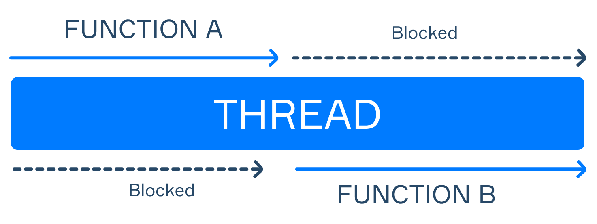
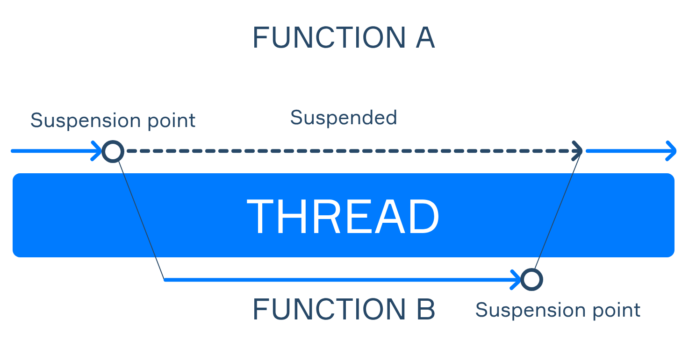

#Suspending function


Coroutine là một phần của chương trình có thể bị tạm dừng và tiếp tục lại sau đó.

Tuy nhiên, Kotlin không tạm dừng coroutine tại một điểm tùy ý; nó chỉ có thể làm điều đó khi **suspending function** đặc biệt được gọi.

Nó theo dõi các chức năng tạm dừng và có thể chạy một chức năng khác đang chờ thực thi, sau đó tiếp tục chức năng ban đầu khi có thể, ngay cả khi không chuyển đổi luồng ở cấp độ OS.

**Cơ chế này có khả năng cho phép chúng tôi chạy nhiều coroutine hơn giới hạn của các luồng hiện có.**


## Tạm dừng chức năng

Hãy xem nó hoạt động như thế nào. Khi bạn gọi hai hàm đơn giản, chúng sẽ chạy tuần tự:
thread chỉ có thể thực hiện một chức năng tại một thời điểm:



Nhưng điều gì sẽ xảy ra nếu một chức năng bị đình chỉ?
Trong trường hợp này, bạn có thể tạm dừng việc thực thi một chức năng và chạy một chức năng khác. Chương trình sẽ không quên chức năng bị tạm dừng của bạn và sẽ tiếp tục lại sau.
Điều này đặc biệt hữu ích khi bạn cần chờ một số tài nguyên bên ngoài.



## Ví dụ về ca sử dụng

Hãy tưởng tượng chúng ta cần chạy rất nhiều thao tác "nặng" như tính tổng kiểm tra cho hàng trăm 
các tệp chúng tôi nhận được từ Internet để đảm bảo chúng không bị hỏng (đó là điều mà các nhà quản lý gói hoặc ứng dụng khách torrent luôn làm).


```kotlin
fun loadFile(): ByteArray {
    return ... // long operation, actual code skipped for brevity
}

fun calculateChecksum(fileData: ByteArray): String {
    return ... // another long operation, actual code skipped for brevity
}

fun main() {
    for (i in 1..10_000) {
        val fileData = loadFile()
        val checksum = calculateChecksum(fileData)
        println(checksum)
    }
}
```

Để hoàn thành mọi phép tính nhanh hơn, chúng ta có thể process mỗi tệp trên một thread riêng biệt.

```kotlin
fun main() {
    for (i in 1..10_000) { // depends on the machine, rarely more than that
        Thread {
            val fileData = loadFileBlocking()
            val checksum = calculateChecksum(fileData)
            println(checksum)
        }.start()
    }
}
```

Tuy nhiên, nó sẽ không cải thiện hiệu suất nếu chúng ta có nhiều tệp hơn lõi CPU vì mỗi lõi chỉ có thể process một thread tại một thời điểm.
Hơn nữa, nếu chúng ta có quá nhiều luồng, chúng ta sẽ sớm hết bộ nhớ vì mỗi thread yêu cầu thêm RAM chỉ để bắt đầu.

Để khắc phục sự cố, cần có các nhóm và lệnh gọi lại thread phức tạp hơn.
Ngược lại, với coroutine, chúng ta có thể chạy hàng trăm nghìn thao tác song song và giữ cho mã của mình luôn đơn giản.
Kotlin sẽ đảm nhiệm việc tạm dừng (tạm dừng) những chức năng hiện không hoạt động.

```kotlin
import kotlinx.coroutines.*

suspend fun loadFile(): ByteArray { // now it's a suspending function
    return ... // long operation
}

suspend fun calculateChecksum(fileData: ByteArray): String { // another suspending
    return ... // long operation
}

// 'runBlocking' and 'async' build coroutines, we'll learn about it in the next topic
//  so far you need to know that everything inside one of these builders is a coroutine
fun main() = runBlocking {
    for (i in 1..10_000) { // now we can have even more operations running concurrently
        async {            // async schedules background execution of a given coroutine
            val fileData = loadFile()
            val checksum = calculateChecksum(fileData)
            println(checksum)
        }
    }
}
```

## Điểm treo

một chức năng được đánh dấu bằng từ khóa `suspend`. Cuộc gọi như vậy là "điểm đỗ" cho một coroutine.

IDE JetBrains sẽ đánh dấu các cuộc gọi này bằng một ký hiệu đặc biệt ở bên trái.


## Tạm dừng từ khóa

Mọi Phương thức, hàm cấp cao nhất, hàm mở rộng và thậm chí cả lambda đều có thể bị tạm dừng. chỉ sử dụng từ khóa `suspend` trước `fun`


## Lời gọi Suspending function

Kotlin chỉ cho phép gọi các hàm tạm dừng từ các hàm tạm dừng khác hoặc từ các trình tạo coroutine đặc biệt như `runBlocking` và `async`

Coroutine nhẹ nhưng không miễn phí—việc tạo quá nhiều có thể làm chậm quá trình thực thi và khiến việc gỡ lỗi trở nên khó khăn hơn.
Các nhà phát triển phải quyết định cẩn thận nơi các chức năng tạm dừng mang lại lợi ích cao nhất.


