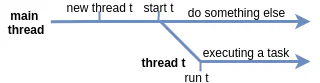

# Tùy chỉnh thread
## Tạo chủ đề tùy chỉnh với inheritance

Hai cách chính để tạo thread mới thực hiện tác vụ bạn cần như sau:

- mở rộng lớp `Thread` và ghi đè phương thức `run` của nó;
  
```kotlin
class HelloThread : Thread() {
    override fun run() {
        val helloMsg = "Hello, i'm $name"
        println(helloMsg)
    }
}
```

- triển khai interface `Runnable` và chuyển việc triển khai cho hàm tạo của lớp `Thread`.

```kotlin
class HelloRunnable : Runnable {
    override fun run() {
        val threadName = Thread.currentThread().name
        val helloMsg = "Hello, i'm $threadName"
        println(helloMsg)
    }
}
```
lớp Thread có rất nhiều hàm tạo. Bạn có thể tìm thấy danh sách đầy đủ [tại đây](https://docs.oracle.com/javase/7/docs/api/java/lang/Thread.html#constructor_summary).

## Cách dễ dàng để tạo thread

Bạn có thể tạo thread với chức năng `thread(...): Thread`. Trong trường hợp này, mã thực thi được truyền trong đối số `block`:

```kotlin
import kotlin.concurrent.thread


val t4 = thread(start = false, name = "Thread 4", block = {
        println("Hello, I'm ${Thread.currentThread().name}")
    })
```

Hàm này có thể có nhiều tham số mô tả thread tùy chỉnh của bạn:

- `start` – nếu `true`, thread được khởi động ngay lập tức (khi đó thread sẽ được tạo);

- `isDaemon` – nếu `true`, thread được tạo dưới dạng daemon thread (chúng ta sẽ nói về chúng sau);

- `contextClassLoader` – trình nạp lớp để tải các lớp và tài nguyên trong thread này (bạn sẽ tìm hiểu thêm về điều này sau);

- `name` – tên của thread;

- `priority` – mức độ ưu tiên của thread;

- `block` – Mã thực thi của thread.

## Bắt đầu chủ đề

Lớp Thread có một phương thức gọi là `start()`, được sử dụng để khởi động thread

Tại một thời điểm nào đó, sau khi bạn gọi phương thức này, quá trình chạy phương thức sẽ được gọi tự động, nhưng nó sẽ không xảy ra ngay lập tức.

Ngoài ra, nếu bạn đặt giá trị của tham số `start` thành `true` (đó là giá trị mặc định), bạn có thể khởi động thread mà không cần gọi phương thức `start()`

## Thread đang hoạt động

Đây là hình ảnh giải thích cách thread thực sự khởi động và tại sao nó không xảy ra ngay lập tức.



Như bạn có thể thấy, có một số độ trễ giữa lúc khởi động thread và thời điểm nó thực sự bắt đầu hoạt động (đang chạy).

> [!CAUTION]
> Bạn phải gọi bắt đầu nếu bạn muốn thực thi mã của mình bên trong lần chạy trong thread khác. Nếu bạn gọi run trực tiếp, mã sẽ được thực thi trong cùng thread.
>
> Nếu bạn cố gắng khởi động thread nhiều lần, hãy bắt đầu ném IllegalThreadStateException.
