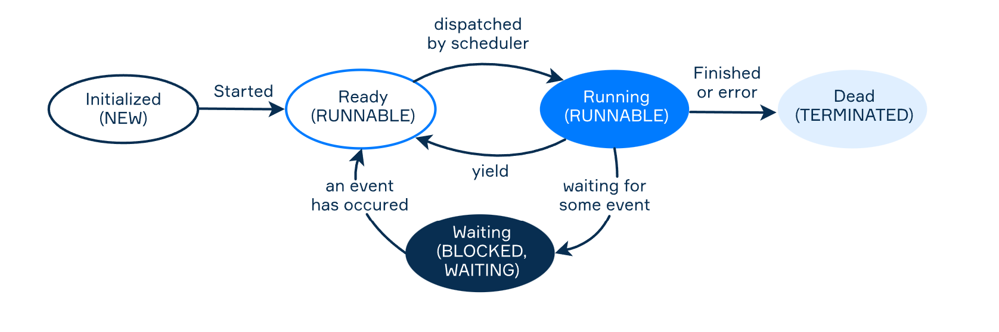

# Trạng thái của thread

Trong suốt lifecycle, trạng thái của thread thay đổi.
Điều này được gây ra bởi cả hành động của người lập trình và một số sự kiện nội bộ trong hệ điều hành.

Chúng tôi sẽ xem xét các trạng thái có thể có của thread được trình bày cả theo thuật ngữ Kotlin và ở cấp độ hệ điều hành (OS).

## Thread.State enum

Trong Kotlin, trạng thái của thread được xác định bởi enum `Thread.State` với sáu giá trị có thể:

- `NEW`: một phiên bản của lớp `Thread` đã được tạo, nhưng nó chưa bắt đầu;

- `RUNNABLE`: thread đang chạy trong JVM, nhưng nó có thể đang chờ một số tài nguyên từ OS (ví dụ: từ bộ xử lý);

- `BLOCKED`: thread bị chặn và đang chờ khóa màn hình (chúng tôi sẽ xem xét sau);

- `WAITING`: thread đang chờ một thread khác thực hiện một nhiệm vụ trong thời gian dài vô thời hạn (ví dụ: tham gia mà không hết thời gian chờ);

- `TIMED_WAITING`: thread đang đợi một thread khác trong một thời gian nhất định (ví dụ: ngủ, tham gia khi hết thời gian chờ);

- `TERMINATED`: thread bị chấm dứt khi chức năng chạy hoàn thành việc thực thi hoặc xảy ra ngoại lệ chưa được phát hiện. **Sau khi thread chấm dứt, nó sẽ không bao giờ trở lại trạng thái có thể chạy được.**

Để có được trạng thái hiện tại của thread, chúng tôi sử dụng tham số `state`.


Hãy xem các trạng thái này thay đổi như thế nào tùy thuộc vào hành động của người lập trình.

```kotlin
val worker: Thread = thread(start = false, block = {
    for (i in 1..10000)
        print("$i ")
    println("End of the work")
}) // new worker to make a difficult task
println(worker.state) // NEW

worker.start() // start the worker
println(worker.state) // RUNNABLE

worker.join()  // waiting for completing the worker
println(worker.state) // TERMINATED
```
Khi thread được tạo, trạng thái của nó là `NEW`. Khi thread được khởi động, trạng thái của nó là `RUNNABLE` (chức năng chạy có thể chưa được gọi).
Cuối cùng, khi thread được hoàn thành, trạng thái là `TERMINATED`. Ngoài ra, thread chính cũng chuyển sang trạng thái `WAITING` (dài vô thời hạn) sau khi gọi hàm `worker.join()`.

## lifecycle thực (gần như) của thread

Các trạng thái trên đã được thảo luận theo thuật ngữ Kotlin.
lifecycle thực của thread hơi khác một chút.

Ví dụ: trạng thái `RUNNABLE` thực sự phức tạp hơn bạn tưởng: **ở trạng thái này, thread thực sự có thể đang chạy hoặc có thể sẵn sàng chạy.**

Dưới đây, bạn có thể thấy lifecycle được đơn giản hóa của thread trong thuật ngữ OS. 

Sơ đồ bao gồm năm trạng thái và các sự kiện khiến thread chuyển từ trạng thái này sang trạng thái khác. Vui lòng không nhầm lẫn các trạng thái này với các trạng thái tương ứng trong Kotlin (các trạng thái đó nằm trong UPPERCASE).



## lifecycle đơn giản hóa của thread trong hệ điều hành

Sau khi khởi tạo, thread đã sẵn sàng chạy (**Sẵn sàng**).

Bộ lập lịch thread có trách nhiệm cung cấp một số thời gian để thread chạy (**Đang chạy**) và sau đó chuyển nó lại sang **Sẵn sàng**.

> [!NOTE]
> Trong Kotlin, bộ lập lịch thread là một thành phần của hệ điều hành quản lý việc thực thi các luồng riêng lẻ trong một chương trình.

Điều này được sử dụng để chia sẻ thời gian xử lý giữa nhiều luồng đồng thời: nếu không, một thread có thể tiêu tốn tất cả thời gian xử lý có sẵn.

Trạng thái **Đang chờ** có nghĩa là thread tạm thời không hoạt động (ví dụ: nó có thể đang đợi một thread khác hoặc chờ I/O hoàn tất).

thread ở trạng thái này không thể tiếp tục thực thi thêm nữa cho đến khi được chuyển sang trạng thái **Sẵn sàng**.

Trên thực tế, trạng thái chờ là một tập hợp các trạng thái khác nhau mà chúng ta sẽ xem xét trong các chủ đề sau.

Tất nhiên, lifecycle thực sự của các luồng thậm chí còn phức tạp hơn những gì chúng tôi đã phác thảo,
nhưng hiện tại, chỉ cần có ít nhất sự hiểu biết chung về cách hoạt động của các luồng là đủ.