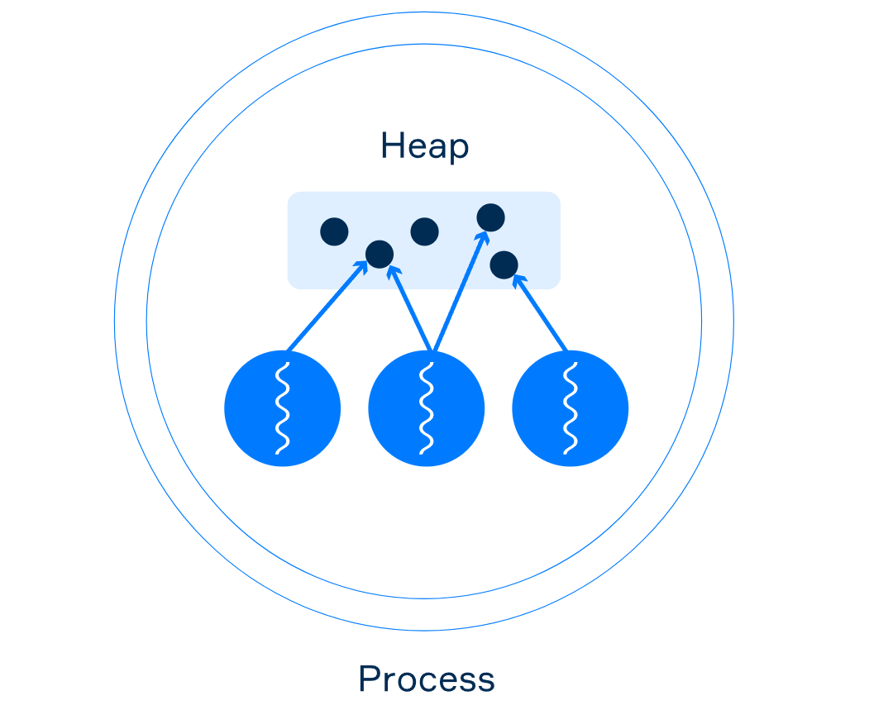

#Dữ liệu được chia sẻ

Như bạn đã biết, bất kỳ chương trình nào cũng hoạt động với dữ liệu được lưu trữ trong một vùng bộ nhớ đặc biệt. Mỗi process có bộ nhớ riêng, nhưng nếu chúng ta sử dụng multithreading trong process này, các luồng có quyền truy cập vào khu vực cụ thể đó để tương tác với nhau.

## Chia sẻ dữ liệu giữa các luồng

**Các luồng thuộc cùng một process chia sẻ bộ nhớ chung (được gọi là heap)**. Họ có thể giao tiếp bằng cách sử dụng dữ liệu được chia sẻ trong bộ nhớ. Để có thể truy cập cùng một dữ liệu từ nhiều luồng, mỗi thread phải có tham chiếu đến dữ liệu này (bởi một đối tượng). Hình ảnh dưới đây thể hiện ý tưởng:



**Nhiều luồng của một process có tham chiếu đến các đối tượng trong Heap**


Hãy xem xét một ví dụ. Đây là một lớp có tên `Counter`:

```kotlin
class Counter {
    var value = 0

    fun increment() {
        value++
    }
}
```

Lớp có một chức năng: `increment`. Mỗi lệnh gọi `increment` sẽ thêm 1 vào trường `value`.

Và đây là lớp mở rộng `Thread`:

```kotlin
class MyThread(val
counter: Counter) : Thread() {
    override fun run() {
        counter.increment()
    }
}
```

Bây giờ chúng ta hãy tạo một phiên bản `Counter` và hai phiên bản `MyThread`. Cả hai phiên bản của `MyThread` đều có cùng tham chiếu đến đối tượng `counter`.

```kotlin
val counter: Counter =
Counter()

val thread1: MyThread = MyThread(counter)
val thread2: MyThread = MyThread(counter)
```

Bây giờ, hãy xem điều gì xảy ra khi chúng ta khởi động từng luồng một và in ra kết quả `counter.value`.

```kotlin
thread1.start() //start the first thread
thread1.join()  // wait for the first thread

thread2.start() // start the second thread
thread2.join()  // wait for the second thread

println(counter.value) // it prints 2
```
Kết quả chính xác là những gì chúng tôi mong đợi.

Khi bạn viết mã của mình trong các luồng khác nhau hoạt động đồng thời với cùng một dữ liệu, điều quan trọng là phải hiểu một số điều:

- một số hoạt động phi nguyên tử

- những thay đổi của một biến được thực hiện bởi một thread có thể ẩn đối với các luồng khác
- nếu có thể nhìn thấy những thay đổi thì thứ tự của chúng có thể không


## Nhiễu Thread

Thao tác **phi nguyên tử** là thao tác bao gồm nhiều bước. thread có thể hoạt động trên giá trị trung gian của hoạt động phi nguyên tử được thực hiện bởi một thread khác. 

Điều này dẫn đến một sự cố gọi là **nhiễu thread** – trình tự các bước của hoạt động phi nguyên tử được thực hiện bởi một số luồng có thể chồng lên nhau.

Các trường đọc và ghi thuộc loại kép và dài (64 bit) có thể không nguyên tử trên một số nền tảng.

Để thực hiện các thao tác như vậy ở dạng nguyên tử, các trường phải được khai báo bằng từ khóa `Volatile`. Bạn sẽ biết điều đó có ý nghĩa gì trong phần tiếp theo!

```kotlin
class MyClass {
    @Volatile
     var longVal: Long = 0 // reading and writing are atomic now

    @Volatile
     var doubleVal: Double = 0.0 // reading and writing are atomic now
}
```


Trong khi đó, các hoạt động đọc và ghi vào các trường thuộc một số loại nhất định (`Boolean`, `Byte`, `Short`, `Int`, `Char` và `Float`) được đảm bảo là nguyên tử.

Trong các ứng dụng lớn, lỗi gây nhiễu thread có thể khó phát hiện.

## Khả năng hiển thị giữa các chủ đề

Đôi khi, khi thread thay đổi dữ liệu được chia sẻ, thread khác có thể không nhận thấy những thay đổi này hoặc nhận chúng theo thứ tự khác. Điều đó có nghĩa là các luồng khác nhau có thể có các chế độ xem không nhất quán đối với cùng một dữ liệu.

Lý do là compiler, runtime hoặc bộ xử lý có thể áp dụng tất cả các loại tối ưu hóa để tăng tốc độ thực thi chương trình. Mặc dù những tối ưu hóa này thường thực sự hữu ích nhưng đôi khi chúng có thể gây ra các vấn đề nghiêm trọng.

Bộ nhớ đệm và sắp xếp lại là những cách tối ưu hóa phổ biến có thể gây ra hành vi không mong muốn trong các chương trình đồng thời. Để quản lý những vấn đề này, Kotlin và JVM cung cấp một số công cụ để kiểm soát thứ tự truy cập bộ nhớ, trong đó chú thích `@Volatile` được sử dụng phổ biến nhất.

Ví dụ:

```kotlin
var number = 0
var ready = false

class Reader : Thread() {
    override fun run() {
        while (!ready) {
             yield() // thread does not need resources right now but wants to request them soon
        }
        println(number)
    }
}

fun main() {
    Reader().start()
    number = 42
    ready = true
}
```

Như bạn mong đợi, kết quả sẽ là 42. Tuy nhiên, chương trình cũng có thể in số 0. Lý do dẫn đến những bất thường như vậy là **khả năng hiển thị yếu** và **sắp xếp lại bộ nhớ**.

Hãy xem tại sao điều đó có thể xảy ra:

**Hầu hết các bộ xử lý hiện đại không ghi vào bộ nhớ ngay sau khi nhận được yêu cầu. Những yêu cầu này được thêm vào hàng đợi trong bộ đệm ghi được phân bổ riêng. Sau một thời gian, tất cả yêu cầu từ hàng đợi sẽ được thực thi ngay lập tức và dữ liệu được ghi vào bộ nhớ chính**.

Vì vậy, khi thread chính thay đổi giá trị của số và các biến sẵn sàng, không có gì đảm bảo rằng thread đang đọc sẽ nhìn thấy nó. Nghĩa là, việc đọc thread có thể thấy giá trị được cập nhật ngay lập tức hoặc có độ trễ nhất định hoặc không bao giờ!

Chú thích `@Volatile` cho phép chúng tôi cung cấp khả năng hiển thị các thay đổi dữ liệu. Do đó, chú thích này trở nên rất hữu ích khi bạn có multithreading trong một chương trình và truy cập một khối mã song song với nhiều luồng.

Ví dụ:

```kotlin
class Counter {
    @Volatile
    var count = 0
}

fun main() {
    val counter = Counter()

    // Thread tăng count
    Thread {
        repeat(10) {
            counter.count++
            println("Tăng: ${counter.count}")
            Thread.sleep(100)
        }
    }.start()

    // Main thread in giá trị count mỗi 100ms
    repeat(10) {
        Thread.sleep(100)
        println("Đọc: ${counter.count}")
    }
}
```

## Các trường hợp nhìn thấy khác

Đôi khi chúng ta không cần sử dụng chú thích `@Volatile`. Các thủ tục sau đây cũng sẽ đảm bảo khả năng hiển thị:

- những thay đổi của các biến được thực hiện bởi thread **trước khi bắt đầu** một thread mới luôn hiển thị với thread mới;

- các thay đổi của các biến bên trong thread luôn hiển thị với bất kỳ luồng nào khác sau khi nó trả về thành công từ `join` (chúng tôi đã sử dụng điều này ở đầu bài viết này).


