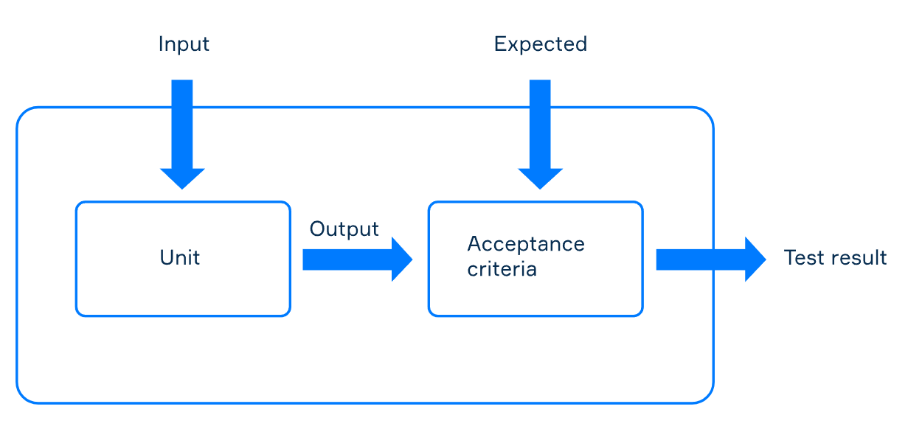
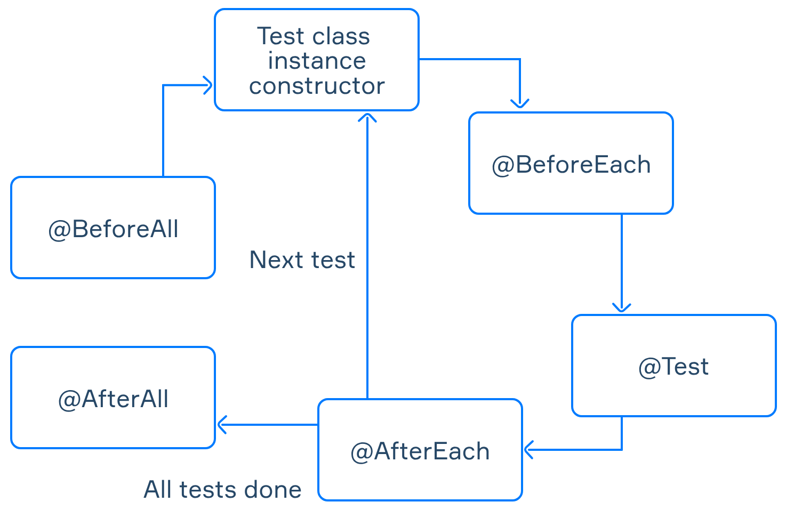
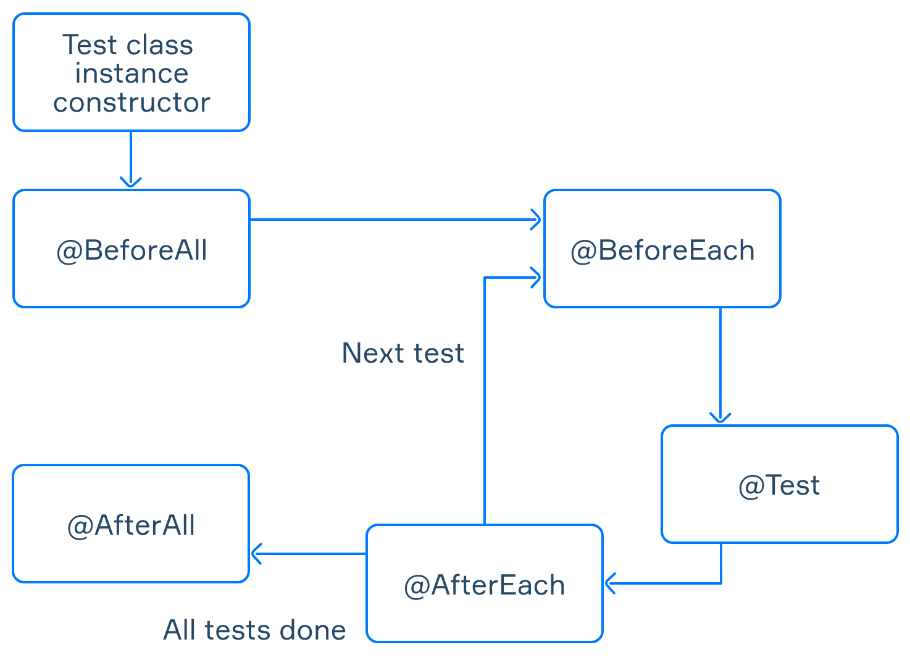

#Unit Test

Chúng tôi sẽ xem xét một thử nghiệm được thực hiện bởi các nhà phát triển: **thử nghiệm đơn vị**. 
Đây có lẽ là phương pháp phổ biến nhất: nó ngụ ý việc kiểm tra hành vi của một đơn vị ứng dụng.

> [!NOTE]
> Đơn vị là một phần mã thực hiện chính xác một tác vụ, vì vậy đây là phần nhỏ nhất có thể kiểm tra được của ứng dụng.

### Các bước kiểm tra một đơn vị

Ý tưởng chính của thử nghiệm đơn vị là tách biệt một đơn vị cụ thể và kiểm tra xem nó có hoạt động tốt không.

Quá trình kiểm tra trải qua các giai đoạn sau:

- Chúng tôi **tạo hai bộ dữ liệu**: đầu vào và đầu ra dự kiến;
- Chúng tôi **xác định tiêu chí chấp nhận**: một số điều kiện xác định xem thiết bị có hoạt động như mong đợi hay không 
(thông thường, tiêu chí chấp nhận là sự so sánh giữa đầu ra thực tế với đầu ra dự kiến);
- Chúng tôi **chuyển tập dữ liệu đầu vào đã tạo cho đơn vị được kiểm tra**;
- Đầu vào gọi mã của đơn vị được kiểm tra;
- Mã tạo ra kết quả;
- Sản phẩm sản xuất ra được kiểm tra theo các chỉ tiêu chấp nhận, 
so sánh sản lượng thực tế với sản lượng dự kiến;
- **Tiêu chí chấp nhận trả về kết quả**: `pass` hoặc `fail`.



> [!NOTE]
> Lưu ý rằng chúng tôi sử dụng các bài kiểm tra đơn vị để kiểm tra chương trình của mình mà không phụ thuộc vào bên ngoài như cơ sở dữ liệu, 
> dịch vụ web, v.v., sẽ thuộc danh mục kiểm tra tích hợp.


## Thủ công và tự động

Tất cả các bước này có thể được thực hiện **thủ công** hoặc **tự động**. 
Trên thực tế, việc lựa chọn thử nghiệm đơn vị thủ công là rất hiếm và có một số lý do chính đáng cho điều đó. 

- Đầu tiên, việc kiểm tra là một process thực sự lặp đi lặp lại: mỗi khi bạn thực hiện một thay đổi nhỏ trong mã của mình, bạn phải kiểm tra lại nó. 
Làm điều này bằng tay sẽ khó khăn. 
Thứ hai, kiểm thử đơn vị có thể dễ dàng được tự động hóa, vì vậy không có lý do gì phải thực hiện thủ công. Các trường hợp kiểm thử tự động có thể tái sử dụng được. 
Giả sử bạn thêm một tính năng mới vào chương trình của mình; bạn có thể thực hiện các trường hợp kiểm thử hiện có để kiểm tra xem tính năng mới có ảnh hưởng đến ứng dụng hay không.

- Thứ hai, kiểm thử đơn vị sẽ bảo vệ mã của bạn khỏi những thay đổi không chính xác tiếp theo.

- Cuối cùng, thử nghiệm đơn vị giúp việc tích hợp process dễ dàng hơn.


Kiểm thử đơn vị là một phần thiết yếu trong công việc hàng ngày của nhà phát triển. Mặc dù khá tốn thời gian nhưng nó bảo vệ mã của bạn khỏi lỗi và giúp bạn tiết kiệm rất nhiều năng lượng vào cuối ngày.

## JUnit


Trong Kotlin, các phương thức có thể trả về giá trị hoặc thay đổi trạng thái bên trong của đối tượng. 

**Để xác minh tính chính xác của bất kỳ phương thức nào, bạn có thể so sánh giá trị được phương thức đó trả về với giá trị mong đợi hoặc so sánh trạng thái bên trong của một đối tượng được sửa đổi bởi phương thức đó với trạng thái bên trong dự kiến**.

Tất nhiên, bạn có thể thực hiện các bài kiểm tra theo cách thủ công, nhưng nó có xu hướng tẻ nhạt và tốn thời gian. 
Đó là lý do tại sao một số framework được phát triển để cung cấp các công cụ thuận tiện cho việc kiểm thử đơn vị tự động. Phổ biến nhất trong số đó là **JUnit**.

> [!TIP]
> Các chức năng kiểm thử phải có tên rõ ràng và mang tính mô tả để dễ hiểu mục đích của kiểm thử và xác định nguồn gốc của lỗi hoặc lỗi khi chạy nhiều kiểm thử. 
> Quy ước đặt tên phổ biến là sử dụng định dạng >
> `FunctionName_TestCondition_ExpectedOutcome`. 
> Điều này giúp truyền đạt rõ ràng mục đích của thử nghiệm, bao gồm phương pháp đang được thử nghiệm, đầu vào hoặc điều kiện mà phương thức được gọi và kết quả mong đợi

## Khẳng định

Lớp `Assertions` của JUnit framework có rất nhiều phương thức nạp chồng cho phép bạn kiểm tra các điều kiện khác nhau

| Phương pháp | Mô tả |
|---|---|
| assertEquals | Kiểm tra xem các đối số có bằng nhau không |
| assertTrue | Kiểm tra xem giá trị có phải là `true` hay không |
| assertFalse | Kiểm tra xem đối số có phải là `false` hay không |
| assertNull | Kiểm tra xem đối số có phải là `null` hay không |
| assertNotNull | Kiểm tra xem đối số có phải là `null` hay không |
| assertThrows | Kiểm tra xem đối số có đưa ra một ngoại lệ nhất định hay không |

Ví dụ

```kotlin 
import org.junit.jupiter.api.assertTrue

class CalculatorTest {
    
    ...

    @Test
    fun `when 2 is checked if even expect true`() {
        assertTrue(Calculator.isEven(2))
    }
}
```

Chúng tôi cũng có thể thêm một thử nghiệm để kiểm tra xem phương thức `division` của chúng tôi có đưa ra `IllegalArgumentException` hay không nếu đối số thứ hai được cung cấp khi gọi nó là 0:


```kotlin
import org.junit.jupiter.api.assertThrows

class CalculatorTest {

    ...
    
    @Test
    fun `when dividing by 0 expect IllegalArgumentException`() {
        assertThrows<IllegalArgumentException> {
            Calculator.divide(10, 0)
        }
    }
}
```

### Chạy thử nghiệm

Để chạy thử nghiệm là sử dụng cửa sổ đầu cuối. 
Trước tiên, hãy thêm các dòng sau vào tệp `build.gradle` để xem đầu ra chi tiết hơn cho các thử nghiệm đã thực hiện:

```kotlin
test {
    ...
    
    testLogging {
        events "passed", "skipped", "failed"
    } 
}
```

Sau đó, chạy lệnh sau trong cửa sổ Terminal (đảm bảo bạn đang ở trong thư mục gốc của dự án):

```bash
./gradlew test
```
Khi các thử nghiệm được thực hiện, bạn sẽ nhận được kết quả này:

```bash
...
> Task :test
CalculatorTest > when adding 1 and 2 expect 3() PASSED
CalculatorTest > when subtracting 2 from 3 expect 1() PASSED
CalculatorTest > when multiplying 2 by 3 expect 6() PASSED
CalculatorTest > when dividing 4 by 2 expect 2() PASSED
CalculatorTest > when 2 is checked if even expect true() PASSED
CalculatorTest > when dividing by 0 expect IllegalArgumentException() PASSED

BUILD SUCCESSFUL in 3s
```

Đôi khi bạn có thể muốn bỏ qua một thử nghiệm đã được triển khai.
Có thể vì nó đang thử nghiệm một tính năng chưa sẵn sàng để phát hành hoặc tính năng này có lỗi chưa được sửa.
Để làm như vậy, hãy chú thích phương pháp thử nghiệm bằng `@Disabled`:

```kotlin 
class CalculatorTest {
    
    @Disabled
    @Test
    fun `when adding 1 and 2 expect 3`() {
        ...
    }
}
```

##MockK

MockK là một thư viện mô phỏng mạnh mẽ được thiết kế cho ngôn ngữ Kotlin. 
Nó cung cấp một cách đơn giản và trực quan để tạo và quản lý các đối tượng mô phỏng cho mục đích thử nghiệm.

### Kiểm tra đơn vị và MockK

Một trong những thách thức trong thử nghiệm đơn vị là xử lý các dependency, chẳng hạn như các dịch vụ bên ngoài hoặc quyền truy cập cơ sở dữ liệu.
Mocking là một kỹ thuật được sử dụng để mô phỏng các dependency này và tạo ra các thử nghiệm riêng biệt.
Bằng cách sử dụng các đối tượng mô phỏng thay vì các dependency thực, nhà phát triển có thể kiểm soát hành vi của các dependency này và làm cho các thử nghiệm của họ dễ dự đoán hơn.
Điều này cho phép họ tập trung vào việc kiểm tra các phần cụ thể trong mã của mình mà không phải lo lắng về các yếu tố bên ngoài có thể ảnh hưởng đến kết quả kiểm tra.

## Kiểm tra chú thích lifecycle

Chúng ta không nên tạo một phiên bản duy nhất của một lớp và chia sẻ nó giữa tất cả các bài kiểm tra, 
vì một thử nghiệm nhất định có thể để lại một số trạng thái trong đối tượng có thể ảnh hưởng đến kết quả của các thử nghiệm khác. 
Đó là lý do tại sao chúng ta nên thực hiện mỗi bài kiểm tra bằng cách sử dụng một phiên bản mới của lớp được kiểm tra.

### Phiên bản lớp kiểm tra lifecycle

Đầu tiên, hãy nói về cách `JUnit5` thực hiện các thử nghiệm của chúng tôi. 
Nó tạo một thể hiện mới của lớp kiểm tra trước khi thực hiện từng phương thức kiểm tra.
Bằng cách này, nó đảm bảo việc thực hiện các phương pháp thử nghiệm riêng lẻ một cách tách biệt để tránh các tác dụng phụ có thể xảy ra do bất kỳ thay đổi trạng thái nào của phiên bản lớp thử nghiệm.


> [!NOTE]
> Chú thích `@TestInstance` kiểm soát phiên bản lớp kiểm tra lifecycle.
> Nó được đặt thành `TestInstance.Lifecycle.PER_METHOD` theo mặc định nhưng có thể thay đổi nếu cần.

Ngoài ra, JUnit5 có các chú thích đặc biệt để chỉ định bất kỳ phương thức nào là phương thức lifecycle,
chẳng hạn như `@BeforeAll`, `@AfterAll`, `@BeforeEach` hoặc `@AfterEach`.
Họ hướng dẫn framework thực thi các phương pháp được chỉ định trước hoặc sau khi thực hiện các phương pháp thử nghiệm thực tế.

Các chú thích `@BeforeEach` và `@AfterEach` lần lượt chỉ ra rằng phương thức được chú thích sẽ được thực thi trước và sau mỗi phương thức của lớp kiểm tra được chú thích bằng `@Test`,
trong khi các phương thức `@BeforeAll` và `@AfterAll` sẽ được thực thi trước hoặc sau tất cả các phương thức `@Test` trong lớp thử nghiệm.

Trong ví dụ sau, chúng tôi tạo một lớp thử nghiệm mới để xem các chú thích lifecycle thực sự hoạt động như thế nào:

```kotlin
import org.junit.jupiter.api.*

class LifeCycleTest {

    constructor(){
        println("Test Class Constructor")
    }

    @BeforeEach
    fun beforeEach() {
        println("Before each test")
    }

    @AfterEach
    fun afterEach() {
        println("After each test")
    }

    @Test
    fun test1() {
        println("Test 1")
    }

    @Test
    fun test2() {
        println("Test 2")
    }
}
```

```bash
Test Class Constructor
Before each test
Test 1
After each test
Test Class Constructor
Before each test
Test 2
After each test
```

Sơ đồ sau minh họa thứ tự này để giúp bạn hiểu rõ hơn về lớp kiểm tra lifecycle:



### Phiên bản kiểm tra mỗi lớp

Nếu vì bất kỳ lý do gì bạn muốn thực thi tất cả các phương thức kiểm tra trên cùng một phiên bản của lớp kiểm tra,
JUnit5 cho phép bạn làm như vậy bằng cách chú thích lớp kiểm tra bằng `@TestInstance(Lifecycle.PER_CLASS)`.
Trong chế độ này, một phiên bản mới của lớp kiểm tra sẽ chỉ được tạo một lần,
do đó, nếu phương pháp thử nghiệm của bạn dựa vào trạng thái được lưu trữ trong các biến không tĩnh của nó, bạn có thể cần phải đặt lại trạng thái đó trong các phương thức `@BeforeEach` hoặc `@AfterEach`.




## Tham khảo
- https://hyperskill.org/learn/step/7545

