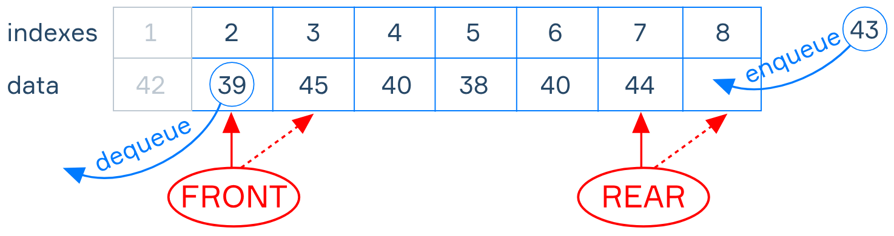
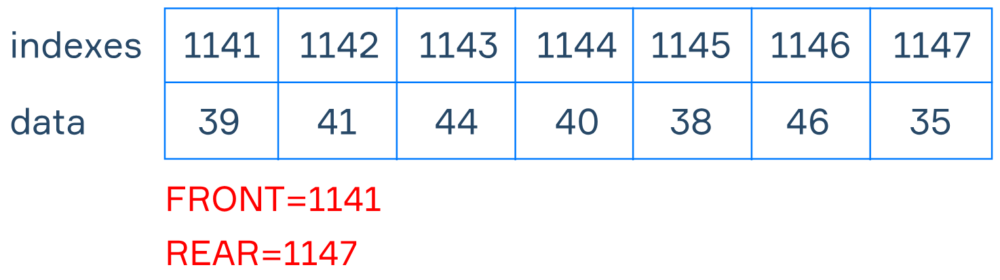
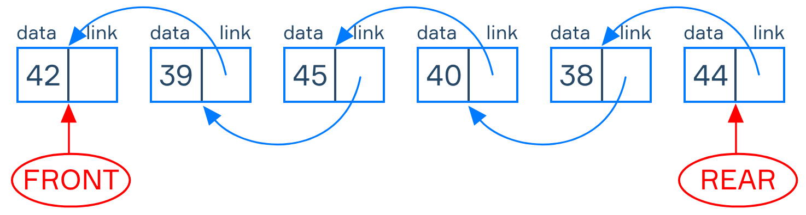

# xếp hàng

nó là minh họa cho nguyên tắc lập trình có tên **FIFO** (Vào trước, ra trước) và data structure hoạt động theo cách này được gọi là **hàng đợi**.

## Kết cấu

Các phần tử trong hàng đợi đứng liên tiếp, với FRONT trỏ vào phần tử đầu tiên và REAR trỏ vào phần tử cuối cùng.

## Hoạt động xếp hàng

chỉ có hai sự kiện trong hàng đợi:

- Thao tác khi bạn chèn một phần tử vào hàng đợi được gọi là **enqueue**, và phần tử đó được thêm vào bởi con trỏ REAR.
- Nếu bạn loại bỏ một phần tử, thao tác này được gọi là **dequeue** và phần tử được FRONT trỏ tới sẽ thoát ra khỏi hàng đợi. 

Tất nhiên, sau bất kỳ thao tác nào trong số này, con trỏ tương ứng sẽ di chuyển.

## Thực hiện hàng đợi

### Mảng

`FRONT` và `REAR` có thể đơn giản là các biến số lưu trữ chỉ mục của các phần tử tương ứng.

Sau đó, bạn có thể truy cập cả phần tử đầu tiên và phần tử cuối cùng trong một khoảng thời gian không đổi: **các thao tác enqueue và dequeue** sẽ thực hiện `O(1)`.

Tuy nhiên, có một vấn đề với cách triển khai này: việc thêm và xóa các phần tử, bạn di chuyển trong mảng, điều đó có nghĩa là bạn cần một mảng có độ dài vô hạn.

### Linked list

`FRONT` và `REAR` sau đó là các con trỏ tới nút đầu tiên và nút cuối cùng trong danh sách, điều này một lần nữa cho phép bạn thực hiện chèn và xóa các phần tử trong `O(1)`.

Nhưng việc lưu trữ một liên kết đến mục tiếp theo trong mỗi mục có nghĩa là lãng phí nhiều bộ nhớ hơn dữ liệu yêu cầu.

### Triển khai trên thực tế

Trong hầu hết các dự án, bạn không cần triển khai hàng đợi: nó đã tồn tại trong programming language của bạn. Vậy nó hoạt động như thế nào? Chà, nó phụ thuộc vào ngôn ngữ cụ thể, nhưng hầu hết nó thường được triển khai trên một mảng với một số nâng cấp. Có thể nói rằng cả hai hoạt động enqueue và dequeue đều có độ phức tạp về thời gian `O(1)`.

