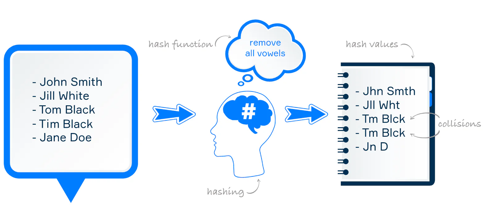

# Tổng quan về Hasing

Về mặt hình thức, hàm băm là các hàm mà chúng ta có thể sử dụng để ánh xạ dữ liệu có kích thước tùy ý tới các giá trị có kích thước cố định. Điều đó khá mơ hồ, vì vậy chúng ta hãy nhìn vào một so sánh thực tế để hiểu rõ hơn về chúng:

Hãy tưởng tượng bạn có một người bạn Paul, người giữ một cuốn danh bạ điện thoại. Bạn của bạn lười biếng và không muốn mất nhiều thời gian để viết tên đầy đủ những người liên hệ của mình.

Vì vậy, thay vào đó, Paul chỉ viết các phụ âm trong tên của họ. Ví dụ, thay vì John Smith, Paul viết Jhn Smth.

Theo một số cách, process này tương tự như **băm**. Chúng ta có thể coi việc "xóa tất cả các nguyên âm" là **hash function**.

Chúng tôi gọi kết quả của việc áp dụng hash function cho một số đầu vào là **giá trị băm** hoặc đơn giản là hàm băm của nó. 

Bây giờ, không phải tất cả các giá trị băm đều khác biệt: hãy nghĩ về hai người có tên Tim Black và Tom Black. Giá trị băm cho cả hai tên đó sẽ là Tm Blck. Khi điều này xảy ra, chúng tôi gọi đó là **va chạm**.

Sự khác biệt chính giữa ví dụ của chúng tôi và hash function thực là trong trường hợp của chúng tôi, các giá trị băm không có kích thước cố định.

hash function thực sự nhận đầu vào có thể thực sự lớn và trả về thứ gì đó có kích thước cố định, vì vậy không có cách nào để tránh hoàn toàn xung đột!

## Ứng dụng của hàm băm

Như chúng tôi đã đề cập ở phần đầu, hàm băm có nhiều ứng dụng. Chúng ta hãy xem xét một số điều quan trọng nhất:

- Bản tóm tắt tin nhắn

Giả sử bạn có một tin nhắn muốn gửi cho một người bạn qua internet nhưng sợ rằng ai đó có thể thay đổi nội dung trước khi nó đến tay bạn bè của bạn. Một trong những điều bạn có thể làm là tính giá trị băm cho tin nhắn của mình trước khi gửi nó. Khi bạn bè của bạn nhận được nó, họ sẽ tính giá trị băm của tin nhắn bằng cách sử dụng hash function giống như bạn. Sau đó, bạn có thể so sánh hai giá trị băm và kiểm tra xem chúng có bằng nhau không. Các hàm băm được sử dụng cho việc này có đặc tính là khó tìm thấy xung đột. Các hàm băm như vậy được gọi là hàm băm **mật mã**. 

- Lưu trữ mật khẩu

Bạn có bao giờ thắc mắc tại sao các trang web không có tùy chọn gửi mật khẩu cho bạn trong trường hợp bạn quên và họ yêu cầu bạn đặt lại mật khẩu không? Để có thể gửi lại, họ phải lưu trữ nó ở dạng văn bản thuần túy. Bằng cách đó, nếu ai đó có quyền truy cập vào cơ sở dữ liệu mật khẩu, họ có thể dễ dàng đánh cắp tất cả các tài khoản! Những gì các trang web làm là lưu trữ hàm băm mật khẩu của bạn. Khi bạn gửi mật khẩu để đăng nhập, họ sẽ tính toán hàm băm của nó và kiểm tra xem nó có bằng với những gì họ đã lưu trữ hay không. Trong trường hợp này, việc tìm ra va chạm không phải là một vấn đề lớn. Ở đây, bạn cần biết rằng nếu ai đó tìm thấy hàm băm của mật khẩu của bạn, họ sẽ không thể tìm ra mật khẩu của bạn từ đó.

- Bảng băm

Một cách sử dụng phổ biến hơn trong lập trình hàng ngày là bảng băm. Chúng là những cấu trúc dữ liệu nhanh chóng và thuận tiện sử dụng hàm băm. Với chúng, bạn có thể tìm kiếm, chèn hoặc xóa các thành phần khỏi bảng. Ý tưởng chính đằng sau chúng là bạn muốn sử dụng các giá trị băm để lập chỉ mục dữ liệu trong một mảng. Ví dụ: nếu bạn muốn sử dụng hash table để lưu danh bạ điện thoại, bạn có thể lưu cặp (Tim Black, 0123456789) tại chỉ mục Tm Blck. Sau đó, để tìm số điện thoại của Tim bạn chỉ cần tìm ở mục lục Tm Blck. Sau đó, bạn cũng có thể lưu (Tom Black, 9876543210) ở cùng một chỉ mục và mỗi khi cần tìm số điện thoại của Tim hoặc Tom, bạn chỉ phải tìm giữa hai cặp chứ không phải tìm cả danh bạ. Các hàm băm được sử dụng trong bảng băm ít hạn chế hơn so với các hàm băm được sử dụng để tóm tắt thông báo và lưu trữ mật khẩu và các giá trị băm của chúng nói chung là các số.

