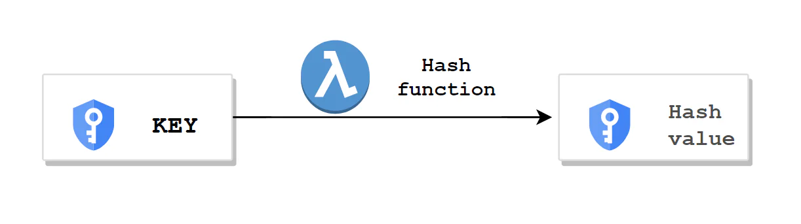
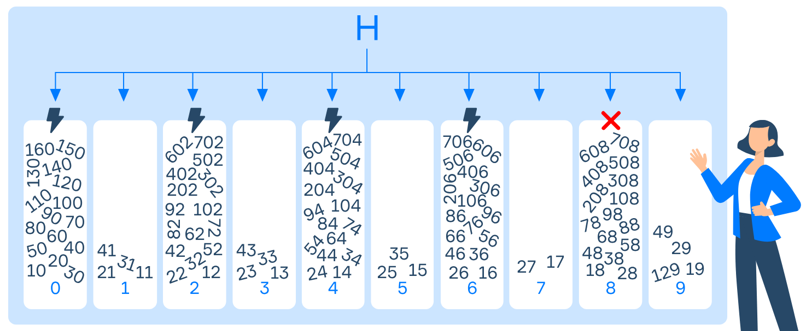

#Hash function

## Nhận dạng hash function tốt

Trước khi bắt đầu, hãy ôn lại hiểu biết của chúng ta về **hàm băm**. Về cơ bản, chúng hoạt động giống như các hàm tiêu chuẩn: bạn nhập một số dữ liệu và chúng trả về một đầu ra khác.

Cụ thể hơn, họ sử dụng các phép biến đổi toán học để chuyển đổi dữ liệu đầu vào có kích thước thay đổi thành đầu ra có kích thước cố định được gọi là **giá trị băm hoặc mã băm**. Vậy điều gì phân biệt một chiếc hash function tốt với một chiếc hash function bình thường? 

- **Hiệu quả**: hash function hiệu quả sẽ thực hiện xử lý dữ liệu nhanh chóng, tối ưu hóa tài nguyên tính toán cho các ứng dụng thực tế.

- **Tính tất định** có nghĩa là hàm sẽ tạo ra cùng một đầu ra cho một đầu vào cụ thể bất kể nó được áp dụng vào thời điểm và tần suất như thế nào.

- **Tính đồng nhất**: Các giá trị băm phải được phân phối đồng đều, nghĩa là đầu vào phải ánh xạ đồng đều giữa các giá trị băm có thể có.

## Hiệu quả

Hiệu quả là huyết mạch của các hàm băm thực tế, cho phép xử lý dữ liệu nhanh chóng cho các ứng dụng như lưu trữ với tính năng tìm kiếm nhanh. Hãy chia nhỏ điều này:

Hãy tưởng tượng bạn đang làm việc với một hệ thống cơ sở dữ liệu, giống như một thư viện rộng lớn, chứa hàng triệu cuốn sách (hồ sơ). Mỗi cuốn sách có một mã số duy nhất (mã định danh duy nhất). Bây giờ, hãy coi hash function như một thủ thư siêu hiệu quả, người có thể cho bạn biết ngay chính xác vị trí của một cuốn sách khi được cung cấp mã duy nhất. Thủ thư này (hash function) nhanh chóng chuyển mã này thành một vị trí (giá trị băm), cho phép bạn tìm thấy sách của mình một cách nhanh chóng. Đây là vẻ đẹp của hash function hiệu quả — nó cho phép truy xuất và tìm kiếm dữ liệu nhanh chóng.

Như chúng ta sẽ tìm hiểu trong các chủ đề sau, tốc độ mà hash function có thể tính toán các giá trị băm thường không đổi, được ký hiệu là `O(1)`. Tốc độ này rất quan trọng để tìm kiếm hiệu quả và hầu hết các bảng băm đều đáp ứng tiêu chí này.

Tuy nhiên, như mọi nơi, vẫn có một số trường hợp ngoại lệ. Một số hàm băm, như SHA1 nổi tiếng, có thể mất một lượng thời gian tuyến tính `O(n)` để tính toán các giá trị băm. Đây không hẳn là một nhược điểm: trên thực tế, nó hoàn toàn có thể chấp nhận được đối với một số tác vụ nhất định, chẳng hạn như tạo tổng kiểm tra và băm mật khẩu. Vấn đề là, 'tốc độ' mong muốn của hash function có thể khác nhau tùy thuộc vào trường hợp sử dụng cụ thể mà nó được áp dụng.

## Chủ nghĩa quyết định

Khái niệm về tính tất định trong hàm băm là một khía cạnh quan trọng cần hiểu trong khoa học máy tính, không chỉ trong hàm băm. Để đơn giản hóa, nếu bạn có hai đầu vào giống hệt nhau, chúng sẽ tạo ra cùng một giá trị băm.

Bây giờ, tại sao thuyết quyết định lại quan trọng? Nó đảm bảo kết quả nhất quán cho một tập hợp đầu vào nhất định. Điều này đặc biệt quan trọng đối với việc lưu trữ mật khẩu. 

Giá trị băm này sau đó được sử dụng để so sánh trong quá trình xác thực process. Nếu không có hàm băm xác định, process xác thực mật khẩu sẽ trở nên hỗn loạn, khiến việc xác minh danh tính người dùng gần như không thể.

## Tính đồng nhất

Tính đồng nhất có nghĩa là hash function phải trải đều đầu ra (giá trị băm) của nó càng đồng đều càng tốt.  

Hãy xem xét nó như thế này - nếu chúng tôi phân loại tất cả các đầu ra có thể có từ hash function, chúng tôi muốn mỗi danh mục hoặc nhóm có cùng kích thước. Điều này giúp tránh tắc nghẽn hoặc chậm lại do có quá nhiều đầu ra (xung đột) tập trung xung quanh một hoặc một vài giá trị, được gọi là khóa cao nhất.

Ví dụ: hãy tưởng tượng một hệ thống lưu trữ dữ liệu sử dụng hash function tạo ra các giá trị băm dựa trên chữ số cuối cùng của ID của người dùng. Nếu phần lớn các ID này kết thúc bằng các chữ số chẵn thì các giá trị băm sẽ có xu hướng xếp chồng lên nhau trong một số 'nhóm' hoặc nhóm nhất định, tạo ra sự phân bổ không đồng đều. Việc phân cụm này dẫn đến nguy cơ xung đột cao hơn, điều này có thể cản trở hiệu suất tổng thể của hệ thống và làm tăng khả năng xảy ra lỗi dữ liệu cũng như các vấn đề về truy xuất.

