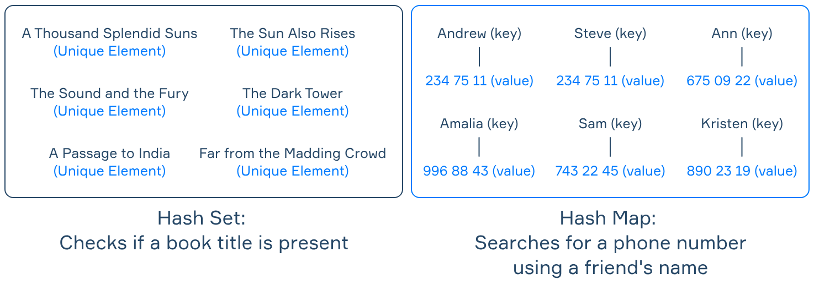

#Hash Table

Hãy tưởng tượng tình huống sau: bạn có rất nhiều bạn bè và một kệ lớn chứa đầy sách. Một số bạn bè của bạn muốn mượn sách của bạn, một số muốn trả lại và một số muốn biết liệu bạn có cuốn sách nào đó không. Vì vậy, bạn muốn viết một chương trình cho phép bạn thêm sách, xóa sách và kiểm tra xem có sách hay không. Đối với trường hợp này, data structure tốt nhất để sử dụng là gì?

**Bảng băm** là cấu trúc cho phép chúng ta chèn và xóa các giá trị, đồng thời kiểm tra xem giá trị có xuất hiện trong thời gian `O(1)` cho mỗi thao tác đó hay không. Chỉ riêng bảng băm không thể đảm bảo lần này. Tuy nhiên, khi kết hợp với hash function tốt, mọi thứ đều hoạt động tốt, khiến nó trở thành một trong những cấu trúc dữ liệu tốt nhất cho mục đích này.

##Hash table

Bảng băm là các mảng trong đó mỗi mục nhập là một **nhóm**. Nhóm có thể chứa 0 hoặc nhiều giá trị của một loại. Chúng được xác định bởi chỉ mục của chúng trong mảng. Nếu chúng tôi muốn chèn một giá trị vào hash table, chúng tôi tính toán giá trị băm của nó và chèn nó vào nhóm với chỉ mục bằng giá trị băm (theo modulo kích thước của mảng). Bạn có thể làm tương tự để xóa một đối tượng hoặc tìm kiếm nó.

> [!WARNING]
> Nếu giá trị băm lớn hơn chỉ số tối đa của nhóm, chúng tôi sử dụng phép chia modulo! Vì vậy, nếu hash table có 5 nhóm (chỉ số tối đa sẽ là 4 vì quá trình đếm bắt đầu từ 0) và giá trị băm của phần tử của chúng tôi là 12, thì chúng tôi lấy phần còn lại của giá trị này theo kích thước của mảng. Trong trường hợp này, 12%5=2, do đó phần tử có giá trị băm bằng 12 sẽ được lưu trữ trong nhóm có chỉ số 2.

## Ví dụ về hash table

Bây giờ chúng ta hãy xem một ví dụ. Giả sử chúng tôi có hash table với 5 nhóm và chúng tôi đang chèn số nguyên {1, 3, 5, 6} với mã nhận dạng hash function. Bảng trông như thế này:

| **Chỉ mục** | 0 | 1 | 2 | 3 | 4 |
|----------||------|--------|------|------|------|
| **Giá trị** | {5} | {1, 6} | {} | {3} | {} |

Bây giờ chúng ta hãy tìm hiểu xem nó hoạt động như thế nào. Vì chúng ta đang sử dụng hàm nhận dạng nên giá trị băm bằng chính giá trị đó. Do đó, bạn có thể thấy rằng 1 và 3 nằm trong các nhóm tương ứng ở chỉ số 1 và 3. Hiện tại, 5 và 6 có giá trị băm là 5 và 6, nhưng có quá ít nhóm! Để tìm nhóm cho chúng, chúng tôi lấy modulo của giá trị băm cho tổng số nhóm, trong trường hợp này là 5. Vì vậy, 5 modulo 5 là 0 và 6 modulo 5 là 1 và bạn có thể thấy trong bảng rằng các giá trị được đặt vào đúng nhóm.

## Bộ băm và bản đồ băm

**Có hai loại bảng băm**. Cái ở trên được gọi là **bộ băm**. Chúng ta có thể sử dụng nó trong các tình huống mà chúng ta chỉ cần kiểm tra xem có một giá trị nào đó hay không: ví dụ: kịch bản cuốn sách trong phần giới thiệu.

`HashSet` của Java tiêu chuẩn bao bọc `HashMap` và sử dụng các khóa của nó, không sử dụng các giá trị. Vì vậy, `HashSet` chỉ sử dụng lại mã hiện có mà không phát minh lại bất cứ thứ gì nhưng lại lãng phí một số bộ nhớ.

Chúng ta vẫn có thể thêm hoặc xóa các phần tử khỏi tập băm, nhưng trong hầu hết các trường hợp, chúng ta không quan tâm đến việc lấy giá trị ra khỏi tập băm. Điều này xảy ra bởi vì chúng tôi đã có một giá trị bằng nhau mà chúng tôi cần để tìm kiếm hash table. Việc triển khai các bộ băm là `unordered_set` trong C++ và `HashSet` trong Java.

Một loại **hash table** khác là bản đồ băm. Hãy tưởng tượng bạn muốn giữ một danh bạ điện thoại có tên và số điện thoại của bạn bè, đồng thời muốn tìm kiếm số điện thoại bằng tên của một người bạn. Nếu bạn giữ một tập hợp băm các cặp tên-số, bạn sẽ cần biết số đó để có thể tìm kiếm. Ở đây, bản đồ băm có thể giúp bạn.

Nó lưu trữ một mảng `Node` còn được gọi là **nhóm** và mỗi nút chứa một hàm băm khóa, một tham chiếu đến khóa và giá trị.
Các nút được định vị bên trong một mảng nhóm theo giá trị băm của chúng.
Xung đột băm được giải quyết bằng cách liên kết các nút với nhau, tạo thành một danh sách bên trong một nhóm.
Hoạt động tìm kiếm (`Map.get`, `Map.containsKey`) xác định một nhóm bằng hàm băm khóa và kiểm tra sự bằng nhau của khóa.
Trong trường hợp xung đột, danh sách các nút sẽ được duyệt qua cho đến khi đạt được nút có khóa bằng nhau.
Đây được gọi là **hash table có địa chỉ đóng** vì các cặp khóa-giá trị được "đóng" (bị khóa) ở một vị trí nhất định.

Chúng rất giống với bộ băm nhưng chúng lưu trữ các cặp. Mục đầu tiên trong cặp được gọi là khóa và mục thứ hai là giá trị. Chỉ hàm băm của khóa được sử dụng và khi tìm kiếm, chúng tôi tìm kiếm giá trị được liên kết với khóa. Trong ví dụ trên, khóa sẽ là tên và giá trị sẽ là số điện thoại. Việc triển khai bản đồ băm là `unordered_map` trong C++ và `HashMap` trong Java.
