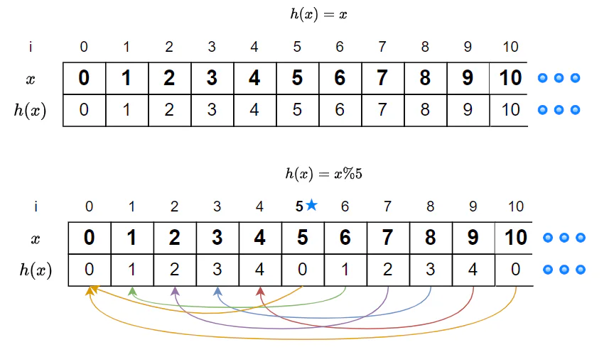
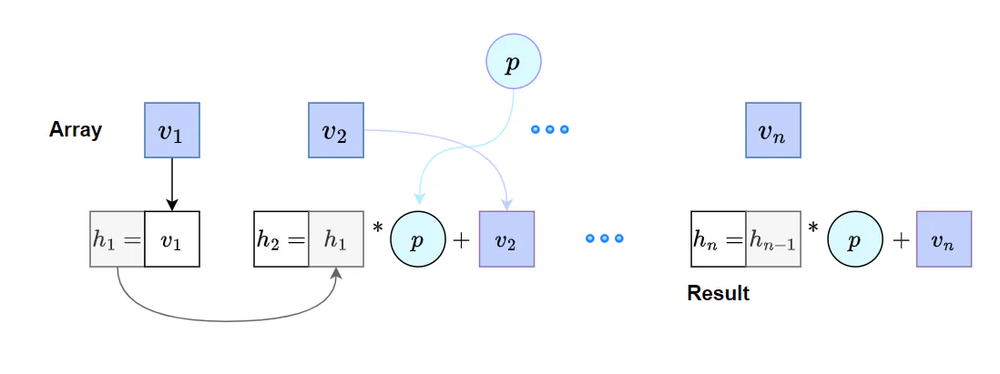
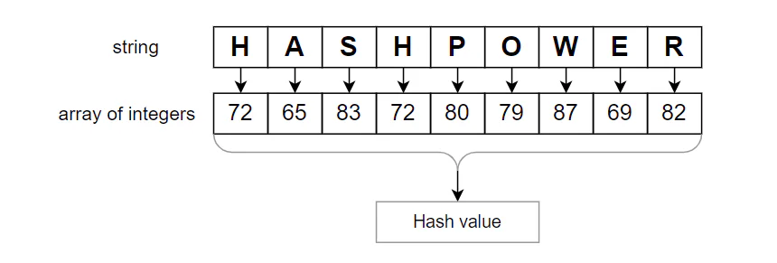

# Hàm băm đơn giản

Để sử dụng hàm băm, trước tiên chúng ta cần hiểu ký hiệu. Thông thường, các hàm băm được ký hiệu là `h`. Giá trị băm cho một mục cụ thể `x` được ký hiệu là `h(x)`

Hãy cùng xem một số cách đơn giản nhất để xây dựng hàm băm cho các kiểu dữ liệu tiêu chuẩn!

## Số nguyên

Làm thế nào chúng ta có thể băm số nguyên? Một cách tiếp cận là sử dụng hàm nhận dạng, nói cách khác là `h(x) = x` hoặc phép toán modulo `h(x) = x % p`, cho một số `p`.
Phép toán modulo `x%p` cho phần còn lại khi lặn x theo p.
Chức năng đầu tiên có vẻ hoàn hảo. tốc độ tối đa, vì chúng tôi không tính toán gì cả;
rõ ràng là xác định và thống nhất không có va chạm.
Tuy nhiên, nhược điểm của nó là có nhiều giá trị băm,
và đây là lúc biến thể modulo có thể giúp ích.
Trong trường hợp modulo, giá trị băm duy nhất có thể có sẽ là `0,1,...,p-1`

## Mảng số nguyên

Còn mảng thì sao? Giả sử chúng ta có mảng `[v1,v2,...,vn]` và bạn muốn tính giá trị băm của nó.
Câu trả lời rất đơn giản: chọn số `p` và sử dụng công thức

`hn = v1 * p^n-1 + v2 * p^n-2 + ... + vn`

> [!NOTE]
> Công thức bắt nguồn từ cách chúng ta biểu diễn các số trong hệ thập phân.
> Ví dụ: số 1234 trong hệ thập phân có thể viết là:
> 1234 = 1 * 10^3 + 2 * 10^2 + 3 * 10^1 + 4 * 10^0

Tính toán trực tiếp theo cách này sẽ dẫn đến độ phức tạp về thời gian tương đối lớn.

Phân tích Công thức tổng quát để có được công thức mới, ta xét một số trường hợp nhỏ:
 
Đối với `n = 1`: `h1 = v1`
Đối với `n = 2`: `h2 = v1 * p + v2`
Đối với `n = 3`: `h3 = v1 * p^2 + v2 * p + v3`

Quan sát mẫu, chúng tôi nhận thấy rằng nếu chúng tôi đã có giá trị `hn-1` từ bước trước,
chúng ta có thể tính hn bằng công thức mới:

`hn = hn-1 * p + vn`

Một lần nữa, để tránh tập hợp giá trị băm rộng, chúng ta có thể lấy các giá trị theo modulo `q`
đối với một số số `q`. Tức là chúng ta có thể áp dụng công thức:
`hn = (hn-1 * p + vn) mod q`

Tóm lại, nếu chỉ tính tổng các phần tử thì chúng ta không thể phân biệt được các mảng chứa các phần tử giống nhau nhưng theo thứ tự khác nhau.
Công thức băm sử dụng lũy ​​thừa của `p` đảm bảo rằng thứ tự của các phần tử cũng ảnh hưởng đến giá trị băm, cho phép chúng ta phân biệt giữa các mảng khác nhau.

Đây là một “thủ thuật” giúp tạo ra hàm băm tốt hơn và ngăn ngừa xung đột khi thứ tự phần tử thay đổi.

## Chuỗi

Có đúng là chỉ có số nguyên mới có thể băm được không? Câu trả lời là không! Về mặt chuỗi hoặc mảng chuỗi, mọi thứ vẫn tương đương, ngoại trừ trước tiên chúng ta chuyển đổi chuỗi thành số nguyên.

Điều này có thể đạt được bằng nhiều cách:
sử dụng bảng Unicode, các hệ thống mã hóa khác hoặc thậm chí các hàm băm chấp nhận chuỗi và số nguyên đầu ra. 
Ví dụ: hãy băm chuỗi "Hash" bằng mã ASCII.

1. Đầu tiên chúng ta cần chuyển ký tự thành số nguyên.
2. Lưu ý rằng bây giờ chúng ta không cần phải băm một chuỗi nữa mà là một chuỗi các số nguyên
3. Phần còn lại đã rõ ràng, chúng ta băm mảng số nguyên này như đã giải thích ở phần trước bằng cách sử dụng.

