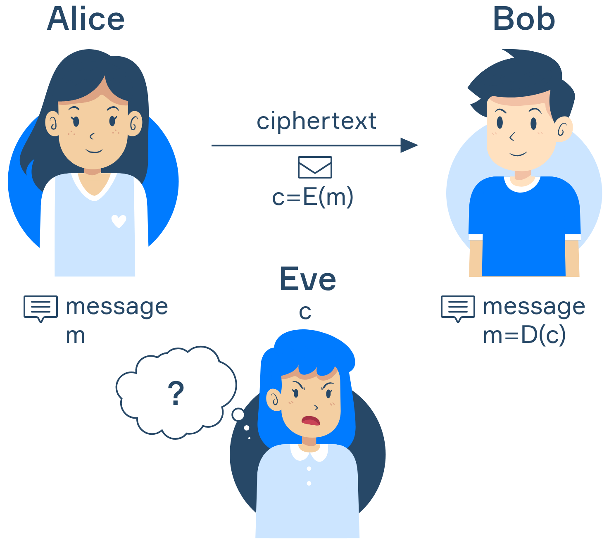

# Những ý tưởng cơ bản của mật mã

Một sự thay đổi mạnh mẽ trong lĩnh vực này đã xảy ra – đó là việc tạo ra mật mã khóa công khai. Hệ thống mật mã khóa công khai đóng một vai trò to lớn trong thế giới máy tính hiện đại.

## Hệ thống mật mã đối xứng và bất đối xứng:

Trong hệ thống mật mã khóa công khai, mỗi người (ví dụ: Bob) có hai khóa, khóa công khai encryption e và khóa giải mã riêng (bí mật) d. Bob công bố khóa công khai của mình để bất kỳ ai cũng có thể gửi cho anh ấy một tin nhắn được mã hóa. Nhưng chỉ Bob, biết khóa riêng của mình, mới có thể giải mã được những tin nhắn này.

Tuy nhiên, hệ thống mật mã đối xứng vẫn chưa biến mất.
Thật vậy, chúng quan trọng hơn bao giờ hết, vì chúng có xu hướng hiệu quả hơn đáng kể (tức là nhanh) so với những cái không đối xứng.
Vì vậy trong thực tế, nếu Alice muốn gửi cho Bob một tin nhắn dài,
đầu tiên cô ấy sử dụng hệ thống mật mã bất đối xứng để gửi khóa cho hệ thống mật mã đối xứng, sau đó cô ấy sử dụng hệ thống mật mã đối xứng để mã hóa tin nhắn của mình.

> [!NOTE]
> Hệ thống mật mã đối xứng bao gồm hai người sở hữu cùng một khóa để mã hóa và giải mã tin nhắn của họ.

## Chính thức hóa

Trong mọi lĩnh vực kỹ thuật, đặc biệt là lĩnh vực có nền tảng toán học vững chắc, một số ký hiệu hình thức sẽ hữu ích.
Vì vậy, hãy suy nghĩ về các quá trình encryption và quá trình giải mã theo quan điểm toán học

Encryption chuyển đổi tin nhắn từ dạng có thể đọc được (còn được gọi là văn bản gốc) sang dạng không thể đọc được (văn bản mã hóa).

vào tập hợp các bản mã có thể có và chúng ta có thể viết `E(m) = c`.
trong đó `m` là viết tắt của thông báo, `c` là viết tắt của văn bản mã hóa và `E` là viết tắt của hàm encryption.

Vậy giải mã là gì? Đây là một hàm khác `D`, chúng tôi áp dụng cho văn bản mã hóa và thu được một số thông báo có thể đọc được: `D(c) = m`.

Vì vậy, hai hàm `E` và `D` nghịch đảo của nhau: `D(E(m)) = m` cho mọi tin nhắn `m`. Nói cách khác, `D` phải là hàm nghịch đảo của `E`

